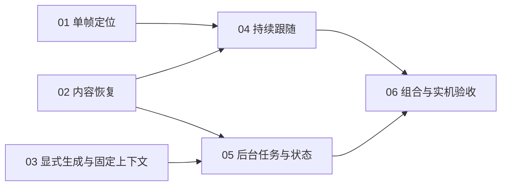

# 持续前台定位与联系人内容保留：任务索引

> 2026-10-14：六项拆分及以下依赖已确认并发布。所有任务初始为 `State: open`、`Triage: ready-for-agent`；发布不表示功能已开始实施或验收通过。

## 任务与依赖

| 编号 | 任务 | Blocked by | State | Triage |
| --- | --- | --- | --- | --- |
| 01 | [单帧定位贯通现有入口](issues/01-single-frame-locator.md) | None | resolved | ready-for-agent |
| 02 | [按联系人恢复输入和候选编辑](issues/02-contact-content-restore.md) | None | resolved | ready-for-agent |
| 03 | [显式生成与固定上下文](issues/03-explicit-generation-context.md) | None | resolved | ready-for-agent |
| 04 | [持续识别与自动跟随联系人](issues/04-continuous-contact-follow.md) | 01, 02 | open | ready-for-agent |
| 05 | [多联系人后台任务与状态恢复](issues/05-contact-generation-jobs.md) | 02, 03 | open | ready-for-agent |
| 06 | [组合回归与正式 App 验收](issues/06-combined-app-acceptance.md) | 04, 05 | open | ready-for-agent |

01、02、03 可独立开始；阻塞票完成后分别进入 04、05，最后执行 06。04 可用现有归属路径验证原任务继续，05 可通过手动切换验证作业状态，二者没有额外互相阻塞。06 只保留最小直接依赖，01–03 已由传递依赖覆盖。

## 覆盖与边界

| 任务 | 主要用户故事 | 独立可验收的闭环 |
| --- | --- | --- |
| 01 | 3–5、9 | 一次定位从原生观察经认证后端到助手，恰好一帧且保留质量/绑定门。 |
| 02 | 1、10–13、24–25 | 手动 A → B → A 恢复完整输入、候选编辑和助手会话，失效内容不能恢复。 |
| 03 | 19、22–23、25、27 | 明确生成取得固定输入/上下文，延迟执行不采用新消息，同键重试不重复生成。 |
| 04 | 2、6–10、20–21、24–25 | 前台持续观察、自动切换恢复、失焦暂停及失败后人工选择。 |
| 05 | 14–19、22–23、25–27 | 不同联系人显式生成、有限调度、状态恢复与原结果归属，退出及失效安全。 |
| 06 | 1–27 的组合验收 | 同一版本完整行为组合及有限正式 App/原生实机证据。 |

每张功能票包含自己的最小验证、隔离、来源失效和迟到结果检查，06 不作为这些检查的延后补票。已有持续助手会话、生成归属、候选版本、删除及退出恢复能力直接复用；不重新实现其他功能规格，不关闭旧自动定位或 Mac 交付票。

## 执行与状态

1. 新上下文处理单票前，读取该票、[完整规格](spec.md)、[领域语言](../../CONTEXT.md)及[领域读取路由](../../docs/agents/domain.md)指定的现行材料；用 [ADR-050](../../architecture/adr/050-continuous-single-frame-contact-follow.md)区分新单帧目标和旧双帧证据。
2. 只领取所有阻塞票已有有效 `Answer` 且 `resolved` 的任务，开始时改为 `claimed`；依赖仍未完成的票保持 `open`。Triage 表示下一步角色，不替代依赖判断。
3. 按[工作流](../../docs/agents/workflow.md)在约定公开接缝上推进单票，完成相关测试和 Standards/Spec 评审；将真实结果、命令、数据影响及剩余风险写入 `## Answer` 后才能改为 `resolved`，同步本索引。
4. 文件编辑与本地提交遵循[工程工作流](../../docs/agents/engineering.md)。需要人类信息或有限实机时段时，按[triage 标签](../../docs/agents/triage-labels.md)如实记录等待原因；不把当前发布解释为实际 App 或微信操作已获本轮测试授权。

2026-10-14：01 已在本地实现分支 `codex/single-frame-locator` 完成原生合成、认证 HTTP/隔离 PG 和安全桌面验证，结果见该票 `Answer`。02、03 仍可独立开始；04 的 01 阻塞已解除，仍等待 02；05 等待 02/03，06 等待 04/05。持续跟随和新版实机性能尚未通过验收，本次实现未运行真实 App 或微信、未外调模型、发送消息或 push。

## 依据

- [功能规格](spec.md)、[ADR-050](../../architecture/adr/050-continuous-single-frame-contact-follow.md)。
- [持续助手会话规格与既有行为](../assistant-session-context/spec.md)、[自动窗口定位的旧实现及实测记录](../automatic-foreground-locator/spec.md)。
- [任务格式](../../docs/agents/issue-tracker.md)、[triage 标签](../../docs/agents/triage-labels.md)。

2026-10-14：03 显式生成与固定上下文完成，验证与数据边界见该票 Answer；02、03 均已 resolved，05 的实现依赖已解除。04、05、06 继续按各自任务验收，本轮未运行真实 App 或微信。
