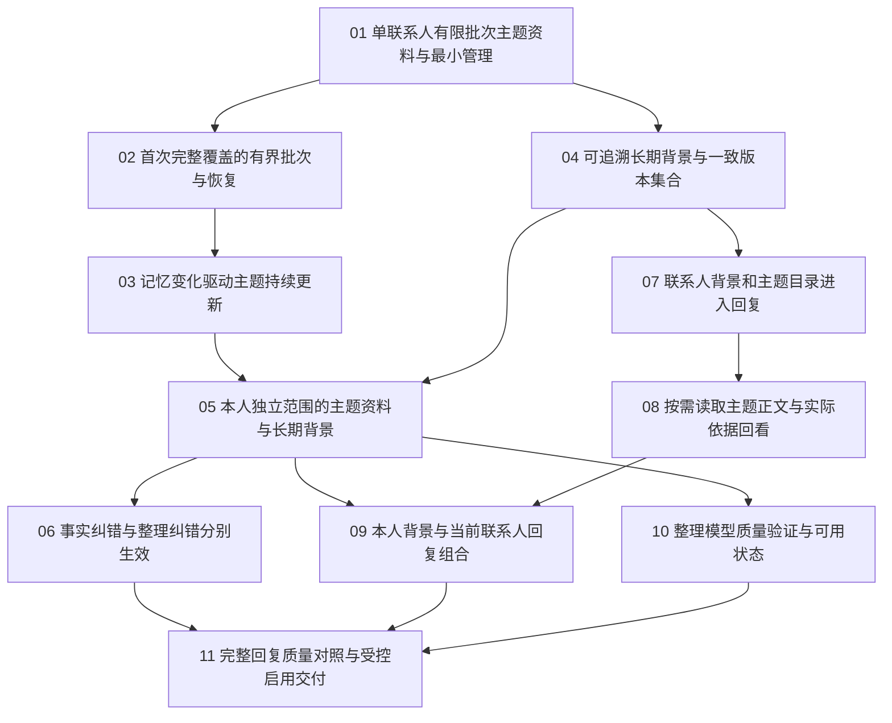

# 分层记忆：任务索引与工作流状态

> 更新：2026-10-17。已启动四会话目标模式执行。集成分支为 `codex/layered-memory-integration`，基线 `main@0702940`；主仓 main 保持不变。01 已通过独立审查和合并验证；02、04现已就绪，其余任务依真实前置等待。
> [正式规格](spec.md)、[已确认拆分](ticket-proposal.md)、[联合方案](../../architecture/drafts/layered-relationship-memory.md)、[ADR-067](../../architecture/adr/067-layered-scenario-and-profile-context.md)。

## 正式任务

| 编号 | 任务 | State | Blocked by |
| --- | --- | --- | --- |
| 01 | [单联系人有限批次主题资料与最小管理](issues/01-contact-scenario-batch.md) | resolved | None |
| 02 | [首次完整覆盖的有界批次与恢复](issues/02-initial-coverage-recovery.md) | open | 01 |
| 03 | [记忆变化驱动主题持续更新](issues/03-incremental-scenario-maintenance.md) | open | 02 |
| 04 | [可追溯长期背景与一致版本集合](issues/04-contact-profile-generation.md) | open | 01 |
| 05 | [本人独立范围的主题资料与长期背景](issues/05-owner-layered-organization.md) | open | 03, 04 |
| 06 | [事实纠错与整理纠错分别生效](issues/06-layered-memory-corrections.md) | open | 05 |
| 07 | [联系人背景和主题目录进入回复](issues/07-contact-layered-reply-context.md) | open | 04 |
| 08 | [按需读取主题正文与实际依据回看](issues/08-scenario-read-tool.md) | open | 07 |
| 09 | [本人背景与当前联系人回复组合](issues/09-owner-contact-reply-context.md) | open | 05, 08 |
| 10 | [整理模型质量验证与可用状态](issues/10-organization-quality-gate.md) | open | 05 |
| 11 | [完整回复质量对照与受控启用交付](issues/11-combined-quality-release.md) | open | 06, 09, 10 |

## 当前可领取前沿

01 已以 `74cb9ea1` 集成并签收。当前可领取 [02：首次完整覆盖的有界批次与恢复](issues/02-initial-coverage-recovery.md) 和 [04：可追溯长期背景与一致版本集合](issues/04-contact-profile-generation.md)；其余票仍须等待真实前置，不按编号或 triage 标签推断就绪。

01 已完成，02 和 04 现在可并行。07／08 的联系人回复路径不等待本人整理；09 汇合两种范围。10 的真实质量验证不阻塞受控工程实现，最终真实使用在11汇合工程与质量要求。

## 依赖图

## 执行与签收

- 一次在独立上下文推进一票，先读取本票、规格、前置 Answer 和相关领域约束；领取时改为 claimed，完成真实验收和两轴审查后才改为 resolved，并同步本索引。
- 不因规格和任务已发布而宣称 L2/L3 已实现。每票从首个新增产物起覆盖隔离、来源、删除、迟到结果、幂等和恢复，11不兜底补齐前票缺失的生命周期。
- 03与04无论先后，后落地者接通统一变化通知；两层始终用一致版本与递归来源依赖，不另起画像更新系统。
- 整理质量资格与回复读取质量资格分别绑定实际合同；受控模型成功不产生真实资格，相关质量身份变化须复验。最终自动加载要求有效资格、范围和用途同时满足。
- 代码／HTTP／隔离数据库／React 的工程证据、实际模型语义质量和真实 App 证据分别记录。未验范围保留未知或未通过，不能回勾 AC、清零失败分母或把 Mock 结果作为真实质量。
- 完成最小相关验证和必要回归后，按工程工作流本地提交，仅包含本票文件；push、远端分支、PR或部署仍遵循明确授权。

## 发布结果

已发布11个独立任务文件。当前开始工程实现；未处理真实业务资料、运行真实业务库迁移或调用外部模型。工程、模型质量和真实 App 证据分别签收；当前仅01完成受控工程签收，真实模型资格仍未知／关闭。
