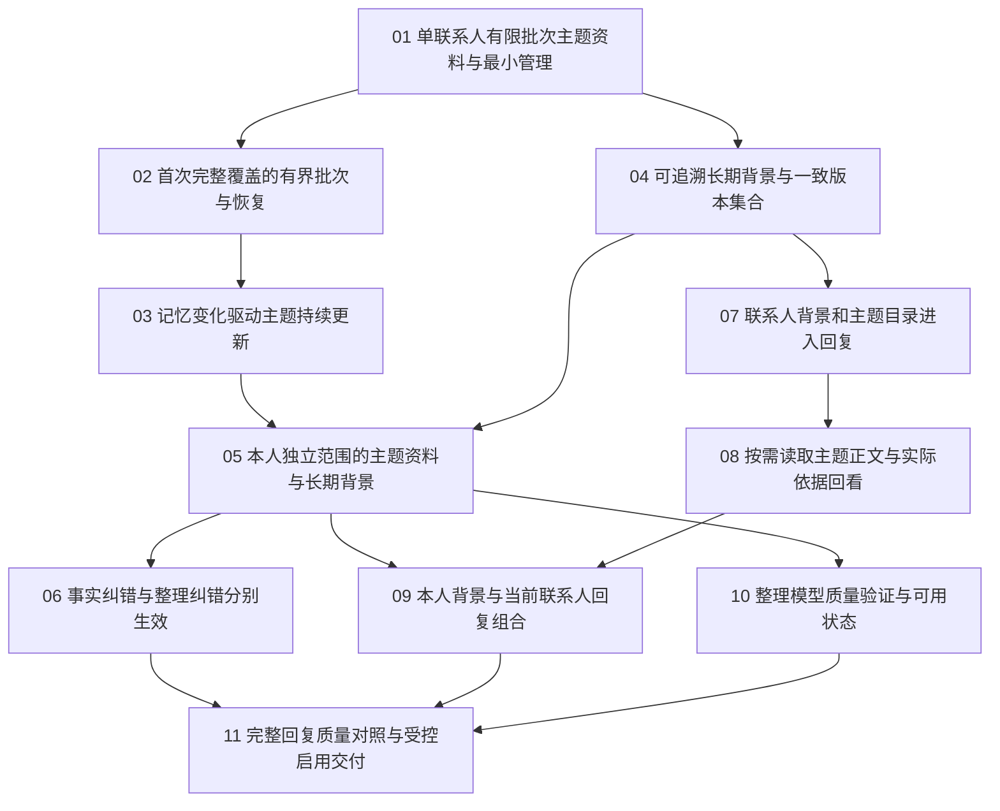

# 分层记忆：任务索引与工作流状态

> 更新：2026-10-18。四会话按真实依赖推进；集成分支 `codex/layered-memory-integration`，本轮固定比较基线 `0702940`。本L2/L3工作不修改主仓main；01–11均已完成工程签收与Agent快速验收；正式质量仍未知，自动使用关闭。
> [正式规格](spec.md)、[已确认拆分](ticket-proposal.md)、[联合方案](../../architecture/drafts/layered-relationship-memory.md)、[ADR-067](../../architecture/adr/067-layered-scenario-and-profile-context.md)。

## 正式任务

| 编号 | 任务 | State | Blocked by |
| --- | --- | --- | --- |
| 01 | [单联系人有限批次主题资料与最小管理](issues/01-contact-scenario-batch.md) | resolved | None |
| 02 | [首次完整覆盖的有界批次与恢复](issues/02-initial-coverage-recovery.md) | resolved | 01 |
| 03 | [记忆变化驱动主题持续更新](issues/03-incremental-scenario-maintenance.md) | resolved | 02 |
| 04 | [可追溯长期背景与一致版本集合](issues/04-contact-profile-generation.md) | resolved | 01 |
| 05 | [本人独立范围的主题资料与长期背景](issues/05-owner-layered-organization.md) | resolved | 03, 04 |
| 06 | [事实纠错与整理纠错分别生效](issues/06-layered-memory-corrections.md) | resolved | 05 |
| 07 | [联系人背景和主题目录进入回复](issues/07-contact-layered-reply-context.md) | resolved | 04 |
| 08 | [按需读取主题正文与实际依据回看](issues/08-scenario-read-tool.md) | resolved | 07 |
| 09 | [本人背景与当前联系人回复组合](issues/09-owner-contact-reply-context.md) | resolved | 05, 08 |
| 10 | [整理模型质量验证与可用状态](issues/10-organization-quality-gate.md) | resolved | 05 |
| 11 | [完整回复质量对照与受控启用交付](issues/11-combined-quality-release.md) | resolved | 06, 09, 10 |

## 当前交付状态

11/11工程任务已签收，没有待领取任务。01–10的签收和验证保留在各票 Answer；11最终产品 `f083fb19` 已由独立合并者以 `9ef3e566` 集成，阻塞审查项均已关闭。全部结果保存在本地集成分支，未合入主仓 main、未推送或部署。

工程完成不等于真实质量达标。两阶段正式资格均保持 unknown，自动使用关闭、原 L1 保留；完整质量和组合原生矩阵未覆盖项继续明示，不以 resolved 回勾这些标准。

## 依赖图

## 执行与签收

- 06 最终代码候选为 `4864eddf`，用户已确认删除整理结果全清旧纠错、主动重开新周期；最小删除产品 `00a61e5c` 的4项定点HTTP／PG回归及类型检查通过。09已正式汇合，06e固定 `340c40db` 的12项组合与 `8cf0b711` 的native03完整1/1证据分别保留。现已以 `1291bbff` 独立合并并完成工程签收；按用户最新v2要求，Agent复用定点公开接缝验收和新增文案静态核对，不追加广测或App重复验收，真实质量仍不因工程通过而开放。
- 一次在独立上下文推进一票，先读取本票、规格、前置 Answer 和相关领域约束；领取时改为 claimed，完成真实验收和两轴审查后才改为 resolved，并同步本索引。
- 不因规格和任务已发布而宣称 L2/L3 已实现。每票从首个新增产物起覆盖隔离、来源、删除、迟到结果、幂等和恢复，11不兜底补齐前票缺失的生命周期。
- 03与04无论先后，后落地者接通统一变化通知；两层始终用一致版本与递归来源依赖，不另起画像更新系统。
- 整理质量资格与回复读取质量资格分别绑定实际合同；受控模型成功不产生真实资格，相关质量身份变化须复验。最终自动加载要求有效资格、范围和用途同时满足。
- 代码／HTTP／隔离数据库／React 的工程证据、实际模型语义质量和真实 App 证据分别记录。未验范围保留未知或未通过，不能回勾 AC、清零失败分母或把 Mock 结果作为真实质量。
- 完成最小相关验证和必要回归后，按工程工作流本地提交，仅包含本票文件；push、远端分支、PR或部署仍遵循明确授权。

## 最终交付与真实结果

- 10整理评测：固定126份材料中的14例有限实际验证，DeepSeek实际64次调用；独立Agent审阅4通过、10未通过，其中6项语义问题、4项执行拒绝。完整126评测与正式标定未完成。
- 11回复对照：固定4对合成输入，实际12次调用；8组中6生成成功、2失败，仅2对完整。独立Agent审阅4批准、2拒绝、2未知；18条最终候选13可用、3关键事实问题、2表达问题。旧轮0调用／8未执行的记录保留，未替换案例或重复调用追求通过。
- 11增量工程验证：相关三个单元模块14例、公开HTTP／隔离PG 6例通过；随后预算子集和入口deadline修复各完成定点红绿，最终capture模块5例通过，与前述结果有重叠。独立Standards／Spec阻塞项0。
- 实际App：复用前票有效证据；11一次原生启动确认服务连接和合成联系人，随后CUA内容区控制失败，菜单退出及资源清理通过。新质量面板／L1交互和完整组合矩阵不宣称本次通过，详见11。
- 数据：本轮真实模型调用仅固定合成集，共76次（整理64、回复12）；没有使用真实聊天数据。私人证据与原始账本保留在本机私有目录，自有临时库／进程清理完成，10原始评测来源及备份按计划保留。未发送外部聊天消息。
- 入口：后端操作配置与成对评测见 `backend/README.md`，桌面开发运行见 `desktop/README.md`。这是本地源码交付，不代表已打包安装或生产启用。

## 当前有效：v2由Agent快速验收

用户要求快速完成并全部由Agent验收，已替代先前v1“用户最后手验”的安排。本轮复用有效证据，只补必要定点验证、独立审查和短原生操作，不等待用户逐例语义审阅或接手普通验收。

独立审阅均记录为agent，不能写成human；有限样本结果不能替代正式资格要求。完整126、正式预算标定、同次双侧及完整组合App矩阵未覆盖，因此两阶段正式质量unknown／自动使用关闭。失败样例、未执行分母与原始账本不清零，后续质量改善属于另行明确范围的工作。
