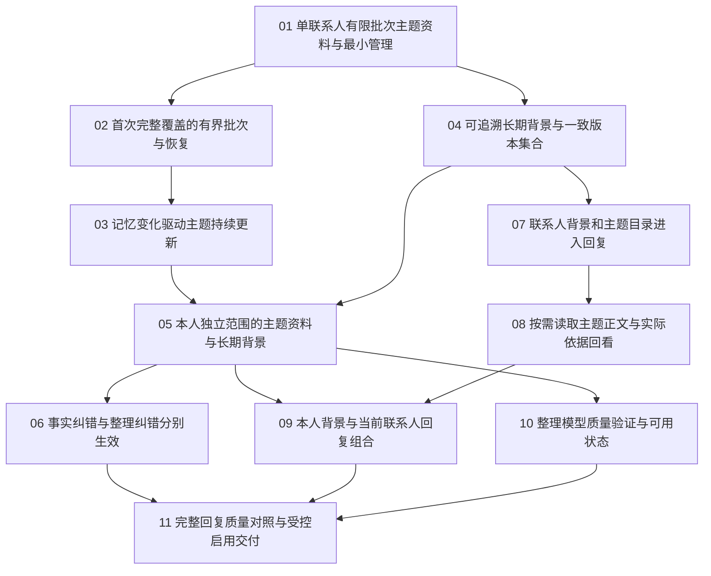

# 分层记忆：任务索引与工作流状态

> 更新：2026-10-18。四会话按真实依赖推进；集成分支 `codex/layered-memory-integration`，本轮固定比较基线 `0702940`。本L2/L3工作不修改主仓main；01–10已完成工程签收，11已在独立工作树领取，继续必要组合接线与快速验收。
> [正式规格](spec.md)、[已确认拆分](ticket-proposal.md)、[联合方案](../../architecture/drafts/layered-relationship-memory.md)、[ADR-067](../../architecture/adr/067-layered-scenario-and-profile-context.md)。

## 正式任务

| 编号 | 任务 | State | Blocked by |
| --- | --- | --- | --- |
| 01 | [单联系人有限批次主题资料与最小管理](issues/01-contact-scenario-batch.md) | resolved | None |
| 02 | [首次完整覆盖的有界批次与恢复](issues/02-initial-coverage-recovery.md) | resolved | 01 |
| 03 | [记忆变化驱动主题持续更新](issues/03-incremental-scenario-maintenance.md) | resolved | 02 |
| 04 | [可追溯长期背景与一致版本集合](issues/04-contact-profile-generation.md) | resolved | 01 |
| 05 | [本人独立范围的主题资料与长期背景](issues/05-owner-layered-organization.md) | resolved | 03, 04 |
| 06 | [事实纠错与整理纠错分别生效](issues/06-layered-memory-corrections.md) | resolved | 05 |
| 07 | [联系人背景和主题目录进入回复](issues/07-contact-layered-reply-context.md) | resolved | 04 |
| 08 | [按需读取主题正文与实际依据回看](issues/08-scenario-read-tool.md) | resolved | 07 |
| 09 | [本人背景与当前联系人回复组合](issues/09-owner-contact-reply-context.md) | resolved | 05, 08 |
| 10 | [整理模型质量验证与可用状态](issues/10-organization-quality-gate.md) | resolved | 05 |
| 11 | [完整回复质量对照与受控启用交付](issues/11-combined-quality-release.md) | claimed | 06, 09, 10 |

## 当前可领取前沿

01以`74cb9ea1`、02以`592b9916`、04以`64024f55`、03以`8276f707`、07以`9170069c`、05以`5c9a6954`、08以`ae077174`集成并签收。06与10已分别由A、C从正式集成基线在新独立上下文领取；09以`105aa8ea`独立集成并签收，其前置为正式05／08；06后落地方须合入正式09补齐真实跨联系人纠错闭包。

06与10可并行，迁移编号078预留06、079预留10，仅实际需要才新增；08已兼容05并交付实际正文读取及保存依据，09已独立签收本人／联系人两侧组合；07的单独验收仍仅代表初始背景与目录。10的真实质量验证不阻塞受控工程实现，11汇合工程与真实质量要求；未验真实质量保持关闭。

## 依赖图

## 执行与签收

- 06 最终代码候选为 `4864eddf`，用户已确认删除整理结果全清旧纠错、主动重开新周期；最小删除产品 `00a61e5c` 的4项定点HTTP／PG回归及类型检查通过。09已正式汇合，06e固定 `340c40db` 的12项组合与 `8cf0b711` 的native03完整1/1证据分别保留。现已以 `1291bbff` 独立合并并完成工程签收；按用户最新v2要求，Agent复用定点公开接缝验收和新增文案静态核对，不追加广测或App重复验收，真实质量仍不因工程通过而开放。
- 一次在独立上下文推进一票，先读取本票、规格、前置 Answer 和相关领域约束；领取时改为 claimed，完成真实验收和两轴审查后才改为 resolved，并同步本索引。
- 不因规格和任务已发布而宣称 L2/L3 已实现。每票从首个新增产物起覆盖隔离、来源、删除、迟到结果、幂等和恢复，11不兜底补齐前票缺失的生命周期。
- 03与04无论先后，后落地者接通统一变化通知；两层始终用一致版本与递归来源依赖，不另起画像更新系统。
- 整理质量资格与回复读取质量资格分别绑定实际合同；受控模型成功不产生真实资格，相关质量身份变化须复验。最终自动加载要求有效资格、范围和用途同时满足。
- 代码／HTTP／隔离数据库／React 的工程证据、实际模型语义质量和真实 App 证据分别记录。未验范围保留未知或未通过，不能回勾 AC、清零失败分母或把 Mock 结果作为真实质量。
- 完成最小相关验证和必要回归后，按工程工作流本地提交，仅包含本票文件；push、远端分支、PR或部署仍遵循明确授权。

## 发布结果

已发布11个独立任务文件。当前继续工程实现；未处理真实业务资料、运行真实业务库迁移或调用外部模型。工程、模型质量和真实 App 证据分别签收；当前01、02、03、04、05、06、07、08、09完成受控工程签收，真实模型资格仍未知／关闭。

## 2026-10-18 用户修订的交付标准（v1，已被v2替代）

本轮优先完成既有11票的工程实现、必要修复、最小相关检查、可运行本地版本和最多五步优先手验清单。最终人工体验与语义验收由用户执行，用户尚未验收不阻止工程交付；已通过证据复用，不重复全量、长时或整套App验收。未执行AC标为用户待验且不勾选；未取得实际质量资格时保持unknown／关闭，来源、隔离、删除和手动发送边界不变。10、11的真实质量结果与用户验收通过情况继续单独记录，不以工程resolved替代。

## 当前有效：v2由Agent快速验收

用户已撤销本人手验安排。已签收9/11票；06公开HTTP／PG定点行为及类型检查通过，新增说明文案仅独立静态核对，未单独原生点击，不挪用旧App证据。10以独立Agent真实身份审阅并执行14例有限真实整理核验，11继续必要集成与短关键组合验证；复用有效证据、不等待用户逐例审阅、不反复全量。保留完整126材料及正式质量未知／关闭，有限通过不能写成全量质量达标。最终交付可运行入口、实际通过、未覆盖及限制。

## 2026-10-18 当前10/11工程交付

10固定`0cd1e7c6`以`6811389c`独立合并签收，真实14例64次请求、Agent审阅4通过／10未通过，正式质量unknown、自动使用关闭。11已领取，复用现有回复运行时与持久物理额度，补生产接线、独立reply合同及可信证据来源、快照资格复验和最多4对／48次有限实际对照。14失败样例不删，不能拿未通过候选作为合法安装材料；完整质量未过不阻止工程继续，但不得称生产新层可用。
