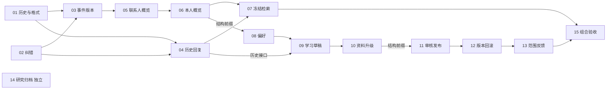

# 记忆与 Skill 正式集成任务索引

> 当前阶段：01–15已签收，共15票resolved，0票claimed、0票open；91项AC已勾、0项未勾。正式15完成同源组合、固定M2保护及分阶段工程验证，原失败、HTTP不完整与历史unknown保留。最新证据见[15集成记录](frontier-15-validation.md)。
> 固定main M2=`08c4d48e719353492f37620f4fb2aabd8710efc6`，来源S=`54e482a6ccfa8ca1ccc7e9dc34b0bfaf27fb1616`。入口：[规格](spec.md)、[重新冻结](refreeze-v2.md)、[原签收证据](acceptance-evidence.md)。

## 正式任务

编号按依赖顺序整理：原U13资料升级改为正式10，原U10/U11/U12分别改为11/12/13。新编号不是源票编号，来源映射逐行标明。

| 正式票 | 交付行为 | 原单元／源票 | State | Blocked by | 主要阻塞原因 |
| --- | --- | --- | --- | --- | --- |
| [01](issues/01-current-status-and-prepared-format.md) | 历史核实与准备格式兼容 | U1／源01 | resolved | None | 独立；建立后续可扩展格式与旧任务处理 |
| [02](issues/02-correction-and-erasure.md) | 纠错防复活与擦除 | U2／源03 | resolved | None | 独立；交付canonical059 |
| [03](issues/03-event-version-grounded-adapter.md) | 事件/原子版本与Grounded适配 | U3／源02 | resolved | 01, 02 | 历史语义、人工保护及059前缀 |
| [04](issues/04-historical-reply-continuation.md) | 合法历史回复与明确继续 | U4／源04 | resolved | 01, 02 | 合法历史、当前复验及原任务归属 |
| [05](issues/05-contact-overview.md) | 联系人概览 | U5／源05 | resolved | 03 | 记忆基础、纠错表及060前缀 |
| [06](issues/06-owner-overview.md) | 本人概览 | U6／源06 | resolved | 05 | 共用投影合同及061前缀 |
| [07](issues/07-frozen-overview-retrieval.md) | 概览进入冻结回复 | U7／源07 | resolved | 04, 06 | 两类概览与历史继续合同 |
| [08](issues/08-expression-preferences.md) | 明确长期偏好 | U8／源08 | resolved | 06 | 062迁移前缀；非偏好产品前置 |
| [09](issues/09-learning-drafts.md) | 授权学习待审草稿 | U9／源09 | resolved | 04, 08 | 历史接口、偏好依赖及063前缀 |
| [10](issues/10-versioned-memory-upgrade.md) | 版本化资料比较与应用 | U13／源13 | resolved | 09 | 记忆基础已传递；task复合父键及064前缀 |
| [11](issues/11-review-and-publication.md) | 同输入审核与范围发布 | U10／源10 | resolved | 10 | 功能前置09已传递；065前缀 |
| [12](issues/12-skill-version-history.md) | Skill更新、合并与回滚 | U11／源11 | resolved | 11 | 审核发布及066前缀 |
| [13](issues/13-scoped-skill-feedback.md) | 方法/Skill范围反馈 | U12／源12 | resolved | 12 | 审核功能已传递；Skill复合键及067前缀 |
| [14](issues/14-semantic-research-archive.md) | 语义研究归档及保持不启用 | U14／源14 | resolved | None | 独立，不阻塞产品链 |
| [15](issues/15-combined-integration-acceptance.md) | 同源组合、main保护与签收 | U15／源15 | resolved | 07, 13 | 其他运行功能经两条链传递 |

## 阻塞图与并行边界

最小传递约简只去掉可沿图得到的重复边，不省略验收内容。15必须覆盖04/07/08/10/11/12/13及其记忆基础；14不是运行时前置，独立open时不得把总批次写成15/15完成。

未来收到实施启动指令后的逻辑初始前沿为01、02、14；01/02后03与04可并行；06后07与08可并行；04/08后09→10→11→12→13；15等07和13。共享装配的实际写入/合并仍需协调串行，逻辑就绪不代表可以同时覆盖同一文件。实施按上述前沿调度，每票在独立任务工作树实施，经审查后仅合入本集成分支。

## 迁移归属

| 正式票 | S原号 | canonical号 |
| --- | --- | --- |
| 02 | 058 | 059 |
| 03 | 059 | 060 |
| 05 | 060 | 061 |
| 06 | 061 | 062 |
| 08 | 062 | 063 |
| 09 | 063 | 064 |
| 10 | 064 | 065 |
| 11 | 065 | 066 |
| 12 | 066 | 067 |
| 13 | 067 | 068 |

M2原001–058保持原字节。上表连续顺序由loader强制，不把每个相邻箭头误写成产品或直接外键依赖。每票包含真实DDL、自己的完整行为与删除闭包；没有单独“先写入、以后补删”的阶段。S分叉库不在任何票的迁移、清理或重建目标中。

## 执行与验收规则

实施开始时先读取规格、本票、最新规则及领域路由，再从固定M2建立获准的独立集成工作树，核对main漂移。原准备树的文档提交不是产品基座。每票保留固定来源身份、逐块集成说明、最小/相关回归、原失败及恢复、独立审查和本地提交，达到AC且有Answer后才resolved。

新格式先在01建立版本/修订与旧任务归属；04/07/08/11–13按自己的新增类型、字段、删除依赖和修订扩展。09只接已可用的草稿/本地包来历，11再扩审核来历，12–13接版本及政策。禁止用最终S整文件复制把后续未建表查询提前带入。

最终签收区分本批工程、真实质量、App/微信和业务数据。15的源448单轮/612分阶段是原证据，不是新成绩；13原超时及15源升级空动作限制继续保留。新的集成验收必须有合法新增和空动作两条升级路径。

## Comments

- 2026-10-15：按用户确认的推荐方案正式发布spec与15张open任务；重新冻结M2，S分叉库保持原样。本轮未领取实施、未迁移清理、未合入main。

- 2026-10-15：按用户“继续继续”启动正式集成；独立分支`codex/memory-skill-integration`以M2为基底，仅导入准备文档。main未漂移，S分叉库和其他会话工作树保持原样。

- 2026-10-15：01、02、14分别在`codex/integration-01`、`codex/integration-02`、`codex/integration-14`独立工作树领取；当前尚无产品票签收。

- 2026-10-15：14的固定归档候选`ba1831a1`经独立Standards/Spec两轴审查均0项发现后，无冲突合入本任务集成分支；5/5 AC与Answer齐全，标为resolved。当前1/15完成，01、02保持claimed，其余12票open；main、S分叉库及其他会话工作均未修改。

- 2026-10-15：02固定候选`1873defb`经独立Standards/Spec两轴审查均0项发现，无冲突合入本任务集成分支；6/6 AC及Answer齐全，标为resolved。当前2/15完成（02、14），01保持claimed，其余12票open；main的其他工作漂移不纳入固定M2集成基底。

- 2026-10-15：01固定候选`9ef25e05`在expired修复后两轴均0项发现，6/6 AC及Answer齐全，逐块解决四个局部冲突后合入；当前3/15完成（01、02、14），其余12票open。共享预算夹具明确更新为001–059/重复0；同轮后端组合141/141、业务Node18/18、unit1331/1331及tsc通过，见[组合记录](frontier-01-02-validation.md)。最终纠正02的TSV字段同步遗漏，并按每票文件重新核对状态及AC数；没有将原失败计为通过或将原S签收数写成当前进度。

- 2026-10-15：首批01/02/14已合入独立候选；固定合并f9b91144的Standards和Spec组合复审均0发现。现领取03/04，分别在独立工作树推进，后续准备结构按实际新增显式提升修订。

- 2026-10-16：03最终来源`b50315a8`经产品代码Standards/Spec两轴0/0及末轮夹具增量0/0后，无冲突合入本集成分支；6/6 AC签收，当前4 resolved、1 claimed（04）、10 open，AC为23已勾/68未勾。实际分阶段成绩和合并最小验证见[03集成记录](frontier-03-validation.md)；旧测试隔离违规另见[事故记录](reports/test-database-isolation-incident.md)，不以复跑或代码审查0发现宣称共享库无影响。05尚未领取，main和S分叉库不在本次合并范围。

- 2026-10-16：03候选经两轴产品代码审查及迁移夹具增量复审后合入c6e77a0f；隔离执行违规及未知影响继续单列，见[03记录](frontier-03-validation.md)。现领取无04业务前置的05；04继续独立修复审查发现，未提前签收。main随后推进da89cc16，仅新增其他工作的记录文件，未吸收或改动。

- 2026-10-16：04固定候选 `df553fcc` 修复两项Spec P2和一项Standards P3后，经独立增量及03／04组合两轴复审均0发现，无冲突合入 `e9d9dd6c`；6/6 AC签收。当前5 resolved、1 claimed（05）、9 open，AC为29已勾/62未勾；见[04集成记录](frontier-04-validation.md)。早期35个未记录库身份的失败目录仍保留，数据库归属/残留未认证；03默认库隔离事故另列，不以新轮次通过覆盖未知。main只读引用已推进 `b8b30626`，没有吸收；S分叉库、业务迁移、main合并及push/PR仍不在本轮操作中。

- 2026-10-16：05最终候选 `c5401978` 的固定净增量 `7ea2d7a8→31a70e7f` 共35个文件经独立Standards（硬违规0、possible 0）与Spec（0发现）审查，最终补记亦核验；无冲突no-ff合入 `684ddea7`，6/6 AC签收。当前6 resolved（01–05、14）、0 claimed、9 open，AC为35已勾/56未勾；见[05集成记录](frontier-05-validation.md)。本次仅静态合并复验，不新增DB、模型、页面或App执行；根持续授权及34个可定位目录＋另1报告路径的资源证据校准保留，未知库未连接或清理。06仍为open。

- 2026-10-16：按真实前置领取06，在独立工作树推进本人稳定资料及原SELF来源核验；当前6 resolved、1 claimed（06）、8 open，AC仍35/56。实际App夹具的建库前ownership缺口另以最小安全增量处理，不变更15票依赖和签收分母。

- 2026-10-16：06最终候选 `2074fea9` 经独立Standards及Spec完整和增量审查，两个P3分别以纯函数提取和证据措辞校准关闭，最终均0项未关闭发现；无冲突no-ff合入 `fc57f270`，6/6 AC签收。当前7 resolved（01–06、14）、0 claimed、8 open，AC为41已勾/50未勾；07/08仅逻辑就绪，尚未领取。分轮成绩与本次纯静态复验见[06集成记录](frontier-06-validation.md)。35个旧失败目录归属已独立恢复，但精确旧库UUID仍为0，数据库残留未认证；未连接或清理未知库。S分叉库保留，本轮未合入main或执行远端操作。

- 2026-10-16：06签收后领取真实就绪前沿07、08，各用独立工作树并行实施；当前7 resolved、2 claimed、6 open，AC仍41/50。codec从2/schema2出发，先合票升3，后合票为新增结构再升4，不能以同修订接受两种结构；共享装配与合并串行协调。

- 2026-10-16：07固定候选 `8bf0d3c8` 经独立完整及增量两轴审查，Standards原P2资源声明已关闭、硬违反0／possible0，Spec产品0发现，P3按实际helper校准cleanup具体字段后获原独立审查者确认关闭，两轴最终均0未关闭；无冲突no-ff合入 `2479f3a6`，6/6 AC签收。当前8 resolved（01–07、14）、1 claimed（08）、6 open，AC47已勾／44未勾；未领取仍受08阻塞的09。页面原1失败与修复后1 case／1 scenario通过分列；旧资源未知不因新轮通过追认，见[07集成记录](frontier-07-validation.md)。本次仅静态合并检查，不新增数据库、页面、App或模型运行；S库保留，不合main或执行远端操作。

- 2026-10-16：08候选a1ac经独立完整、组合接缝及最后页面两轴审查均0未关闭，无冲突no-ff合入3e903976；原P2显式重新准备及P3摘要清单重复已关闭。最小检查发现EOF多余空行，独立核对仅两空行删除及AST相同后合入ec1e修正为df209de1，原运行摘要身份不挪到新字节。六项AC签收，当前9 resolved（01–08、14）、0 claimed、6 open，AC53／38；09已逻辑就绪但仍open，未提前领取。最新schema4页面1 case／1 scenario、实际3次／cap4／外部0与联合HTTP5/5分轮记录，旧94四UUID、旧35与03／07未知不因新绿追认，详见[08集成记录](frontier-08-validation.md)。本次只静态合并复验，没有新增业务或桌面资源，S库保留，不合main或执行远端操作。

- 2026-10-16：08签收提交 `b74d886d` 后，领取真实就绪的09授权增量学习与待审草稿，复用已准备的独立工作树。当前9 resolved、1 claimed（09）、5 open，AC仍53／38；先核无DB守卫、再固定小批公开HTTP／隔离PG，未提前查审核／政策后续表。10仍受09阻塞，未领取；S库保留、不合main及不动其他会话边界不变。

- 2026-10-16：09固定候选 `6370c06b` 经独立完整及增量两轴审查，Spec原P1 thinking与具名tool_choice冲突以真实SDK本地传输反例修复并关闭，新增及未关闭0，Standards硬项0／possible0；无冲突no-ff合入 `dff25a77`，合并树与候选一致，六项AC签收。当前10 resolved（01–09、14）、0 claimed、5 open，AC59／32，10尚未领取。分阶段200个唯一方法、原失败及单Chrome页面分别记录；页面15关键模块仅14与修复后字节相同，不冒称新运行时已跑页面，详见[09集成记录](frontier-09-validation.md)。本次merger仅静态与类型检查，23守卫轮62个已知库及页面独立1库的既有核销不补03／35／07／08未知缺口；S库保留，不合main或执行远端操作。

- 2026-10-16：09签收 `1ea12db5` 后领取真实就绪的10版本化资料比较与应用；当前10 resolved、1 claimed（10）、4 open，AC仍59／32。独立树以09签收及本次领取元数据为起点，先验证真实SDK请求与预算，再接065和持久算法指纹；11仍受10阻塞。冻结M2不变，S库保留、不合main及不动其他会话边界继续有效。

- 2026-10-16：10固定候选 `b8fc33f0` 经独立Standards硬项0／possible0及Spec三类发现均0后，无冲突no-ff合入 `16be9841`，树与候选相同；六项AC签收。当前11 resolved（01–10、14）、0 claimed、4 open，AC65／26；11仅逻辑就绪仍open。分阶段142唯一PG／HTTP、最终unit1452、SDK本地4派发及首页面失败／恢复1 case／1 scenario分别记录，19个确证created精确absence不补旧未知库。详情见[10集成记录](frontier-10-validation.md)。本次merger仅类型／静态核验及本地publication，没有新动态资源，默认质量门不放开，S库保留，不合main或执行远端操作。

- 2026-10-16：10签收 `2887c42a` 后领取真实就绪的11同输入审核与明确范围发布；当前11 resolved、1 claimed（11）、3 open，AC65／26。独立树接续065，先核真实SDK请求、预算与台账，再追加066并保留M2固定准备及按联系人恢复scene。12／13仍未领取，未知预算不默认放行；S库保留、不合main及不动其他会话边界不变。

- 2026-10-16：11固定候选 `bd7d568200e2d8ad289ee9ff6caf5e7e6e620e6b` 经独立Standards／Spec完整及增量复查，原两个P2及一个P3均关闭，两轴新增及未关闭0；无冲突no-ff合入 `ce4c1151bb439759414b6deb938ed6591e92cd85`，树与候选完全相同。六项AC与Answer齐全后签收；当前12 resolved（01–11、14）、0 claimed、3 open（12／13／15），AC71／20。原112与修复58的PG／HTTP并集139不是单轮成绩；原5bb页面／suite与修复新轮次分列，29个本票确证created精确核销不补旧unknown。见[11集成记录](frontier-11-validation.md)。merger仅类型／静态与publication检查，没有新动态资源；12保持open未领取，S库保留，不合main或远端发布。

- 2026-10-16：11签收 `2b0da792` 后领取真实就绪的12更新／合并／版本历史与合法回滚；当前12 resolved、1 claimed（12）、2 open，AC仍71／20。独立树在066前缀上追加067，保留审核双确认、完整来历与只读加载，真实两HTTP实例验证回滚／删除两锁序；13仍受12阻塞，不查询068。冻结M2、S库保留及其他会话不动边界保持。

- 2026-10-16：12固定最终候选 `b2e4bf42e3e1cf118e55da7f232fe1c355820339` 经独立Standards／Spec完整与增量最终复查，Standards原P2 closed、两轴新增及未关闭0；无冲突no-ff合入 `1f3f711c0b017e8977d65cf429309c15e0b17511`，树与候选完全一致。六项AC与Answer签收，当前13 resolved（01–12、14）、0 claimed、2 open（13／15），AC77／14；13仅就绪未领取。原117与修复24按method ID并集118，三旧页面与新窄修分轮保留，277模块仅275同字节，不转认旧页面；30已知created精确核销不补03／35／07／08 unknown。见[12集成记录](frontier-12-validation.md)。merger类型／静态及publication均通过，没有新动态资源，S库保留，不合main或远端发布。

- 2026-10-16：12最终候选 `b2e4bf42e3e1cf118e55da7f232fe1c355820339` 经独立Standards／Spec最终完整及增量复查均0新增／未关闭，原Standards P2 closed；无冲突合入 `1f3f711c0b017e8977d65cf429309c15e0b17511` 并签收 `608dd74786a4c45464d37f389fa721c248c7b96a` 后，领取真实就绪的13。canonical068依赖067提供的Skill复合键，按最小owner／contact／scene范围、独立policy_revision及真实正文／资源执行视图推进，保留普通意见只改当前回复、长期修订走待审与明确撤销才恢复。后续独立工作树实施，本集成根本次只记领取元数据，不写产品、不查询068或新建动态资源；六AC仍空，15继续受13阻塞。冻结M2、S分叉库保留、不合main与不动其他会话边界继续有效。

当前13 resolved、1 claimed（13）、1 open（15），AC仍77／14；本次领取不签收13，也不改变其六项未勾AC。

- 2026-10-16：13最终固定候选`3a2ff9b2d7bcb93f48748666d855e13f02b6d2f7`经独立Standards／Spec完整及增量复查，原P2及重复投影判断项均closed，两轴新增／未关闭0；无冲突no-ff合入`762405952efad9f0da5aab56b64e4b84fcf4af09`，tree与候选完全相同。六AC与Answer签收，当前01–14共14 resolved、0 claimed、1 open（15），AC83／8；15仅逻辑就绪未领取。新绿30分2／27／1三轮，与旧40交28并42，旧页面／381／SDK／npm65不追认新字节；新9加旧26共35个本票known-created核销不补旧unknown，详见[13集成记录](frontier-13-validation.md)。merger仅本树类型、静态合同及双publication检查，没有新动态资源；S分叉库保留，不合main或远端发布。

- 2026-10-16：13最终候选`3a2ff9b2d7bcb93f48748666d855e13f02b6d2f7`经独立完整及增量Standards／Spec复查均0新增／未关闭，无冲突合入`762405952efad9f0da5aab56b64e4b84fcf4af09`并签收`e1c73d93808da368f84297dcb557ae33216d2bb5`后，前置07／13均已resolved，领取真实就绪的15。后续在独立任务工作树实施同源组合、M2保护和最终分层验收；本集成根本轮仅记录领取，不运行PG／HTTP／Chrome／App／probe／CLI／模型或新租约，不创建任务工作树。15八AC仍空，原失败、分轮字节和旧unknown继续保留；M2冻结、S分叉库保留、不合main和不执行远端操作边界不变。

当前14 resolved、1 claimed（15）、0 open，AC仍83／8；本次领取不签收15。

- 2026-10-16：正式15固定代码`86feaa8c`完成同源组合与M2保护；单元1341、后端360唯一方法和M2 130唯一方法分阶段验证，React及实际App按各自入口记录。八项AC据实签收，当前15/15 resolved、91项已勾／0未勾；partial、原失败、Self间歇及旧unknown继续保留。仅形成独立本地集成候选，S库保留，不合main或执行远端操作。
