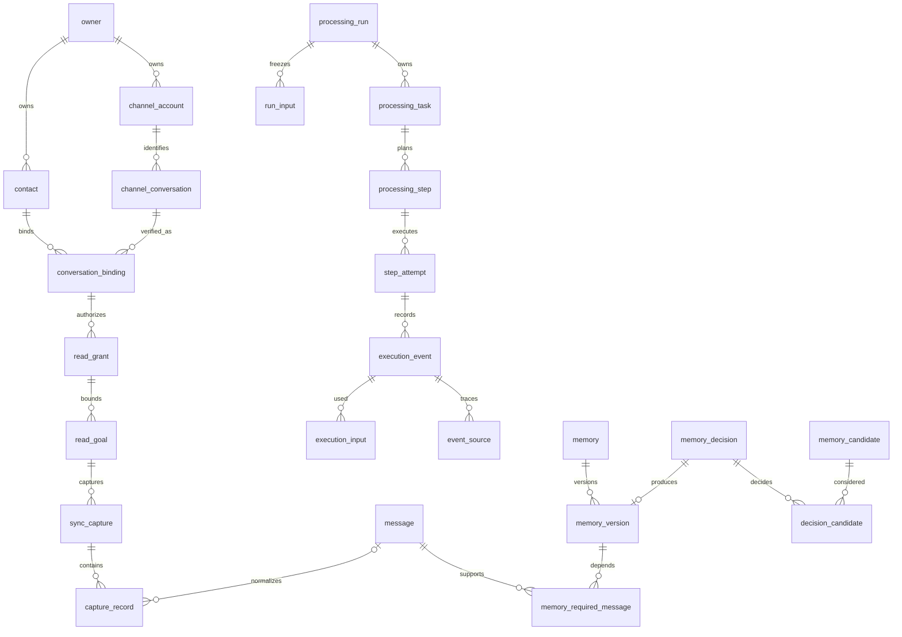
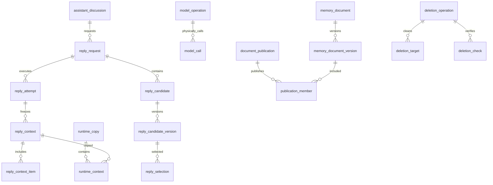
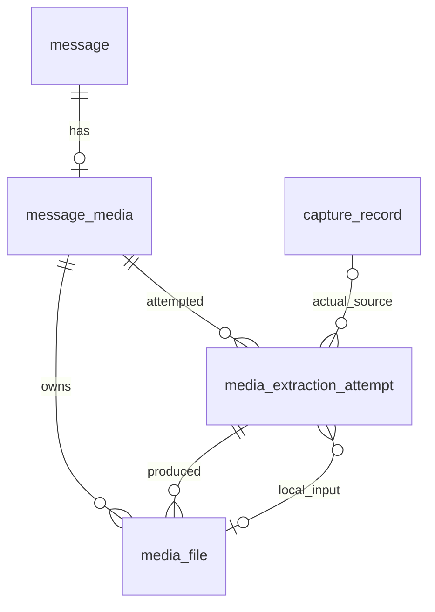

# SQLite 数据库统一设计方案

状态：2026-10-29逻辑设计与验收条件定稿，实施未启动。包含实体、字段、键、关系、状态、索引、事务、存储及切换合同；77表是当前模型结果，实际DDL与集成仍须验证，不因定稿宣称已批准或执行全部物理细节。四份规格及本轮实测范围见[定稿记录](../../research/wechat-spec-finalization-validation.md)。

本文是数据库结构的唯一主设计入口。[结构化逐表目录](consolidated-schema.json)保存同一版字段、键和约束；早期数据库分项讨论只作论证过程，不再作为并行结构方案。同步与媒体规格继续分别负责已确认的产品行为和媒体细节，不因本文为数据库主稿而失效。需求边界见[规格](spec.md)。旧 94／100／54 表方案不再作为目标，Q43 共享材料表仍暂缓。

四方案之间的目标、职责及正式ADR衔接见[一致性约定](map.md#plan-alignment)。当前不提供手动聊天文件导入；媒体Q11已确认并将三实体及统一删除账本扩展整合入本草图；数据库的all_private表达能力不表示本轮开启全部私聊。

三稿交叉边界统一遵循[共同规则](../sync-memory-behavior/spec.md#cross-plan-contract)：关读取开关不等于停止已保存资料的处理；取消勾选不等于删除；单独清媒体不等于清空聊天。同步的占位规则不取消手动媒体能力，媒体保存不产生记忆输入。

## 范围和数量

新建一个空 SQLite 业务数据库，不迁旧 PG 业务资料。按 owner 和 contact 隔离；昵称只作展示。保留规范消息、原始来源、完整提取追踪、记忆及回复版本、来源删除路径。基础文字同步中的非文字消息保留占位、正文为空，不自动抓取媒体或进入记忆；用户明确手动提取的图片/视频/语音由媒体三实体保存受管文件，仍不转写/理解或进入记忆。

最新确认：Skill 仅设计官方 DSH 加载与最小业务关联，保留原目录；不纳入经验学习、审核发布和方法级停用表。不默认全部停用；无法证明的状态单独待核验。此处不执行旧功能下线或清理。

本清单共 **77 张逻辑表：71 张业务表、4 张诊断表、2 张数据库元数据表**。媒体Q1–Q11已确认并整合三实体，基础删除操作补message_identity；数量是模型结果，不是目标，也不等于全部DDL已经批准或验证。诊断表在隔离实例执行合成诊断，不意味着复制真实资料到测试库。

| 分组 | 表数 |
| --- | ---: |
| 身份与来源 | 14 |
| 处理与调用 | 13 |
| 实际追踪 | 3 |
| 记忆与裁决 | 7 |
| 助手与副本 | 13 |
| 偏好与文档 | 10 |
| Skill最小关联 | 2 |
| 删除与元数据 | 6 |
| 纠错与诊断 | 6 |
| 媒体提取 | 3 |

## 建模原则与字段约定

一行只表达一种有独立身份或生命周期的事实。身份与不可变版本分离，M:N 关系用关联行，不把外键列表放进 JSON；只有协议原始载荷、普通值对象允许 JSON。共享字段不自动意味着同一个实体，尤其不能合并来源、证据和实际输入。

以下是逻辑字段合同。`?` 表示允许 NULL；ID 与外部标识用 TEXT，时间戳、计数与修订用 INTEGER，正文用 TEXT。每张表枚举值的实现映射、长度和索引 SQL 在下一阶段 DDL 中固定；状态与时间单位见后文，不以本文缩写冒充可直接执行的 SQL。

- 普通实体主键为 `(owner_id,id)`，版本和关联行使用各卡片明确列出的复合键。逐表卡片已列出每条基础外键的完整列组，结构化目录的 foreign_key_contracts 保存同一关系；引用版本必须带所属实体 ID 与版本号，不能只引用 version_no。
- `U(...)` 表示唯一约束。self/contact 等可空范围分支须 CHECK 与部分唯一索引配合；可选关联中的可选字段组必须同有或同无；owner及所属业务父键保持非空，不是整条复合FK都设NULL。分支CHECK显式使用IS NULL/IS NOT NULL，不能借NULL绕过父存在或范围约束。每条 SQLite 连接启用 foreign_keys。
- 同 owner 不等于同 contact。message、capture_record 注册 `(owner,contact,id)` 候选键，capture_record 另注册 `(owner,contact,id,message_id)`；引用者以相同列组验证联系人、消息和来源。其他父子关系按卡片注册范围候选键，或用明确触发器验证，不能只在业务代码约定。
- 当前版本／发布指针的循环外键采用延迟 NO ACTION 与原子事务。发布检查包括同 scope、同文档与兼容输入；不能把“旧版仍合法”等同于“与本轮配套”。
- 不默认 ON DELETE SET NULL 保留失去来源的正文；先撤销写入资格、完成敏感依赖闭包清理，再移除父对象。授权修订与当前指针是所属主体的字段，不另造一组 1:1 状态表。
- deletion_operation 使用独立 operation_id；owner_identity 和类型化目标地址是清理身份快照，不能依赖即将删除的 live 行。需要持久引用时使用 `(owner_identity,operation_id)` 唯一键。该特例不能推广为无真实 FK 的通用证据表。

## 主关系图

图展示主要基数；[全表关系索引](schema-relations.md)按分组覆盖全部77张表及跨组基础外键。精确跨范围约束以逐表卡片为准。`run_input` 包含目标和有界前文，只有目标对应 processing_item。

媒体来源分支由goal约束：新微信读取指capture_record及当前读取许可，本地语音重转只指合法受管SILK；部分结果、来源与读取资格分开，文件不会按内容摘要共享权限。单条清除/替换复用统一删除账本的媒体scope。

## 已作出的合并与不建决定

| 原先容易重复的结构 | 当前权威位置与理由 |
| --- | --- |
| source_batch / source_record 等同义主体 | sync_capture 是一次有界实际捕获，capture_record 是一次原始出现；直接关联 message，不再建额外 message_source_ref |
| 原聊天正文历史 | 不建 message_version；原聊天不直接编辑，当前解释修订只作 CAS；当时实际输入在追踪中保留 |
| 记忆候选编辑稿 | 不建 memory_candidate_version；保存模型原稿，修改采纳产生 memory_version |
| 采纳记录与决定重复 | memory_decision 是权威动作；memory_version.decision_id 唯一，反向查询结果，不另建 adoption |
| 任务跨轮关系与重复目标 | task 固定属于一轮；run_input 冻结目标和前文，step_attempt 保存实际执行，不另设跨轮归属表 |
| 本人与联系人记忆、场景与画像 | 分别共享 memory/version、memory_document/version；范围和 kind 受约束 |
| 回复原稿“第 0 版” | 所有正文统一 reply_candidate_version，从 v1 起；与记忆候选不同 |
| 当前记忆／偏好／读取状态 | owner/contact/account 上各自的修订与控制字段，不再建立重复状态主体 |
| 材料共享平台 | 暂不建 material_set/reference；各用途有直接父记录和真实外键，Q43 未选择 |
| Skill 学习、审核、方法策略 | 按最新范围不建；仅 package/revision 目录身份与版本锚点 |
| 概览、向量、FTS 投影 | 不先建持久投影表；当前关系查询派生，需要性能证据后再决定索引与缓存 |
| 媒体存储与删除 | 新增message_media/media_extraction_attempt/media_file表达管理状态、实际执行及文件，不建共享引用计数、批量父请求、独立媒体删除账本或多版重复字节历史 |
| 旧数据升级／迁移助手表 | 新空库不复刻；新 SQLite 自身升级保留 schema_migration |

## 生命周期约定

| 标签 | 清理与保留规则 |
| --- | --- |
| owner / contact | 控制资料归属；删除先撤销授权与在途写入，逐域清理，不能单次删主体宣布完成 |
| channel | 稳定渠道身份与长期排除；删除联系人后仍须阻止重新读取已排除范围，不自动随 binding 级联消失 |
| source | 捕获和原始出现可多次支持同一 message；身份待核验不得进入正常输入；来源失效启动派生与追踪清理 |
| execution / trace | 固定目标与完整实际过程；含敏感正文的事件、输入和副本均进删除闭包，失败记录不享有豁免 |
| call | 分开逻辑操作和物理请求；unknown 不自动重发或退款；只允许去正文、不可复用的 sealed 最小回执按删除范围保留，迟到结算不能恢复写入资格 |
| derived | 记忆、偏好、文档与纠错有各自来源；来源变动先停用待复核，删除不能借恢复版本或复制正文绕过 |
| reply / runtime | 精确到候选版本、选用和文件副本；复制不证明发送，数据库行消失不证明 DSH 文件与活动会话已清除 |
| skill | 保存目录身份与修订锚点，不复制整个 Skill 历史；实际载入内容进调用追踪；空库无引用不能触发原目录删除 |
| deletion | 操作、目标、复核分粒度；长期请求墓碑与渠道排除不随短期清理进度过期；仍被排除规则引用的操作不可裁剪 |
| diagnostic | 用例内容同样敏感且可删除；执行仅允许隔离实例和已核验 fixed_synthetic；准备真实用例不等于允许模型执行 |
| metadata | 实例身份和真实新库迁移记录；不包含旧 PG 业务迁移历史 |
| media | 每消息独立受管副本；保留当前必要文件组合与最小尝试记录。单独清媒体保留聊天，代次拒绝迟到发布；有限结果不降级合法完整组合；发布与退役文件清理意图同事务，空间不足不驱逐其他副本 |

## 逐表结构

下列字段是完整逻辑目录，PK/FK 和必要约束一并列出。外键已列完整基础列组；附加的同contact／同discussion／同run范围约束仍须按卡片生成候选键或触发器，不能仅凭同owner外键成立认定权限正确。

### 身份与来源

#### 1. `owner`

本机资料所有者。独立理由：其下有多个账号、联系人和本人资料；全局读取控制直接归本行。

- 字段：`owner_id; read_enabled; read_epoch; memory_revision; preference_revision; skill_revision; document_revision; current_publication_id?; created_at; feedback_revision`
- 主键：`owner_id`。外键：`(owner_id,current_publication_id)` → `document_publication(owner_id,id)`。
- 约束：本人发布指针必须同owner且scope=self；各revision各自单调。
- 生命周期：`owner`，适用上方清理规则。

#### 2. `contact`

真实联系人及当前控制。独立理由：联系人不同于渠道会话和读取许可；当前控制字段不另拆壳。

- 字段：`owner_id; id; display_name?; remark?; selection_generation; data_generation; source_revision; memory_revision; document_revision; current_publication_id?; state; feedback_revision`
- 主键：`owner_id,id`。外键：`(owner_id)` → `owner(owner_id)`；`(owner_id,current_publication_id)` → `document_publication(owner_id,id)`。
- 约束：名称不唯一；当前发布同contact；取消/清空各推进对应代次。
- 生命周期：`contact`，适用上方清理规则。

#### 3. `channel_account`

已核验本人渠道账号。独立理由：一个账号下多个会话；稳定外部身份不随显示名变化。

- 字段：`owner_id; id; identity_scheme; external_key; display_name?; identity_state; scope_mode; scope_revision; scope_confirmed_at?`
- 主键：`owner_id,id`。外键：`(owner_id)` → `owner(owner_id)`。
- 约束：U(owner,identity_scheme,external_key)；selected为默认；all_private须真实明确授权，不能从开关推导。
- 生命周期：`channel`，适用上方清理规则。

#### 4. `channel_conversation`

稳定私聊渠道身份。独立理由：清空排除须跨contact删除保留，故不能附在live联系人上。

- 字段：`owner_id; id; account_id; identity_scheme; external_key; display_name?; barrier_generation`
- 主键：`owner_id,id`。外键：`(owner_id,account_id)` → `channel_account(owner_id,id)`。
- 约束：U(owner,account,identity_scheme,external_key)；只接纳已核验私聊。
- 生命周期：`channel`，适用上方清理规则。

#### 5. `conversation_binding`

私聊与联系人的核验绑定。独立理由：身份映射与反复授权是不同事实。

- 字段：`owner_id; id; contact_id; conversation_id; identity_generation; state`
- 主键：`owner_id,id`。外键：`(owner_id,contact_id)` → `contact(owner_id,id)`；`(owner_id,conversation_id)` → `channel_conversation(owner_id,id)`。
- 约束：有效conversation映射唯一；不得原地改contact；同一有效绑定重选沿用id。
- 生命周期：`contact`，适用上方清理规则。

#### 6. `binding_verification`

一次成功核验的最小证明。独立理由：同绑定会多次核验，不能覆盖历史许可依据。

- 字段：`owner_id; id; binding_id; identity_generation; method; proof_format; proof; verified_at`
- 主键：`owner_id,id`。外键：`(owner_id,binding_id)` → `conversation_binding(owner_id,id)`。
- 约束：证明不可改写；无聊天正文；grant引用时核同binding/代次。
- 生命周期：`contact`，适用上方清理规则。

#### 7. `read_grant`

一次读取授权。独立理由：同绑定1:N许可，旧撤销许可不可重新打开。

- 字段：`owner_id; id; contact_id; binding_id; verification_id; selection_generation; granted_at; revoked_at?; reason?`
- 主键：`owner_id,id`。外键：`(owner_id,contact_id)` → `contact(owner_id,id)`；`(owner_id,binding_id)` → `conversation_binding(owner_id,id)`；`(owner_id,verification_id)` → `binding_verification(owner_id,id)`。
- 约束：U(owner,contact,selection_generation)；每contact最多一个有效grant；核验链同绑定；账号范围切换/撤销时在同事务撤销不再覆盖的grant；不只改account.scope_revision。
- 生命周期：`contact`，适用上方清理规则。

#### 8. `read_goal`

固定许可和有限目标下的读取流。独立理由：一许可多读取目标、一目标多页；恢复同意固定到一个目标，不另造1:1许可壳。

- 字段：`owner_id; id; contact_id; binding_id; grant_id; accepted_data_generation; accepted_barrier_generation; kind; restore_request_key?; restore_confirmed_at?; target_protocol; target_descriptor; cursor?; state; coverage_state`
- 主键：`owner_id,id`。外键：`(owner_id,contact_id)` → `contact(owner_id,id)`；`(owner_id,binding_id)` → `conversation_binding(owner_id,id)`；`(owner_id,grant_id)` → `read_grant(owner_id,id)`。
- 约束：explicit_restore必须有明确确认键/时间；其他kind为空；U(owner,restore_request_key)条件唯一；目标/许可不可变；提交经grant→binding→account复验当前范围；恢复许可不越过新账号范围撤销。
- 生命周期：`source`，适用上方清理规则。

#### 9. `history_cutoff`

渠道私聊的精确历史截断。独立理由：可跨联系人删除且覆盖尚未读入历史；时间戳不是替代证明。

- 字段：`owner_id; conversation_id; barrier_generation; operation_id; state; protocol?; boundary_token?; established_at?`
- 主键：`owner_id,conversation_id,barrier_generation`。外键：`(owner_id,conversation_id)` → `channel_conversation(owner_id,id)`；`(owner_id,operation_id)` → `deletion_operation(owner_identity,operation_id)`。
- 约束：verified必须完整协议证明；不引用live contact/binding；操作FK为(owner_id,operation_id)→deletion_operation(owner_identity,operation_id)；禁止级联删抑制；verified须原子接受完整身份集合及覆盖证明，boundary_token只保存协议证明而非替代成员；已接受源切面不可后移，established_at不是源消息截断时间。
- 生命周期：`channel`，适用上方清理规则。

#### 10. `read_exclusion`

一条渠道消息或整会话的读取排除。独立理由：渠道上多条持久禁止规则，生命周期不等于一次清理目标。

- 字段：`owner_id; id; conversation_id; kind; identity_scheme?; external_message_key?; operation_id; barrier_generation`
- 主键：`owner_id,id`。外键：`(owner_id,conversation_id)` → `channel_conversation(owner_id,id)`；`(owner_id,operation_id)` → `deletion_operation(owner_identity,operation_id)`。
- 约束：conversation/message分支CHECK；各分支条件唯一；不含正文/摘要；操作FK为(owner_id,operation_id)→deletion_operation(owner_identity,operation_id)；有效排除引用的操作最小行不得剪枝；联系人聊天清空操作新增message候选仅在同owner/conversation/operation/barrier_generation的history_cutoff已verified且完整集合已接受后生效，其他删除scope不套用此延迟；既有有效排除不覆盖不撤销，失败只清本次未生效候选，重试先处理遗留候选。
- 生命周期：`channel`，适用上方清理规则。

#### 11. `sync_capture`

一次真实读取响应。独立理由：一个目标有多次独立观察，记录各次实际资格。

- 字段：`owner_id; id; contact_id; goal_id; read_epoch; runtime_token; captured_at; adapter_version; cursor_in?; cursor_out?; state; error_code?`
- 主键：`owner_id,id`。外键：`(owner_id,contact_id)` → `contact(owner_id,id)`；`(owner_id,goal_id)` → `read_goal(owner_id,id)`。
- 约束：同一已收到响应DB重放沿用id；重新读取新id；新capture发起/提交均复验读取代次。
- 生命周期：`source`，适用上方清理规则。

#### 12. `capture_record`

响应中的一次原始出现。独立理由：多次出现可支持同消息，未知身份可独立隔离；每record最多一message。

- 字段：`owner_id; id; contact_id; capture_id; item_no; state; message_id?; raw_payload?; observed_scheme?; observed_key?; normalizer_version; reason_code?`
- 主键：`owner_id,id`。 额外候选键：`(owner_id,contact_id,id,message_id)`；`(owner_id,contact_id,id)`。外键：`(owner_id,contact_id)` → `contact(owner_id,id)`；`(owner_id,capture_id)` → `sync_capture(owner_id,id)`；`(owner_id,message_id)` → `message(owner_id,id)`。
- 约束：U(owner,capture,item_no)；normalized须message；其余为空；同绑定/身份校验；擦除后无payload；U(owner,contact,id)及U(owner,contact,id,message_id)供真实支持FK；message同contact且同capture→goal的binding；非文字raw_payload只留核验身份/类型/位置所需元数据，不含媒体字节、base64、OCR/转写正文；不下载资源。
- 生命周期：`source`，适用上方清理规则。

#### 13. `message`

可靠身份的规范聊天事实。独立理由：消息与偶然捕获不同；原始记录直接FK，无重复来源中间表。

- 字段：`owner_id; id; contact_id; binding_id; identity_scheme; external_key; sender_role; kind; text_body?; original_type?; sent_at?; time_precision?; order_scheme?; order_key?; interpretation_revision; availability`
- 主键：`owner_id,id`。 额外候选键：`(owner_id,contact_id,id)`。外键：`(owner_id,contact_id)` → `contact(owner_id,id)`；`(owner_id,binding_id)` → `conversation_binding(owner_id,id)`。
- 约束：U(owner,contact,binding,identity_scheme,external_key)；非文字正文NULL；时间/排序成对；正文不编辑；U(owner,contact,id)供完整范围FK；联系人/绑定同范围。
- 生命周期：`source`，适用上方清理规则。

#### 14. `manual_confirmation`

可供明确上下文复用的手动联系人确认。独立理由：已有确认可服务多请求且独立撤销，不能伪造binding或改成每次强迫确认。

- 字段：`owner_id; id; contact_id; context_token; accepted_data_generation; confirmed_at; revoked_at?; state`
- 主键：`owner_id,id`。外键：`(owner_id,contact_id)` → `contact(owner_id,id)`。
- 约束：绑定当前确认上下文；撤销不可重开；不授予微信读取许可。
- 生命周期：`contact`，适用上方清理规则。

### 处理与调用

#### 15. `processing_run`

一次用户开始操作。独立理由：一次点击有多个范围task。

- 字段：`owner_id; id; start_request_key; state; intent_revision; pause_requested_at?; started_at; finished_at?; accepted_owner_feedback_revision`
- 主键：`owner_id,id`。外键：`(owner_id)` → `owner(owner_id)`。
- 约束：U(owner,start_request_key)；暂停意图CAS；恢复不自动模型调用。
- 生命周期：`execution`，适用上方清理规则。

#### 16. `run_contact`

本轮一个联系人的固定贡献资格。独立理由：本人混合处理需逐联系人复验；不能由当前重新授权刷新旧资格。

- 字段：`owner_id; run_id; contact_id; grant_id; accepted_selection_generation; accepted_data_generation; state; accepted_feedback_revision`
- 主键：`owner_id,run_id,contact_id`。外键：`(owner_id,run_id)` → `processing_run(owner_id,id)`；`(owner_id,contact_id)` → `contact(owner_id,id)`；`(owner_id,grant_id)` → `read_grant(owner_id,id)`。
- 约束：原授权代次不可更新；revoked终态。
- 生命周期：`execution`，适用上方清理规则。

#### 17. `processing_item`

一条消息在明确用途下的跨轮处理身份。独立理由：防换run重复处理；提取成功与全流程完成不同；删除后最小记录不再可执行。

- 字段：`owner_id; id; contact_id; message_id?; purpose; extraction_state; pipeline_state; completion_attempt_id?`
- 主键：`owner_id,id`。外键：`(owner_id,contact_id)` → `contact(owner_id,id)`；`(owner_id,message_id)` → `message(owner_id,id)`；`(owner_id,completion_attempt_id)` → `step_attempt(owner_id,id)`。
- 约束：U(owner,contact,message,purpose)覆盖所有message非NULL且未deleted项，包括已完成项；下轮已完成不得重复入目标，未完成项复用同item身份；message空仅deleted；purpose非任意升级号；completion_attempt须沿真实步骤/固定输入闭包包含本item，且全部适用阶段有成功或明确不适用结果。
- 生命周期：`execution`，适用上方清理规则。

#### 18. `run_input`

点击时接受的目标和有界上下文。独立理由：目标与前文都须按点击时集合冻结，不能靠created_at过滤或事后读取当前材料。

- 字段：`owner_id; run_id; input_no; role; kind; source_contact_id?; item_id?; message_id?; record_id?; accepted_interpretation_revision?; memory_id?; memory_version_no?; document_id?; document_version_no?; feedback_id?`
- 主键：`owner_id,run_id,input_no`。外键：`(owner_id,run_id)` → `processing_run(owner_id,id)`；`(owner_id,source_contact_id)` → `contact(owner_id,id)`；`(owner_id,item_id)` → `processing_item(owner_id,id)`；`(owner_id,message_id)` → `message(owner_id,id)`；`(owner_id,record_id)` → `capture_record(owner_id,id)`；`(owner_id,memory_id,memory_version_no)` → `memory_version(owner_id,memory_id,version_no)`；`(owner_id,document_id,document_version_no)` → `memory_document_version(owner_id,document_id,version_no)`；`(owner_id,feedback_id)` → `organization_feedback(owner_id,id)`。
- 约束：材料kind恰一；target必须message+item，context不建item；消息固定真实record；消息贡献完整FK(run,source_contact)→run_contact；运行后不增成员；feedback为独立typed分支，适用窗口与提交时保护修订复验；消息分支完整FK(owner,source_contact,record_id,message_id)→capture_record；memory/document分支按任务范围核验。
- 生命周期：`execution`，适用上方清理规则。

#### 19. `processing_task`

一轮一个固定范围的管线。独立理由：task 1:N恢复步骤；不再建同义round/task双身份。

- 字段：`owner_id; id; run_id; scope_kind; contact_id?; state; control_revision; resume_no; accepted_memory_revision?; accepted_document_revision?; accepted_publication_id?; document_basis_state`
- 主键：`owner_id,id`。外键：`(owner_id,run_id)` → `processing_run(owner_id,id)`；`(owner_id,contact_id)` → `contact(owner_id,id)`；`(owner_id,accepted_publication_id)` → `document_publication(owner_id,id)`。
- 约束：self/contact形状；每run范围条件唯一；范围/已接受消息不变；文档基线在本task前置记忆阶段成功后、首个文档step输入冻结时捕获；document_basis_state=pending/frozen/not_applicable；frozen要求memory/document修订非空，即使零选中也存在；发布前按同scope修订及当前publication进行CAS；本task前置记忆写入发生在捕获之前；捕获后基线不可更新，失效需新run，不覆盖另一轮发布。
- 生命周期：`execution`，适用上方清理规则。

#### 20. `task_contribution`

任务固定依赖的本轮联系人。独立理由：本人task可依赖多联系人，真实M:N门禁。

- 字段：`owner_id; task_id; run_id; source_contact_id`
- 主键：`owner_id,task_id,source_contact_id`。外键：`(owner_id,task_id)` → `processing_task(owner_id,id)`；`(owner_id,run_id)` → `processing_run(owner_id,id)`；`(owner_id,source_contact_id)` → `contact(owner_id,id)`。
- 约束：复合FK(run,source_contact)→run_contact；task须同run；冻结后不变。
- 生命周期：`execution`，适用上方清理规则。

#### 21. `processing_step`

可恢复的小批或阶段。独立理由：可恢复位置有独立结果；不是每个内部函数一行。

- 字段：`owner_id; id; task_id; step_no; kind; state; input_state; successful_attempt_id?; not_applicable_reason?`
- 主键：`owner_id,id`。外键：`(owner_id,task_id)` → `processing_task(owner_id,id)`；`(owner_id,successful_attempt_id)` → `step_attempt(owner_id,id)`。
- 约束：U(owner,task,step_no)；成功attempt须同step；not_applicable有理由。
- 生命周期：`execution`，适用上方清理规则。

#### 22. `step_input`

步骤的一项冻结输入。独立理由：冻结范围与实际使用子集不同；中间产物稍后一次冻结，不向旧输入追加。

- 字段：`owner_id; step_id; input_no; kind; role; run_id?; run_input_no?; candidate_id?; memory_id?; memory_version_no?; document_id?; document_version_no?; feedback_id?`
- 主键：`owner_id,step_id,input_no`。外键：`(owner_id,step_id)` → `processing_step(owner_id,id)`；`(owner_id,run_id,run_input_no)` → `run_input(owner_id,run_id,input_no)`；`(owner_id,candidate_id)` → `memory_candidate(owner_id,id)`；`(owner_id,memory_id,memory_version_no)` → `memory_version(owner_id,memory_id,version_no)`；`(owner_id,document_id,document_version_no)` → `memory_document_version(owner_id,document_id,version_no)`；`(owner_id,feedback_id)` → `organization_feedback(owner_id,id)`。
- 约束：起始材料只能FK本task.run的run_input；新候选/版本必须由本轮合法固定输入产生；分支恰一、冻结后不变；联系人task不能用别人的run_input；feedback为独立typed分支，适用窗口与提交时保护修订复验。
- 生命周期：`execution`，适用上方清理规则。

#### 23. `step_attempt`

一步的一次实际运行。独立理由：运行事实1:N步骤，承接追踪头，不再重复trace身份。

- 字段：`owner_id; id; step_id; attempt_no; resume_no; lease_token; lease_expires_at; accepted_control_revision; state; started_at; finished_at?; error_code?`
- 主键：`owner_id,id`。外键：`(owner_id,step_id)` → `processing_step(owner_id,id)`。
- 约束：U(owner,step,attempt_no)；最多一有效租约；新attempt不改冻结输入或贡献。
- 生命周期：`execution`，适用上方清理规则。

#### 24. `model_operation`

固定效果的一次逻辑模型操作。独立理由：一次逻辑效果可有多次可证明安全的真实发送。

- 字段：`owner_id; id; purpose; memory_step_id?; reply_request_id?; slot; input_seal; state; resolution_code?; commit_forbidden_at?; quality_run_id?; quality_case_id?`
- 主键：`owner_id,id`。外键：`(owner_id,memory_step_id)` → `processing_step(owner_id,id)`；`(owner_id,reply_request_id)` → `reply_request(owner_id,id)`；`(owner_id,quality_run_id)` → `quality_run(owner_id,id)`；`(owner_id,quality_case_id)` → `quality_case(owner_id,id)`。
- 约束：活动父分支恰一；每父+slot条件唯一；seal检查输入不变不代替权限；封存态父可空且永久禁提交；诊断父分支为真实run+case，须同时存在，与memory/reply分支互斥。
- 生命周期：`call`，适用上方清理规则。

#### 25. `operation_item`

提取操作对消息效果的占用。独立理由：防止未知批次拆分或换请求绕过逐消息互斥。

- 字段：`owner_id; operation_id; item_id; effect_kind; state`
- 主键：`owner_id,operation_id,item_id,effect_kind`。外键：`(owner_id,operation_id)` → `model_operation(owner_id,id)`；`(owner_id,item_id)` → `processing_item(owner_id,id)`。
- 约束：reserved/sent/unknown时U(owner,item,effect_kind)；与operation原子变更。
- 生命周期：`call`，适用上方清理规则。

#### 26. `operation_scope`

组织/画像等效果的保守范围占用。独立理由：聚合等价难证明时锁同范围同效果，牺牲并发换取不盲重发。

- 字段：`owner_id; operation_id; scope_kind; contact_id?; effect_kind; state`
- 主键：`owner_id,operation_id,effect_kind`。外键：`(owner_id,operation_id)` → `model_operation(owner_id,id)`；`(owner_id,contact_id)` → `contact(owner_id,id)`。
- 约束：活动状态按self/contact分别U(owner,范围,effect_kind)；unknown不因输入换组释放。
- 生命周期：`call`，适用上方清理规则。

#### 27. `model_call`

一次真实发送尝试与回执。独立理由：物理调用与逻辑操作不同；原发起者不因后续复用变更。

- 字段：`owner_id; id; operation_id; attempt_no; step_attempt_id?; reply_attempt_id?; reply_context_id?; provider; request_key; receipt_id?; state; sent_at?; received_at?; input_tokens?; output_tokens?; error_code?; quality_attempt_id?; reserved_budget_units; actual_budget_units?; settlement_state`
- 主键：`owner_id,id`。外键：`(owner_id,operation_id)` → `model_operation(owner_id,id)`；`(owner_id,step_attempt_id)` → `step_attempt(owner_id,id)`；`(owner_id,reply_attempt_id)` → `reply_attempt(owner_id,id)`；`(owner_id,reply_context_id)` → `reply_context(owner_id,id)`；`(owner_id,quality_attempt_id)` → `quality_attempt(owner_id,id)`。
- 约束：U(owner,operation,attempt_no)；provider/request命名空间唯一；活动producer恰一并同operation父；封存态禁复用；诊断producer为quality_attempt第三互斥分支，同operation run/case且通过test门禁；unknown预算不按超时释放，迟到结算不恢复业务写入资格；reply_context必须属于真实reply_attempt（重建context不能伪装模型调用输入）；reply_attempt.request等于operation.reply_request。
- 生命周期：`call`，适用上方清理规则。

### 实际追踪

#### 28. `execution_event`

一次实际过程的有序载荷事件。独立理由：完整请求/响应/解析/核验都为真实有序事件，不另复制payload/artifact日志体系。

- 字段：`owner_id; id; step_attempt_id?; reply_attempt_id?; event_no; kind; originated_call_id?; reused_call_id?; payload?; payload_format; content_state; created_at; quality_attempt_id?`
- 主键：`owner_id,id`。外键：`(owner_id,step_attempt_id)` → `step_attempt(owner_id,id)`；`(owner_id,reply_attempt_id)` → `reply_attempt(owner_id,id)`；`(owner_id,originated_call_id)` → `model_call(owner_id,id)`；`(owner_id,reused_call_id)` → `model_call(owner_id,id)`；`(owner_id,quality_attempt_id)` → `quality_attempt(owner_id,id)`。
- 约束：producer恰一；每producer/event_no唯一；原发call同执行；复用call同固定operation且有合法回执；不伪造新发送；诊断事件producer为quality_attempt互斥分支。
- 生命周期：`trace`，适用上方清理规则。

#### 29. `execution_input`

过程事件实际使用的具体材料。独立理由：固定输入可用集合不等于每call实际子集；本结构是执行协议事实而非跨业务共享材料清单。

- 字段：`owner_id; event_id; input_no; role; presentation_no; planned_step_id?; planned_input_no?; reply_context_id?; context_item_no?; source_contact_id?; message_id?; record_id?; accepted_revision?; candidate_id?; memory_id?; memory_version_no?; document_id?; document_version_no?; feedback_id?; quality_case_id?; quality_input_no?; kind`
- 主键：`owner_id,event_id,input_no`。外键：`(owner_id,event_id)` → `execution_event(owner_id,id)`；`(owner_id,planned_step_id,planned_input_no)` → `step_input(owner_id,step_id,input_no)`；`(owner_id,reply_context_id,context_item_no)` → `reply_context_item(owner_id,context_id,item_no)`；`(owner_id,message_id)` → `message(owner_id,id)`；`(owner_id,record_id)` → `capture_record(owner_id,id)`；`(owner_id,candidate_id)` → `memory_candidate(owner_id,id)`；`(owner_id,memory_id,memory_version_no)` → `memory_version(owner_id,memory_id,version_no)`；`(owner_id,document_id,document_version_no)` → `memory_document_version(owner_id,document_id,version_no)`；`(owner_id,feedback_id)` → `organization_feedback(owner_id,id)`；`(owner_id,quality_case_id,quality_input_no)` → `quality_case_input(owner_id,case_id,input_no)`；`(owner_id,quality_case_id)` → `quality_case(owner_id,id)`。
- 约束：实际memory输入指冻结step_input且核同值；reply输入指真实context_item；材料分支严格；引用record实际指message；feedback为独立typed分支，适用窗口与提交时保护修订复验；诊断输入只指本operation实际case的冻结材料；whole_case分支直接指冻结quality_case，不能要求纯合成案例伪造业务来源；消息分支同contact且record实际指message；planned_step_id必须等于事件producer step_attempt.step_id；回复输入context必须是该call实际context；复用事件只引用同operation已知回执。
- 生命周期：`trace`，适用上方清理规则。

#### 30. `event_source`

事件完整载荷的实际传递来源。独立理由：通过实际来源反向清理完整载荷，不仅展示引句；一事件多来源。

- 字段：`owner_id; event_id; source_contact_id; record_id`
- 主键：`owner_id,event_id,record_id`。外键：`(owner_id,event_id)` → `execution_event(owner_id,id)`；`(owner_id,source_contact_id)` → `contact(owner_id,id)`；`(owner_id,record_id)` → `capture_record(owner_id,id)`。
- 约束：冻结实际依赖，包括context/旧记忆传递来源；不能用当前可用来源替换；完整FK(owner,source_contact,record_id)→capture_record(owner,contact,id)。
- 生命周期：`trace`，适用上方清理规则。

### 记忆与裁决

#### 31. `memory_candidate`

模型提出的固定原稿。独立理由：可被拒绝而无正式memory；不建候选版本表。

- 字段：`owner_id; id; scope_kind; contact_id?; proposed_body?; produced_attempt_id; output_no; state; state_revision`
- 主键：`owner_id,id`。外键：`(owner_id,contact_id)` → `contact(owner_id,id)`；`(owner_id,produced_attempt_id)` → `step_attempt(owner_id,id)`。
- 约束：U(owner,attempt,output_no)；正文不编辑；来源贡献沿固定task_contribution，不用单origin_contact假代表混合输入；缺必要来源的候选只可待核验，不能auto采纳；范围与真实producer task一致。
- 生命周期：`derived`，适用上方清理规则。

#### 32. `memory`

一条长期记忆身份。独立理由：同一记忆有多版本；本人/联系人共表。

- 字段：`owner_id; id; scope_kind; contact_id?; current_version_no; head_revision; state; manual_protection; protection_decision_id?`
- 主键：`owner_id,id`。外键：`(owner_id)` → `owner(owner_id)`；`(owner_id,contact_id)` → `contact(owner_id,id)`；`(owner_id,id,current_version_no)` → `memory_version(owner_id,memory_id,version_no)`；`(owner_id,protection_decision_id)` → `memory_decision(owner_id,id)`。
- 约束：self/contact形状；当前指针同memory；首版与头事务闭合；当前人工保护只归memory，变更须真实protect/unprotect决定并CAS推进head_revision；protection_decision必须target本memory，决定expected_version等于动作当时版本；当前保护不从旧版本快照恢复。
- 生命周期：`derived`，适用上方清理规则。

#### 33. `memory_version`

一版正式记忆内容。独立理由：有不可变内容历史；decision结果从本行反查，不存双向结果指针。

- 字段：`owner_id; memory_id; version_no; body?; formation_kind; adoption_mode; decision_id; previous_version_no?; restored_from_version_no?; protection_at_formation; content_state; provenance_state`
- 主键：`owner_id,memory_id,version_no`。外键：`(owner_id,memory_id)` → `memory(owner_id,id)`；`(owner_id,decision_id)` → `memory_decision(owner_id,id)`；`(owner_id,memory_id,previous_version_no)` → `memory_version(owner_id,memory_id,version_no)`；`(owner_id,memory_id,restored_from_version_no)` → `memory_version(owner_id,memory_id,version_no)`。
- 约束：U(owner,decision_id)；自引用同memory；原稿/来源改变追加版本；恢复不洗成人工确认；来源复核未完成时禁止发布；人工保护变更需真实决定；若decision有target_memory则必须同本memory；目标/候选scope与本memory一致；保护更改须真实user决定；protection_at_formation只为形成当时快照，不原地改写；自动更新/恢复以memory当前保护复验；version_no从1递增；v1前驱NULL，其余前驱为决定时旧current且小于新版；自动采纳必须有完整必要消息和合法可追溯来源；改写或恢复继承删除依赖，不转为无来源人工正文。
- 生命周期：`derived`，适用上方清理规则。

#### 34. `memory_decision`

一次真实采纳/拒绝/纠错/恢复决定。独立理由：操作可能无版本，不能全塞进version；不另建1:1 adoption壳。

- 字段：`owner_id; id; request_key; action; actor_kind; execution_id?; target_memory_id?; expected_version_no?; restored_from_version_no?; created_at; outcome; quality_attempt_id?; expected_head_revision?`
- 主键：`owner_id,id`。外键：`(owner_id,execution_id)` → `step_attempt(owner_id,id)`；`(owner_id,target_memory_id)` → `memory(owner_id,id)`；`(owner_id,target_memory_id,expected_version_no)` → `memory_version(owner_id,memory_id,version_no)`；`(owner_id,target_memory_id,restored_from_version_no)` → `memory_version(owner_id,memory_id,version_no)`；`(owner_id,quality_attempt_id)` → `quality_attempt(owner_id,id)`。
- 约束：U(owner,request_key)；actor/action形状；system需真实execution；结果至多一version，拒绝可无结果；action可包含protect/unprotect且不产生新正文版；必须真实user、精确目标版本与CAS，不能系统冒充；修改/恢复/保护类动作必须携带expected_head_revision与精确版本，CAS失败不得写内容或保护状态；user动作保留真实确认请求，system/diagnostic各真实producer分支互斥。
- 生命周期：`derived`，适用上方清理规则。

#### 35. `decision_candidate`

决定涉及的实际候选。独立理由：多人本人候选可合并为一版，不以单candidate列丢失关系。

- 字段：`owner_id; decision_id; candidate_id; relation_kind; accepted_state_revision`
- 主键：`owner_id,decision_id,candidate_id`。外键：`(owner_id,decision_id)` → `memory_decision(owner_id,id)`；`(owner_id,candidate_id)` → `memory_candidate(owner_id,id)`。
- 约束：同scope/owner；有效采纳贡献唯一且状态CAS；恢复不重新消费候选。
- 生命周期：`derived`，适用上方清理规则。

#### 36. `memory_required_message`

主张成立必须存在的消息。独立理由：正文依赖粒度不同于展示片段；每条消息合法捕获OR。

- 字段：`owner_id; id; candidate_id?; memory_id?; version_no?; source_contact_id; message_id`
- 主键：`owner_id,id`。外键：`(owner_id,candidate_id)` → `memory_candidate(owner_id,id)`；`(owner_id,memory_id,version_no)` → `memory_version(owner_id,memory_id,version_no)`；`(owner_id,source_contact_id)` → `contact(owner_id,id)`；`(owner_id,message_id)` → `message(owner_id,id)`。
- 约束：候选/版本父恰一；每父+message条件唯一；联系人主张同contact；消息集合AND；消息完整FK(owner,source_contact,message_id)→message；来源contact与消息一致。
- 生命周期：`derived`，适用上方清理规则。

#### 37. `memory_citation`

主张的一处实际来源片段。独立理由：一消息多引句；直接归主张，不预建全局evidence壳。

- 字段：`owner_id; id; candidate_id?; memory_id?; version_no?; source_contact_id; message_id; record_id; span_start; span_end; explanation?`
- 主键：`owner_id,id`。外键：`(owner_id,candidate_id)` → `memory_candidate(owner_id,id)`；`(owner_id,memory_id,version_no)` → `memory_version(owner_id,memory_id,version_no)`；`(owner_id,message_id)` → `message(owner_id,id)`；`(owner_id,record_id)` → `capture_record(owner_id,id)`。
- 约束：父恰一；复合FK(record,message)确保真实支持；统一Unicode码点跨度；同scope；自动证据须可沿候选/决定的实际执行查到所用record；人工依据由真实决定核验，不冒充模型复核；实际完整FK(owner,source_contact,record_id,message_id)→capture_record(owner,contact,id,message_id)。
- 生命周期：`derived`，适用上方清理规则。

### 助手与副本

#### 38. `assistant_discussion`

联系人下的一段业务讨论。独立理由：一讨论有多请求及多次重建副本。

- 字段：`owner_id; id; contact_id; title?; state; current_runtime_id?`
- 主键：`owner_id,id`。外键：`(owner_id,contact_id)` → `contact(owner_id,id)`；`(owner_id,current_runtime_id)` → `runtime_copy(owner_id,id)`。
- 约束：current副本须同discussion/contact；不能更换归属联系人。
- 生命周期：`reply`，适用上方清理规则。

#### 39. `discussion_entry`

一条实际业务发言。独立理由：按已确认讨论需求保存发言；旧发言编辑/分支未定不预建多版本。

- 字段：`owner_id; id; contact_id; discussion_id; position; role; body?; origin_request_id?; origin_call_id?; content_state`
- 主键：`owner_id,id`。外键：`(owner_id,contact_id)` → `contact(owner_id,id)`；`(owner_id,discussion_id)` → `assistant_discussion(owner_id,id)`；`(owner_id,origin_request_id)` → `reply_request(owner_id,id)`；`(owner_id,origin_call_id)` → `model_call(owner_id,id)`。
- 约束：U(owner,discussion,position)；user/assistant起源形状；模型发言真实call；不复制可编辑候选正文；contact与discussion一致，origin_request也属该discussion；origin_call属于该request。
- 生命周期：`reply`，适用上方清理规则。

#### 40. `reply_request`

一次明确回复/讨论请求。独立理由：同发言可明确重生成，业务请求不等于某次运行。

- 字段：`owner_id; id; contact_id; discussion_id; request_key; trigger_entry_id; kind; carried_selection_id?; identity_origin; binding_id?; verification_id?; confirmation_id?; state`
- 主键：`owner_id,id`。外键：`(owner_id,contact_id)` → `contact(owner_id,id)`；`(owner_id,discussion_id)` → `assistant_discussion(owner_id,id)`；`(owner_id,trigger_entry_id)` → `discussion_entry(owner_id,id)`；`(owner_id,carried_selection_id)` → `reply_selection(owner_id,id)`；`(owner_id,binding_id)` → `conversation_binding(owner_id,id)`；`(owner_id,verification_id)` → `binding_verification(owner_id,id)`；`(owner_id,confirmation_id)` → `manual_confirmation(owner_id,id)`。
- 约束：U(owner,discussion,request_key)；触发entry同discussion且user；绑定证明或手动确认恰一；携入真实选择；contact与discussion一致；carried_selection必须来自同discussion，允许前一请求，不要求同当前request。
- 生命周期：`reply`，适用上方清理规则。

#### 41. `reply_attempt`

回复请求的一次实际运行。独立理由：一次请求可失败/继续，多次实际运行；不伪造memory task。

- 字段：`owner_id; id; request_id; attempt_no; state; lease_token; accepted_data_generation; started_at; finished_at?; error_code?`
- 主键：`owner_id,id`。外键：`(owner_id,request_id)` → `reply_request(owner_id,id)`。
- 约束：U(owner,request,attempt_no)；有效租约互斥；未知调用不得新request绕过。
- 生命周期：`reply`，适用上方清理规则。

#### 42. `reply_context`

一次实际输入冻结快照。独立理由：一attempt可多context；重建也需合法固定输入。

- 字段：`owner_id; id; contact_id; discussion_id; origin_kind; attempt_id?; request_id?; owner_publication_id?; contact_publication_id?; preference_revision; skill_revision; owner_memory_revision; contact_memory_revision; frozen_at; state`
- 主键：`owner_id,id`。外键：`(owner_id,contact_id)` → `contact(owner_id,id)`；`(owner_id,discussion_id)` → `assistant_discussion(owner_id,id)`；`(owner_id,attempt_id)` → `reply_attempt(owner_id,id)`；`(owner_id,request_id)` → `reply_request(owner_id,id)`；`(owner_id,owner_publication_id)` → `document_publication(owner_id,id)`；`(owner_id,contact_publication_id)` → `document_publication(owner_id,id)`。
- 约束：request型真实attempt且同讨论；rebuild型无伪attempt；本人/联系人发布scope各核验；零选中仍存修订；request必须等于attempt.request；contact必须等于discussion.contact。
- 生命周期：`reply`，适用上方清理规则。

#### 43. `reply_context_item`

回复快照的一项准确材料。独立理由：快照1:N材料；实际Skill读取另有call事件，不拿selected冒充loaded。

- 字段：`owner_id; context_id; item_no; kind; role; presentation_no; source_contact_id?; message_id?; record_id?; accepted_revision?; candidate_id?; memory_id?; memory_version_no?; document_id?; document_version_no?; preference_id?; preference_version_no?; package_id?; package_revision_no?; entry_id?; selected_candidate_id?; selected_version_no?; selection_id?`
- 主键：`owner_id,context_id,item_no`。外键：`(owner_id,context_id)` → `reply_context(owner_id,id)`；`(owner_id,message_id)` → `message(owner_id,id)`；`(owner_id,record_id)` → `capture_record(owner_id,id)`；`(owner_id,candidate_id)` → `memory_candidate(owner_id,id)`；`(owner_id,memory_id,memory_version_no)` → `memory_version(owner_id,memory_id,version_no)`；`(owner_id,document_id,document_version_no)` → `memory_document_version(owner_id,document_id,version_no)`；`(owner_id,preference_id,preference_version_no)` → `expression_preference_version(owner_id,preference_id,version_no)`；`(owner_id,package_id,package_revision_no)` → `skill_package_revision(owner_id,package_id,revision_no)`；`(owner_id,entry_id)` → `discussion_entry(owner_id,id)`；`(owner_id,selected_candidate_id,selected_version_no)` → `reply_candidate_version(owner_id,candidate_id,version_no)`；`(owner_id,selection_id)` → `reply_selection(owner_id,id)`。
- 约束：材料kind恰一真实FK；文档须属于所冻结publication成员；原始聊天同contact；候选标未采纳；选稿分支必须有真实selection_id且与具体版本一致、携入符合请求显式授权；record完整复合FK核同source_contact/message；entry/selection候选版本同discussion；当前请求携入须有真实授权选择。
- 生命周期：`reply`，适用上方清理规则。

#### 44. `reply_candidate`

可选择回复的稳定身份。独立理由：身份不随编辑变化，Q39正文统一版本。

- 字段：`owner_id; id; request_id; candidate_no`
- 主键：`owner_id,id`。外键：`(owner_id,request_id)` → `reply_request(owner_id,id)`。
- 约束：U(owner,request,candidate_no)；无original_text/edited_text/v0。
- 生命周期：`reply`，适用上方清理规则。

#### 45. `reply_candidate_version`

候选的一版正文身份和来历。独立理由：Q39原稿及手改均从v1统一；不可改旧选择。

- 字段：`owner_id; candidate_id; version_no; origin_kind; parent_version_no?; call_id?; output_no?; content_state`
- 主键：`owner_id,candidate_id,version_no`。外键：`(owner_id,candidate_id)` → `reply_candidate(owner_id,id)`；`(owner_id,candidate_id,parent_version_no)` → `reply_candidate_version(owner_id,candidate_id,version_no)`；`(owner_id,call_id)` → `model_call(owner_id,id)`。
- 约束：v1模型稿真实call且属同request；手改有同候选父版；模型call/output位置条件唯一；version_no>=1；v1无父版，手改parent严格小于新版；正文缺失时不得选用或复用。
- 生命周期：`reply`，适用上方清理规则。

#### 46. `reply_version_part`

候选版本中的一条文字消息。独立理由：保留多条短消息的真实1:N，无额外segment身份壳。

- 字段：`owner_id; candidate_id; version_no; part_no; text_body?`
- 主键：`owner_id,candidate_id,version_no,part_no`。外键：`(owner_id,candidate_id,version_no)` → `reply_candidate_version(owner_id,candidate_id,version_no)`。
- 约束：正文仅在本表；顺序只属于本版本；content擦除受父资格控制。
- 生命周期：`reply`，适用上方清理规则。

#### 47. `reply_basis`

候选版本的可展示依据。独立理由：一个版本可引用多项输入，展示子集不同于所有输入。

- 字段：`owner_id; candidate_id; version_no; basis_no; context_id; item_no; relation_kind; verification_state; explanation?`
- 主键：`owner_id,candidate_id,version_no,basis_no`。外键：`(owner_id,candidate_id,version_no)` → `reply_candidate_version(owner_id,candidate_id,version_no)`；`(owner_id,context_id,item_no)` → `reply_context_item(owner_id,context_id,item_no)`。
- 约束：模型版依据须在产生call实际输入链；手改继承标未复核；不是完整删除依赖。
- 生命周期：`reply`，适用上方清理规则。

#### 48. `reply_selection`

用户实际选择/改选事件。独立理由：选择是0:N事件，固定具体版本，不是candidate布尔。

- 字段：`owner_id; id; request_id; selection_no; candidate_id; version_no; selected_at`
- 主键：`owner_id,id`。外键：`(owner_id,request_id)` → `reply_request(owner_id,id)`；`(owner_id,candidate_id,version_no)` → `reply_candidate_version(owner_id,candidate_id,version_no)`。
- 约束：U(owner,request,selection_no)；候选属同请求；不设置从复制推断的sent_at。
- 生命周期：`reply`，适用上方清理规则。

#### 49. `runtime_copy`

一个实际DSH运行副本。独立理由：同讨论多副本须枚举删除，不能只存当前文件路径。

- 字段：`owner_id; id; contact_id; discussion_id; sdk_instance_id; managed_locator; expected_identity?; write_generation; state; committed_request_id?; committed_event_boundary?; configuration_digest?`
- 主键：`owner_id,id`。外键：`(owner_id,contact_id)` → `contact(owner_id,id)`；`(owner_id,discussion_id)` → `assistant_discussion(owner_id,id)`；`(owner_id,committed_request_id)` → `reply_request(owner_id,id)`。
- 约束：sdk_instance_id唯一；ready需业务提交+flush+事件边界/配置/资格；不猜SDK事件号；contact与discussion一致；committed_request必须属于该discussion；sdk_instance_id为应用预选的官方SessionId，不能用进程内symbol；preparing且目录未建时expected_identity可空，可写dirty/ready前必须登记真实目录身份；committed_event_boundary为带格式版本的实际事件边界/摘要，不持久化进程内stat.revision冒充跨重启证明。
- 生命周期：`runtime`，适用上方清理规则。

#### 50. `runtime_context`

运行副本实际纳入的一份上下文。独立理由：副本与context M:N，重复纳入位置也是事实。

- 字段：`owner_id; copy_id; incorporation_no; context_id; event_start?; event_end?; provenance_state`
- 主键：`owner_id,copy_id,incorporation_no`。外键：`(owner_id,copy_id)` → `runtime_copy(owner_id,id)`；`(owner_id,context_id)` → `reply_context(owner_id,id)`。
- 约束：完整同discussion/contact复合约束；未知事件位置明确NULL；可重复纳入同context。
- 生命周期：`runtime`，适用上方清理规则。

### 偏好与文档

#### 51. `expression_preference`

一条明确长期指令的身份。独立理由：独立长期意图不同于一次性请求或模型推断。

- 字段：`owner_id; id; current_version_no; head_revision; state`
- 主键：`owner_id,id`。外键：`(owner_id)` → `owner(owner_id)`；`(owner_id,id,current_version_no)` → `expression_preference_version(owner_id,preference_id,version_no)`。
- 约束：当前版完整FK；不按正文相似合并。
- 生命周期：`derived`，适用上方清理规则。

#### 52. `expression_preference_version`

偏好内容及适用范围的一版。独立理由：改变范围/内容需保持旧调用准确引用；不另建1:1保存操作壳。

- 字段：`owner_id; preference_id; version_no; instruction_text?; scope_kind; contact_id?; reply_mode?; origin_kind; confirmation_key; confirmed_at; previous_version_no?; content_state`
- 主键：`owner_id,preference_id,version_no`。外键：`(owner_id,preference_id)` → `expression_preference(owner_id,id)`；`(owner_id,contact_id)` → `contact(owner_id,id)`；`(owner_id,preference_id,previous_version_no)` → `expression_preference_version(owner_id,preference_id,version_no)`。
- 约束：U(owner,confirmation_key)；范围随版本；真实明确确认；不能自动把讨论变长期；version_no>=1，前驱同preference且严格小于新版；当前指针与head_revision原子CAS。
- 生命周期：`derived`，适用上方清理规则。

#### 53. `preference_source`

一版偏好的真实来源/继承。独立理由：组合来源/继承是多值；改成全局不清掉原联系人来源。

- 字段：`owner_id; preference_id; version_no; source_no; kind; entry_id?; previous_preference_id?; previous_version_no?; source_contact_id?; message_id?; record_id?`
- 主键：`owner_id,preference_id,version_no,source_no`。外键：`(owner_id,preference_id,version_no)` → `expression_preference_version(owner_id,preference_id,version_no)`；`(owner_id,entry_id)` → `discussion_entry(owner_id,id)`；`(owner_id,previous_preference_id,previous_version_no)` → `expression_preference_version(owner_id,preference_id,version_no)`；`(owner_id,message_id)` → `message(owner_id,id)`；`(owner_id,record_id)` → `capture_record(owner_id,id)`。
- 约束：来源分支恰一；讨论必须真实用户表达；前版继承无环；独立设置可无来源行但有确认；record核同source_contact/message；旧版修改必须保留实际继承；来源contact不必等于新版适用contact。
- 生命周期：`derived`，适用上方清理规则。

#### 54. `memory_document`

场景或画像的稳定身份。独立理由：Q40同构身份/版本，实际可用版由发布集合选定。

- 字段：`owner_id; id; scope_kind; contact_id?; kind; state`
- 主键：`owner_id,id`。外键：`(owner_id)` → `owner(owner_id)`；`(owner_id,contact_id)` → `contact(owner_id,id)`。
- 约束：scene/profile共表；标题不唯一；不设独立current_version。
- 生命周期：`derived`，适用上方清理规则。

#### 55. `memory_document_version`

一份文档的内容修订。独立理由：文档多版与发布事实不同；正文结构归块和陈述。

- 字段：`owner_id; document_id; version_no; title; produced_attempt_id; previous_version_no?; input_contract_version; content_state`
- 主键：`owner_id,document_id,version_no`。外键：`(owner_id,document_id)` → `memory_document(owner_id,id)`；`(owner_id,produced_attempt_id)` → `step_attempt(owner_id,id)`；`(owner_id,document_id,previous_version_no)` → `memory_document_version(owner_id,document_id,version_no)`。
- 约束：前驱同文档；未发布不可作为当前材料；不另存可改整篇Markdown；produced_attempt所属task必须为该document范围的合法文档阶段；version_no>=1，前驱同document且严格小于新版；kind/范围不可随版本漂移。
- 生命周期：`derived`，适用上方清理规则。

#### 56. `document_block`

版本内段落/画像条目容器。独立理由：一文档多块，逐项引用和纠正需要稳定版内位置。

- 字段：`owner_id; document_id; version_no; block_no; kind; heading?`
- 主键：`owner_id,document_id,version_no,block_no`。外键：`(owner_id,document_id,version_no)` → `memory_document_version(owner_id,document_id,version_no)`。
- 约束：kind匹配document；块号只在本版定位；不重复保存权威整段正文。
- 生命周期：`derived`，适用上方清理规则。

#### 57. `document_statement`

块内一项概括/推断/矛盾。独立理由：一块可多陈述；保留推断/矛盾结构，不每kind另造身份表。

- 字段：`owner_id; document_id; version_no; block_no; statement_no; kind; body?; rationale?; left_claim?; right_claim?; resolution_state?; resolution_text?`
- 主键：`owner_id,document_id,version_no,block_no,statement_no`。外键：`(owner_id,document_id,version_no,block_no)` → `document_block(owner_id,document_id,version_no,block_no)`。
- 约束：kind分支CHECK；矛盾左右及状态完整；普通/推断/矛盾字段互斥；修订新文档版。
- 生命周期：`derived`，适用上方清理规则。

#### 58. `document_basis`

陈述的一项实际依据。独立理由：每陈述多依据，引用真实执行输入，不回填相关材料冒充实际来源。

- 字段：`owner_id; document_id; version_no; block_no; statement_no; basis_no; event_id; input_no; relation_kind; contradiction_side?`
- 主键：`owner_id,document_id,version_no,block_no,statement_no,basis_no`。外键：`(owner_id,document_id,version_no,block_no,statement_no)` → `document_statement(owner_id,document_id,version_no,block_no,statement_no)`；`(owner_id,event_id,input_no)` → `execution_input(owner_id,event_id,input_no)`。
- 约束：输入须属于document产生attempt；事实基础为已采纳合法memory_version，旧文档只作可追溯上下文；矛盾两侧明确。
- 生命周期：`derived`，适用上方清理规则。

#### 59. `document_publication`

一个范围的一次成套发布。独立理由：配套可见性是独立事实，不等于各文档最新head。

- 字段：`owner_id; id; scope_kind; contact_id?; publication_no; run_id?; input_contract_version; basis_task_id; published_at; availability`
- 主键：`owner_id,id`。外键：`(owner_id)` → `owner(owner_id)`；`(owner_id,contact_id)` → `contact(owner_id,id)`；`(owner_id,run_id)` → `processing_run(owner_id,id)`；`(owner_id,basis_task_id)` → `processing_task(owner_id,id)`。
- 约束：范围内publication_no条件唯一；完整成员同事务发布；失效停止使用；run存在时必须有匹配scope的合法task；新增成员来自该run获准贡献，继承成员逐项复验资格及版本兼容；basis_task与run/scope一致，直接从该task读取明确记忆/发布基线，不使用无定义的本人source_revision；publication_no是发布顺序，不冒充所有失效动作的document_revision。
- 生命周期：`derived`，适用上方清理规则。

#### 60. `publication_member`

发布集合选中的具体文档版。独立理由：publication与版本M:N，不存ID数组或递归补上次成员。

- 字段：`owner_id; publication_id; document_id; version_no`
- 主键：`owner_id,publication_id,document_id`。外键：`(owner_id,publication_id)` → `document_publication(owner_id,id)`；`(owner_id,document_id,version_no)` → `memory_document_version(owner_id,document_id,version_no)`。
- 约束：全部同scope；每文档一版；完整清单；画像引用与场景版本兼容。
- 生命周期：`derived`，适用上方清理规则。

### Skill最小关联

#### 61. `skill_package`

官方加载目录包的业务身份。独立理由：保留原目录及可证状态，官方DSH加载；不建学习审核方法平台。

- 字段：`owner_id; id; directory_identity; display_name; enabled_state; verification_state; verification_reason?; current_revision_no?; head_revision`
- 主键：`owner_id,id`。外键：`(owner_id)` → `owner(owner_id)`；`(owner_id,id,current_revision_no)` → `skill_package_revision(owner_id,package_id,revision_no)`。
- 约束：目录身份受控唯一；enabled/disabled/unknown分开；未知不一律停用或启用。
- 生命周期：`skill`，适用上方清理规则。

#### 62. `skill_package_revision`

具体文件内容的完整性锚点。独立理由：包可变化，实际call须指具体内容；旧正文由实际载荷保存，不新造文件历史库。

- 字段：`owner_id; package_id; revision_no; manifest_digest; content_digest; source_kind; verification_state; verified_at?; availability`
- 主键：`owner_id,package_id,revision_no`。外键：`(owner_id,package_id)` → `skill_package(owner_id,id)`。
- 约束：不可变锚点；读文件须核摘要；不伪造review来源或历史文件；revision_no>=1；摘要匹配仅证明当前文件一致，不证明历史正文仍可读取。
- 生命周期：`skill`，适用上方清理规则。

### 删除与元数据

#### 63. `deletion_operation`

统一删除意图与恢复进度。独立理由：被删主体消失后仍需清理；操作不能随contact级联消失。

- 字段：`operation_id; owner_identity; request_namespace; request_key; scope_kind; contact_identity?; source_identity?; discussion_identity?; message_identity?; accepted_generation; state; plan_revision; created_at; completed_at?`
- 主键：`operation_id`。 额外候选键：`(owner_identity,operation_id)`。外键：无业务父外键。
- 约束：U(owner_identity,request_namespace,request_key)及U(owner_identity,operation_id)；有限scope字段形状；主体标识是受控快照，非live FK；有效history_cutoff/read_exclusion引用用RESTRICT/NO ACTION保护；完成不等于可删除其最小身份；媒体scope为media_result_clear/media_result_replace，owner_identity/contact_identity/message_identity完整，source_identity/discussion_identity为空，accepted_generation指媒体代次；message_identity为非live FK的受控内部快照；clear/replace分别固定请求namespace，replace只清本次旧文件，不能删到新current组合。
- 生命周期：`deletion`，适用上方清理规则。

#### 64. `deletion_target`

一次操作的受控行/文件目标。独立理由：跨存储多目标、重试进度不同；不兼任长期读取排除。

- 字段：`operation_id; target_no; storage_kind; row_kind?; row_key_snapshot?; managed_locator?; expected_identity; plan_revision; state; attempts; last_error_code?`
- 主键：`operation_id,target_no`。外键：`(operation_id)` → `deletion_operation(operation_id)`。
- 约束：row/file类型形状；地址只接受白名单schema及合法复合键，不接受任意SQL；文件核身份和代次；row_kind白名单含message_media/media_extraction_attempt/media_file及真实PK；媒体文件目标捕获独立file_id及预期身份/代次，禁止整消息目录误删新文件，仅验证空目录后收尾。
- 生命周期：`deletion`，适用上方清理规则。

#### 65. `deletion_check`

一存储面/写入门禁的复核结果。独立理由：目标已删与整体无残留/无旧writer不同，真实1:N复核。

- 字段：`operation_id; plan_revision; check_kind; check_no; result; checked_at; verifier_version; minimal_proof`
- 主键：`operation_id,plan_revision,check_kind,check_no`。外键：`(operation_id)` → `deletion_operation(operation_id)`。
- 约束：当前计划全部必要面通过才完成；无正文证明。
- 生命周期：`deletion`，适用上方清理规则。

#### 66. `request_tombstone`

已失效业务请求的最小拒绝键。独立理由：防删后重放恢复旧资料；长期约束不是清理目标。

- 字段：`owner_identity; request_namespace; request_key; invalidation_kind; authority_generation; deletion_operation_id?; created_at`
- 主键：`owner_identity,request_namespace,request_key`。外键：`(deletion_operation_id)` → `deletion_operation(operation_id)`。
- 约束：固定命名空间含资料实例/业务域；无正文；独立于live请求及短期删除进度；不得普通剪枝；媒体提取请求失效写入本实例media.extract命名空间，旧key不能因打开页面/重启/新文件存在而恢复；重提须新明确request_key。
- 生命周期：`deletion`，适用上方清理规则。

#### 67. `database_instance`

文件实例及格式身份。独立理由：工程身份不同于owner，防误开/误初始化。

- 字段：`slot; database_id; format_family; role; created_at`
- 主键：`slot`。外键：无业务父外键。
- 约束：slot=1；database_id唯一；role业务/测试不单独授权破坏；核路径/预期实例。
- 生命周期：`metadata`，适用上方清理规则。

#### 68. `schema_migration`

已提交的结构升级历史。独立理由：不同升级是1:N事实，保留校验以识别结构漂移；不迁旧业务数据。

- 字段：`version; checksum; applied_at`
- 主键：`version`。外键：无业务父外键。
- 约束：递增版本；同一脚本checksum不可悄变；结构与账本同事务；未知高版本拒绝。
- 生命周期：`metadata`，适用上方清理规则。

### 纠错与诊断

#### 69. `organization_feedback`

针对明确资料版本的有限纠错保护。独立理由：一次memory_decision与跨轮仍生效的保护生命周期不同，不能把纠错丢成一次按钮记录。

- 字段：`owner_id; id; scope_kind; contact_id?; kind; request_key; state; target_memory_id?; target_memory_version_no?; target_document_id?; target_document_version_no?; target_block_no?; reason_text?; quality_attempt_id?; created_at; revoked_at?`
- 主键：`owner_id,id`。外键：`(owner_id,contact_id)` → `contact(owner_id,id)`；`(owner_id,target_memory_id,target_memory_version_no)` → `memory_version(owner_id,memory_id,version_no)`；`(owner_id,target_document_id,target_document_version_no,target_block_no)` → `document_block(owner_id,document_id,version_no,block_no)`；`(owner_id,quality_attempt_id)` → `quality_attempt(owner_id,id)`。
- 约束：目标kind真实FK恰一；U(owner,request_key)；范围/窗口有限；不是全局文本黑名单或正确事实。
- 生命周期：`derived`，适用上方清理规则。

#### 70. `feedback_input`

纠错保护实际适用的固定材料窗口。独立理由：一个保护依赖多份输入，需随来源删除且不能靠内容hash替代。

- 字段：`owner_id; feedback_id; input_no; kind; source_contact_id?; message_id?; record_id?; memory_id?; memory_version_no?`
- 主键：`owner_id,feedback_id,input_no`。外键：`(owner_id,feedback_id)` → `organization_feedback(owner_id,id)`；`(owner_id,message_id)` → `message(owner_id,id)`；`(owner_id,record_id)` → `capture_record(owner_id,id)`；`(owner_id,memory_id,memory_version_no)` → `memory_version(owner_id,memory_id,version_no)`。
- 约束：typed分支恰一；记录真实来源与准确版本；窗口失效须复验/退役，不能无限扩大。
- 生命周期：`derived`，适用上方清理规则。

#### 71. `quality_case`

可回看并用于明确评估的冻结案例。独立理由：案例可用于多次运行或单独人工审阅，不等于一条模型call。

- 字段：`owner_id; id; contact_id?; data_kind; label; input_payload?; expected_result?; state; created_at; fixture_identity?; fixture_digest?; verification_method?; verification_version?; verified_at?; fixture_revision?`
- 主键：`owner_id,id`。外键：`(owner_id,contact_id)` → `contact(owner_id,id)`。
- 约束：真实案例按敏感数据处理；fixed_synthetic需验证来源；冻结输入不能原地替换；冻结后改输入创建新case身份，不覆写已执行案例；fixed_synthetic必须有全部fixture/核验字段并与代码内受信fixture登记一致，不能只由调用方设置data_kind；真实case不得据正文相似改标synthetic；发送前按fixture_identity/revision/digest与受信登记逐字节核对规范输入，且无真实业务来源。
- 生命周期：`diagnostic`，适用上方清理规则。

#### 72. `quality_case_input`

案例快照的真实业务来源。独立理由：冻结case payload仍需独立来源删除路径；不能将诊断一概当无敏感数据。

- 字段：`owner_id; case_id; input_no; kind; source_contact_id?; message_id?; record_id?; memory_id?; memory_version_no?; document_id?; document_version_no?`
- 主键：`owner_id,case_id,input_no`。外键：`(owner_id,case_id)` → `quality_case(owner_id,id)`；`(owner_id,message_id)` → `message(owner_id,id)`；`(owner_id,record_id)` → `capture_record(owner_id,id)`；`(owner_id,memory_id,memory_version_no)` → `memory_version(owner_id,memory_id,version_no)`；`(owner_id,document_id,document_version_no)` → `memory_document_version(owner_id,document_id,version_no)`。
- 约束：真实来源分支必须完整FK；纯合成可无业务来源；真实案例的全部敏感窗口可反查。
- 生命周期：`diagnostic`，适用上方清理规则。

#### 73. `quality_run`

一次明确诊断运行。独立理由：同一组案例可多次运行，预算与状态属于运行。

- 字段：`owner_id; id; request_key; dataset_contract; budget; state; started_at; finished_at?`
- 主键：`owner_id,id`。外键：`(owner_id)` → `owner(owner_id)`。
- 约束：U(owner,request_key)；仅隔离test实例及已验证fixed_synthetic案例可发起现有评估；不自动复制业务资料。
- 生命周期：`diagnostic`，适用上方清理规则。

#### 74. `quality_attempt`

运行中一个案例的真实尝试与审阅。独立理由：业务评分与调用回执不同，run/case均有多次尝试。

- 字段：`owner_id; id; run_id; case_id; attempt_no; state; review_result?; started_at; finished_at?`
- 主键：`owner_id,id`。外键：`(owner_id,run_id)` → `quality_run(owner_id,id)`；`(owner_id,case_id)` → `quality_case(owner_id,id)`。
- 约束：U(owner,run,case,attempt_no)；实际调用共享model_call；失败/unknown不冒充已评估。
- 生命周期：`diagnostic`，适用上方清理规则。

### 媒体提取

#### 75. `message_media`

一条已核验媒体消息的可选提取管理单元。独立理由：提取/单独清除有独立代次，消息占位仍保留；媒体专属状态不复制到文字消息，也不另造重复message身份。

- 字段：`owner_id; message_id; contact_id; media_generation; head_revision; state; created_at`
- 主键：`owner_id,message_id`。 额外候选键：`(owner_id,contact_id,message_id)`。外键：`(owner_id,contact_id,message_id)` → `message(owner_id,contact_id,id)`。
- 约束：U(owner_id,contact_id,message_id)；仅image/video/audio消息；state为active/cleared/invalidated/deleting，不冒充文件播放结果；单独清除推进media_generation/head_revision并封禁旧执行，message保持；新明确操作才可重提。
- 生命周期：`media`，适用上方清理规则。

#### 76. `media_extraction_attempt`

一次明确单条媒体操作的实际执行及结果。独立理由：同一消息可多次提取/补提/转换，每次执行要独立核对租约、来源、失败和部分结果；单个幂等请求只执行一次，不预建自动恢复/批量请求平台。

- 字段：`owner_id; id; contact_id; message_id; request_key; attempt_no; goal; record_id?; input_file_id?; accepted_media_generation; accepted_head_revision; accepted_data_generation; accepted_read_epoch?; accepted_selection_generation; grant_id?; binding_verification_id?; runtime_token?; state; result_outcome; lease_token?; lease_expires_at?; requested_at; started_at?; finished_at?; adapter_version; association_proof_format?; association_proof?; error_code?`
- 主键：`owner_id,id`。 额外候选键：`(owner_id,contact_id,message_id,id)`。外键：`(owner_id,contact_id,message_id)` → `message_media(owner_id,contact_id,message_id)`；`(owner_id,contact_id,record_id,message_id)` → `capture_record(owner_id,contact_id,id,message_id)`；`(owner_id,grant_id)` → `read_grant(owner_id,id)`；`(owner_id,binding_verification_id)` → `binding_verification(owner_id,id)`；`(owner_id,input_file_id)` → `media_file(owner_id,id)`。
- 约束：U(owner_id,request_key)固定本实例media.extract命名空间，同key只允许同目标/goal且不重新执行；U(owner_id,message_id,attempt_no)；U(owner_id,contact_id,message_id,id)；同消息pending/running状态部分唯一，索引不含当前时间；新明确操作同事务以state/token/到期时间及代次CAS终结旧执行再建新执行，时间到期不自动授权重提；goal为extract/original_upgrade/audio_conversion且分支恰一；新读取要求record/grant/verification/runtime及当前read_epoch/selection_generation，绑定/联系人/账号一致并复验；audio_conversion只用同消息current/present且已校验的audio_source，新的微信读取字段为空，仍核选中/资料/媒体代次，允许读取总开关关闭；原图补提仅image；pending/running/failed/interrupted/revoked必须no_result，completed必须full/limited/quality_unknown并在完成事务中至少发布一个produced_attempt_id为本次执行的合法文件；仅查看/检查既存文件不新建提取执行，同request_key重试返回原记录，旧组合留存不算本次成功；有限结果不能降低已有合法完整组合；SILK已保存/WAV失败为completed/limited且记录转换错误；中断后只手动新请求，旧执行与迟到结果永久拒绝提交；所有发布复验lease/data/media/head等快照，敏感证明随来源删除。
- 生命周期：`media`，适用上方清理规则。

#### 77. `media_file`

一个应用管理的媒体文件副本及其真实产生执行。独立理由：一条消息可同时有SILK原始件/WAV播放件、暂存与当前文件；文件质量/用途/完整性和删除身份不是执行状态，不跨消息共享物理文件。

- 字段：`owner_id; id; contact_id; message_id; produced_attempt_id; role; image_quality; quality_proof?; format?; mime_type?; byte_size?; content_digest?; managed_locator?; expected_file_identity?; parent_file_id?; content_state; publish_state; created_at`
- 主键：`owner_id,id`。外键：`(owner_id,contact_id,message_id)` → `message_media(owner_id,contact_id,message_id)`；`(owner_id,contact_id,message_id,produced_attempt_id)` → `media_extraction_attempt(owner_id,contact_id,message_id,id)`；`(owner_id,parent_file_id)` → `media_file(owner_id,id)`。
- 约束：FK/head、producer和parent均同owner/contact/message，parent无环并沿实际派生追溯；role为image_display/audio_source/audio_playback/video_playback；image_display的image_quality为original/thumbnail/unknown，其余为not_applicable；current/present每消息每role部分唯一，定位/文件身份/格式/MIME/大小/摘要完整且验证；staged/erased允许format和mime_type为空，current/present必须具备实测格式与MIME；先登记staged身份/清理地址后写文件，完整或允许有限组合原子发布；新的有限/未知结果不得降级已有合法原图/可播放组合；成功发布同事务将不再需要旧文件登记到统一删除计划，再退役/推进head_revision；空间不足不驱逐其他已保存结果；SILK父件仍必需时不得按旧文件清除；非空managed_locator在owner范围内唯一，定位须规范化且只属一个文件记录；副本路径/文件身份独立，不跨消息硬链接，不对digest设跨消息唯一；erased清除可恢复路径/证明/敏感摘要；cleanup_pending不冒称已删；App活动播放/预览引用须复核，外部原件不删除。
- 生命周期：`media`，适用上方清理规则。

## 六条贯穿场景的设计验收

以下为逻辑推演和后续验收条件，尚未执行完整 DDL 测试。

| 场景 | 预期数据关系与不可违反的约束 |
| --- | --- |
| 同一文字重复读取 | 两条不同 capture_record 可指一条 message；相同捕获页重放由 capture/item_no 去重；可靠身份缺失时隔离原始出现，不按正文／昵称合并 |
| 修改候选后采纳 | 原 memory_candidate 不改；真实 memory_decision 产生新 memory_version，关联被考虑候选和必要消息；不制造采纳前版本链 |
| 暂停／失败后继续 | 沿原 run/task/input 和成功 step；新建 step_attempt。点击后新消息不得补进旧 run_input，已保存前文只是上下文、不计作新目标 |
| 模型调用结果未知 | model_call 保持 unknown；operation_item 阻止拆批绕过，operation_scope 保守锁定同 scope/effect 的聚合；改请求 ID 或改分组不能解锁，已知回执才可合法复用 |
| 删除一个来源 | 正文依赖为“必要消息 AND，各消息合法出现 OR”；但实际 trace/citation 指定 R1 时不能换 R2 假装旧输入仍有效。清理实际副本，重新核验派生发布资格后才能恢复可用 |
| 删除联系人后重新绑定 | 旧 writer 世代失效；渠道排除／历史截止仍生效，新联系人不能绕过。只有明确重新同步历史授权才建立新的读取范围，不复活旧任务、旧回复或已删正文 |

回复快照还记录当前本人／联系人记忆与发布、偏好和 Skill 修订，包括本轮“选中零条”的情况。旧调用的生产者不能被重试改写；originated_call 与 reused_call 区分真实发出和使用已有结果。文档发布用一次完整成员集合切换，不能逐篇指针更新。

## 状态、数据类型与空值合同

所有时间使用 UTC Unix 毫秒 INTEGER；展示时转换时区。未知发送时间、顺序或调用计费为 NULL，不用 0 或当前时间填充。修订为非负 INTEGER，递增时检查安全整数范围；大整数由存储层精确读取和序列化，不能经 JS Number 截断。布尔值用 INTEGER CHECK IN(0,1)。ID 和渠道顺序标识用 TEXT；排序比较必须由 adapter 合同定义。协议 JSON 用 TEXT 并校验格式及版本，业务外键不得藏入 JSON。

`model_call.reserved_budget_units / actual_budget_units` 是总 token 配额单位，不是货币金额；实际未知不记零。quality_run.budget 是冻结的值对象，明确 max_calls、max_total_tokens、deadline_ms。预留、发送、实耗与释放需同账本状态一致，unknown 保留预留；迟到实耗可以结算，但不能重开业务提交资格。

下表为逻辑状态合同，相关删除动作可以从任何仍有内容的状态进入失效／清理，终态不得普通“继续”。同一行的运行状态、内容状态和来源资格分别表达不同事实。

| 对象／字段 | 状态与约束 |
| --- | --- |
| contact.state / conversation_binding.state | active → deleting → removed；绑定可 active → revoked，撤销记录不能原地换contact；重选有效原绑定另建授权 |
| read_grant | revoked_at=NULL 才可能有效，还须当前代次与scope核验；revoked_at一旦写入不清空 |
| read_goal.state / coverage_state | prepared → reading → completed 或 failed/revoked；覆盖为 pending/proven/unproven，只有adapter证明覆盖才能推进可靠检查点 |
| history_cutoff.state | pending/verified/blocked；非verified时禁止跨该边界读取，不能临时以时间猜测 |
| sync_capture.state | prepared → committed/failed；已收响应的提交重放沿用同id；敏感清理后 redacted，不再重放payload |
| capture_record.state | quarantined/normalized/erased；只有normalized才有关联message，erased无raw_payload |
| message.kind / availability | text/image/audio/video/file/sticker/other；available/invalidated/erased；只有合法text可供记忆，其他正文NULL |
| processing_run / task / step | preparing或pending → running → succeeded；可经paused/failed手动继续；revoked/cancelled/deleted不恢复；step可带理由not_applicable |
| processing_item | extraction_state与pipeline_state分别 pending/running/succeeded/failed/invalidated/deleted；仅全部适用阶段完成才设置completion_attempt；已完成身份仍唯一 |
| step_attempt / reply_attempt | running → succeeded/failed/unknown/aborted；租约到期不等于外部调用未发送，不复用旧attempt身份 |
| model_call.state | prepared → sending → succeeded/failed/unknown；sending后崩溃按unknown；unknown只由可验证回执或未发送证明解开，不能超时自动变failed |
| model_operation.state | prepared/in_flight/unknown/resolved/applied/failed/sealed；resolved表示已知结果，applied才表示业务提交；sealed永久禁提交和复用，可只处理迟到结算 |
| operation_item / operation_scope.state | reserved/sent/unknown 阶段保守互斥；释放须有同operation已解决或确定未发送依据，不能仅换请求ID |
| memory_candidate.state | pending → adopted/rejected/invalidated；清理后deleted；原稿固定，修改采纳落正式版本 |
| memory / expression_preference.state | active/withdrawn/invalidated/deleting；正文合法性另按当前版本content/provenance核验 |
| content_state / provenance_state | 内容 present/redacted；来源 eligible/pending_revalidation/invalidated；无正文与合法性不能互相替代 |
| memory_document_version / publication | 未发布版本不等于当前；发布availability为eligible/invalidated；成员集合不可原地修改 |
| reply_request.state | pending/running/completed/failed/unknown/invalidated；完成不表示用户已发送 |
| media_extraction_attempt.state / result_outcome | pending/running/failed/interrupted/revoked对应no_result；completed对应full/limited/quality_unknown。语音SILK已存/WAV失败可completed/limited，但不能覆盖已有合法可播放组合 |
| media_file.publish_state / content_state | staged/current/retired/cleanup_pending 与present/erased分开；current/present必须完整定位/身份/校验且每消息每role唯一；擦除清可恢复定位和敏感摘要 |
| runtime_copy.state | preparing/dirty/ready/blocked/deleting/deleted；只有ready且全部恢复凭据匹配才续用；清理失败保持blocked |
| skill enabled_state / verification_state | enabled/disabled/unknown；verified/pending/invalid；未知须显示并核验，不能把文件存在当启用证据 |
| deletion_operation.state | prepared → fenced → cleaning → verifying → completed；失败记blocked待同操作重试，不回到可写；目标可pending/cleaning/cleared/failed |
| request_tombstone | 生效后不可由普通重试删除；命名空间、实例身份与代次决定适用范围，不保存正文 |
| quality_case / quality_run / quality_attempt | case在冻结后不可改输入；真实资料可准备待审，但只有核验通过的固定合成case能在隔离实例执行；unknown不能当已评估 |

可空typed材料统一按 kind 做 CHECK：message分支同时有message_id、record_id、source_contact_id；版本分支有完整实体ID和版本号；entry、selection、feedback、whole_case等分支只填所属字段。角色 target/context 与材料kind分开：有界前文是context，不制造processing_item。父ID在复合键中固定存在时，前驱version_no=NULL只表示无前驱，不要求把父ID一起置空。

memory.manual_protection 是当前治理状态，由真实保护决定与 head_revision CAS更新；memory_version.protection_at_formation只是形成当时快照。恢复旧正文仍检查当前保护，不把旧快照复制回来覆盖当前保护。

## 关键事务与并发边界

外部CLI、模型、DSH flush、文件删除与网络结算均在数据库事务外执行。数据库事务记录资格、意图、预留和结果，提交前再核验，不能长时间持锁等待外部响应。

| 动作 | 单次数据库事务必须闭合的关系 | 事务外与失败处置 |
| --- | --- | --- |
| 联系人绑定／重选 | 核验稳定账号/会话，生成或复用绑定；固定verification，建新grant并推进selection_generation | 不猜测重名，不恢复已撤销代次 |
| 关闭读取总开关 | 推进read_epoch，撤销旧读取代次的提交资格 | 停止微信正文及媒体新读取；已勾选联系人已有文字的手动记忆处理、本地合法SILK手动重转不因此终止；已保存合法媒体可查看 |
| 取消勾选联系人 | 推进selection_generation，撤销不再覆盖的grant及该人相关在途处理/媒体提交资格 | 停止该人读取、记忆处理和本地媒体转换；不删除已有合法资料，重选不复活旧执行或解除历史截断 |
| 捕获提交 | 复验epoch、运行实例、grant、data/barrier代次；写capture/records、按可靠键幂等写message、最后提交cursor/coverage | CLI返回在外；迟到页不能只因请求曾合法就写入；未证明覆盖不能推进已读界限 |
| 点击处理 | preparing下保存run_contact、全部run_input、去重item和scope任务，记录反馈修订；全部冻结后置pending，文档基线在前置记忆阶段完成后单独冻结 | 新消息进入下一轮；冻结失败整体回滚 |
| 领取／继续步骤 | CAS task control_revision与step状态，创建step_attempt租约；固化step_input | 成功步骤不重复执行；新attempt不能改输入；租约过期结合model_call恢复 |
| 模型发送 | 建/核同model_operation，预留item/scope互斥与预算，建prepared call；发送前写sending | 外部发送后记录回执；崩溃保守unknown；不回滚成“从未发送” |
| 记忆决定／保护 | 检查候选状态、来源、当前保护、目标版本及expected_head_revision；真实decision与候选关系；需要时建version及证据并切current；推进范围memory_revision | CAS失败须重新核验；人工修改不洗掉继承的来源与删除依赖 |
| 发布场景／画像 | 检查basis_task的accepted_memory_revision、accepted_document_revision及accepted_publication；复验成员和来源；发布完整成员集合并原子切指针、推进document_revision | 先完成本task记忆阶段再冻结文档基线；冻结后并发变化须新run，原task文档结果失效，不覆盖并发结果 |
| 回复生成／选用 | request与已确认contact固定；冻结context含零选择修订；保存实际输入/调用/候选版本；selection指精确版本 | 外部发送始终由用户；模型调用完成不等于runtime_copy ready |
| DSH副本提交 | 先记录dirty副本和runtime_context；业务结果有完整FK | 官方flush后核对事件边界/配置/资格，再短事务置ready；中断保持dirty，重新核验或重建 |
| 单条媒体提取/本地转换 | 注册尝试、受控staged目标和固定代次；短事务发布完整/允许有限组合、记录结果并原子登记旧文件清理目标 | 微信读取遵守总开关/勾选；本地合法SILK重转允许总开关关闭；中断后不自动新读 |
| 删除 | 先写operation、递增scope代次、封禁writer并捕获目标；分批清依赖且每批进度同事务 | 文件按expected_identity删；全部规定复核面成功后才completed，迟到写入由代次拒绝 |

文档scope基线在本task前置记忆阶段完成、首个文档step输入冻结时捕获；不能在task创建时就冻结，否则本task合法新增记忆也会使自己失效。基线即使本轮选中零条记忆也存在。accepted_publication_id需要同scope外键／触发器，不允许联系人任务拿本人或他人发布集。合法输入外的并发修订不能通过空集合绕过CAS。

## 查询、索引与存储接口草图

除主键／唯一约束形成的索引，子表反查外键前缀需要显式索引；SQLite不会自动给每个子外键建索引。先按下列实际访问路径建索引，后续用隔离负载验证，避免为所有列加索引。

| 查询／操作 | 关键索引前缀或部分唯一条件 |
| --- | --- |
| 稳定联系人绑定／消息去重 | account(owner,identity_scheme,external_key)唯一；conversation(owner,account_id,identity_scheme,external_key)唯一；有效binding的conversation唯一；message(owner,contact_id,binding_id,identity_scheme,external_key)唯一 |
| 联系人消息列表 | message(owner,contact_id,availability,sent_at,id)；实际order_key由已知adapter排序，unknown必须明确；capture_record(owner,message_id,state)反查合法出现 |
| 固定输入与重复处理 | processing_item(owner,contact,message,purpose)对message非NULL且未deleted唯一；run_input(owner,item_id,run_id)反查；所有record_id使用反向索引 |
| 任务领取／成功步骤 | processing_task(owner,state,run_id)；processing_step(owner,task_id,step_no)唯一；step_attempt(owner,step_id,attempt_no)唯一；有效租约部分唯一 |
| unknown互斥 | operation_item(owner,item_id,effect_kind)活动唯一；operation_scope的self与contact各自活动唯一；model_call(provider,request_key)按真实provider命名空间唯一 |
| 当前记忆／版本／证据 | memory(owner,scope_kind,contact_id,state)；version(parent,version_no)主键；required_message(owner,source_contact,message_id)；citation(owner,record_id) |
| 实际输入与删除闭包 | event_source(owner,source_contact,record_id,event_id)；execution_input各typed来源FK前缀；runtime_context(owner,context_id,copy_id) |
| 助手与版本 | discussion_entry(owner,discussion_id,position)唯一；reply_candidate(owner,request_id,candidate_no)唯一；selection(owner,request_id,selection_no)唯一 |
| 当前文档发布 | publication按self/contact各scope的publication_no唯一；member(owner,document_id,version_no,publication_id)反向索引；document_basis按实际输入FK反查 |
| 媒体当前文件/尝试/来源反查 | head PK及范围UNIQUE；attempt幂等键、消息attempt_no唯一及pending/running状态部分唯一（不含当前时间）；file每消息每current role部分唯一，producer/input/parent/source及待清理状态反向索引；无跨消息digest唯一 |
| 删除重试／长期排除 | deletion_target(operation_id,state,target_no)；operation(owner_identity,request_namespace,request_key)唯一；read_exclusion各typed身份部分唯一；墓碑复合主键 |

所有含敏感来源FK的表均按该FK建删除反查索引，范围修订和短事务不得以全库扫描替代。展示顺序可以用稳定id兜底，但不能作为真实因果证据。FTS／向量索引本轮不建，基础文本查找和当前版本查询通过同一权限服务；有性能证据再增加可清理派生索引。

存储服务以具名动作提供接口，例如 capture.commitPage、processing.freezeRun/claimStep/commitStep、memory.applyDecision、documents.publishSet、reply.commitResult、deletion.plan/advance/verify。每个接口接受owner与必要scope、预期代次／修订和幂等键，返回committed/stale/blocked/conflict等明确结果。业务模块不直接传任意SQL事务回调，不模拟pg连接池；SQL与跨表不变量集中在存储边界。

## SQLite文件、启动和恢复草图

这是本轮工程建议，尚未实施。依据现有[运行时证据](../../research/sqlite-runtime-baseline.md)和[合成约束探针](../../research/sqlite-constraint-results.md)，选择开发Electron自带Node的 node:sqlite 为首个实现方案。使用专用存储Worker与一条受控连接，串行执行具名短写事务；查询也先经该Worker，不先引入独立读池或原生addon。运行时版本变化须重新核验API与SQLite版本。

- 默认业务路径建议为 `${userData}/managed/sqlite/notalone.sqlite`，遵循App已配置userData根；测试使用独立临时根。绝不从项目cwd猜业务库。目录0700、文件0600，核对受控路径、符号链接与预期database_id，不误开其他实例。
- 初始表使用STRICT；可测后对合适复合键关联表使用WITHOUT ROWID，不把它当功能要求。所有连接启用foreign_keys，默认WAL、synchronous=FULL、secure_delete=ON；busy_timeout设短且有上限，超时重试完整可幂等数据库动作，不重发外部模型／CLI。
- 首次创建只在明确“从未初始化”的安装/切换状态执行。打开既有路径时核验database_instance、迁移版本/checksum；文件缺失、损坏、路径不匹配或未知高版本都报错并保留现场，不自动造空库。
- schema_migration版本与DDL同一事务；升级失败回滚，不伪造成功账本。VACUUM/checkpoint等维护在事务外受控执行。当前无自动备份设计，不为本次重置额外保留旧PG业务备份。
- 崩溃恢复先核验schema/integrity与FK，再阻止旧租约提交；prepared且可证明未发送的调用仍须用户手动继续才可发送，sending/unknown保守挂起；启动恢复本身不调用模型。DSH dirty副本不能直接续用；SDK已核实无公开删除API，先封禁业务代次，等待官方dispose/close完成后才清应用登记的独立目录；未知close结果不能假装释放。
- 删除含正文资料后，不能把普通DELETE等同于存储面清除。维护阶段排空相关连接/长读事务，执行并核验checkpoint、空闲页与必要VACUUM，复核WAL/SHM、临时文件、DSH副本与活动引用；失败不得completed。此方案不承诺SSD底层或外部备份的法证级擦除。
- 日志、错误与最小回执不写聊天正文、提示词、昵称或绝对私人来源路径。完整过程保存于受控业务trace，其删除权与原始资料一致。

### 来源删除的闭包与完成复核

清理以实际参与来源反查，不只沿展示citation：record → event_source/输入快照 → 候选／正式版本／文档／回复 → runtime_context及真实文件；本人资料可跨联系人传播，必须继续遍历。媒体闭包另沿record → media_extraction_attempt → media_file及parent_file/input_file派生链，覆盖当前、退役、暂存、在途文件及活动播放引用；联系人聊天清空清除该范围全部来源与媒体，单独媒体清除保留message占位。必要消息的其他合法出现可保持事实可用，但不能替换旧trace中真正使用的record。需要模型的来源复核必须进入用户明确启动的处理范围，未核验前不能恢复生成资格，删除本身不触发模型。人工独立新输入必须有真实确认和独立来源，不能复制已删内容制造“独立”。

`deletion_check.check_kind` 使用有限名单：write_fence、database_rows、derived_eligibility、trace_payloads、request_replay、runtime_files、runtime_live_refs、sqlite_pages_wal、scope_suppression、final_recheck。plan_revision捕获本次必需复核面；不适用要有无敏感内容的明确理由。全部当前计划检查通过、目标清除、无未处置迟到写入才完成。清理中发现新目标先推进plan_revision，再复核，旧计划绿色不能覆盖新目标。

### 新空库切换顺序

1. 先完成隔离DDL、存储接口和产品集成验证；更新与空SQLite冲突的ADR-101/102相关范围，保留官方DSH扩展边界。
2. 切换进入维护态，撤销旧writer资格、停止并核验App后台／任务／DSH活动引用；只按实例身份确定旧PG及应用持有副本。
3. 新SQLite初始化新database_id/owner和迁移账本。切换控制与旧目标清理进度保存在不会被删除的控制面；本次可由新SQLite记录旧PG目标，不把唯一账本放在待drop旧PG。若以后要删整个SQLite文件，须由受控切换manifest记录文件级进度，不能删掉唯一恢复凭据。
4. 按已确认范围清理旧业务库及应用保存的旧助手／缓存／派生文件。保留模型密钥、原Skill目录、外部原文件；不迁旧业务或旧排除记录。Skill仅重建目录与官方加载的最小关联，缺数据库引用不触发清理。
5. 逐存储面复核和确认新库身份后原子切换启动配置；新库不完整或旧清理失败则保持维护态重试，不切回旧writer，也不再创建另一个空库。

这是切换设计，不是本轮的删除指令或完成报告。

## 已整合的媒体范围

[媒体规格](../wechat-media-extraction/spec.md)Q1–Q11已确认：本轮单条消息手动操作，受管副本独立于微信缓存；允许明确的缩略图/未知质量及SILK已存未可播放结果；可单独清除媒体保留占位；新结果先校验再切换，失败不降级旧合法结果；不跨消息共享文件。新微信读取受总开关/勾选控制，本地语音重转保持所选范围且允许总开关关闭；退出/异常后不自动重提。

不建批量、自动恢复平台或独立媒体删除账本。deletion_operation新增message_identity及media_result_clear/media_result_replace分支；目标按实际file_id/文件身份清理，原件保持。八个媒体场景的详细设计推演见媒体规格；这些是合同和推演，不是执行测试。

## 实施前技术结论（2026-10-29）

以下为已查证的工程方向和实施验收依赖，不表示已接线。仍保留77表，未新增领域平台；媒体字段/租约与运行副本身份的具体修正已回写结构化目录。

| 技术项 | 查证结论 | 实施合同与门槛 |
| --- | --- | --- |
| SQLite运行时与约束 | 开发Electron的Node24.21/SQLite3.53.4可用；新增11/11合成探针通过，77表/215基础FK骨架可编译 | 专用Worker与node:sqlite；分支NULL、状态唯一、范围FK、CAS及发布/清理意图事务按[约束证据](../../research/sqlite-ready-constraints.md)实施。骨架统一TEXT且无完整业务触发器，不算77表正式DDL验收 |
| 微信身份、分页与媒体关联 | 锁定CLI存在歧义锚点、语音OR回退取首条、图片启发式质量选择；已找到版本化身份支持档路线 | 按实际schema核验主键、自增及来源连续性，用限定代次的完整出现键规范化；server_id辅助核验，补齐不重复建消息。现有上游无直接升级修复，不要求永久全球唯一，也不直接认证local_id。[当前解决合同](../../research/wechat-channel-resolution-v2.md) |
| 清空精确边界 | 已定位单次只读元数据屏障的底座，Q24本机已有未读历史可用完整身份集合覆盖；现成命令未实现此合同 | 每分片独立observer/reader：全部observer采pre、全部reader实际读取固定快照、各原observer采post；短获取窗口无提交并核验实例/覆盖，随后reader快照枚举期间允许正常写入；固定源快照B与S(B)，复用history_cutoff/read_exclusion。候选成员不提前生效，已接受B不后移；不读旧正文、不只排除NotAlone已见ID。当前schema、目标WCDB制品及恢复场景尚须验证，不以未来回填未认证否定核心算法 |
| 本地语音与格式校验 | silk-wasm3.7.1在目标Electron合成解码通过；ImageIO/AVFoundation合成格式探针通过 | 采用WASM+TS WAV、macOS窄格式检查helper；复制完整、容器有效、可播放分别核验，截断成功不算完整。资源唯一读取依赖渠道适配；图片.dat已定位XOR/AES算法且纯字节合同7/7通过，V2密钥供给接口待接线、WXGF仍明确unsupported，不能声称全格式支持。依赖资产、许可告知与边界用例见[媒体运行时](../../research/sqlite-ready-media-runtime.md) |
| 文件发布 | SQLite不与文件字节组成同一事务 | 先登记固定不可复用定位→排他创建并记录身份→写入/同步/验证→短事务发布current和旧文件清理意图；不靠rename或临时内存维护双路径。清除只处理精确旧文件，详细恢复协议见媒体报告 |
| DSH与统一删除 | 官方持久化无delete；dispose/close可能继续写最后事件；公开空会话合同在目标Electron通过 | fence→等待所有者释放→事务外清受管文件→数据库存储面/活动引用复核→completed；preparing目录身份可空，可写前补全；SessionId预先分配。见[运行时删除协议](../../research/sqlite-ready-runtime-deletion.md) |

定稿时的实测状态：当前微信4.0.6/build29387版本已确认；开发App已恢复，原业务数据库不可连接，无法核验读取开关及联系人范围，故真实结构检查仍受阻且未读微信库。固定官方源码、同参数研究WCDB库12/12合成原生断言通过，生命周期14/14合成合同与反例通过；结果不认证原缓存摘要或最终分发字节，也不认证真实发送／撤回。迁移／恢复按用户最新要求本轮不做、保持未验证，不阻塞已确认规格定稿。业务SQLite与读取库分别验收；B是操作内被证明的源快照切面，不是post或业务接受时间，关闭读取不得为边界读元数据。当前算法以[原生v3协议](../../research/wechat-wcdb-native-results-v3.md)为准，完整矩阵见[本轮验证记录](../../research/wechat-spec-finalization-validation.md)。

实施顺序固定为：先验证上述版本支持档和窄屏障；数据库DDL及存储Worker、媒体本地转换和文件登记、DSH副本隔离可独立开发和用合成数据验证；真实同步、清空和媒体提取接线依赖对应验收通过；最后做跨存储故障注入、正式profile与桌面验收。既有ADR替代范围在实施票中显式修订。本轮只有查证和方案收敛，未启动实现。

## 旧 PG 查漏与实现门槛

[旧表查漏附录](consolidated-legacy-check.md)覆盖静态迁移清单中的 115 个名称，只检查业务事实落点、明确排除与接线风险；不说明实际用户库有 115 张表，不要求照搬，也不证明运行时消费者已改造。

当前落地门槛以上表及对应一手证据为准；下列项目是实施验收清单，不另开领域草案：

1. 按二轮合同验证源表主键/自增、分片/表连续性、状态轨迹和单次元数据屏障；不以未认证local_id、秒级时间或跨调用data_version冒充保证，不借raw隔离越过读取授权。
2. 把本逻辑清单变成 SQLite DDL，逐项验证复合 FK、空值分支、唯一性、当前版本循环、范围触发器和删除事务。原基础探针和本轮11/11专项探针仅覆盖各自声明范围，不是这77张正式表和业务流程通过测试。
3. DSH公开持久化/释放接口及两阶段协议已查明；须实施验证非空活动会话、文件身份、崩溃恢复与跨存储删除，不能把空会话探针当业务接线验收。
4. 媒体消息到资源的可靠映射和图片质量仍依赖渠道证明；本机SILK、格式校验及文件发布路线已确定，仍须实施帧校验、限额、取消、实际SQLite/文件故障恢复；历史PG登记不证明集成可用。
5. 现有消费者逐模块改接新模型；讨论编辑、旧导入入口、概览元数据、诊断与已排除 Skill 功能需要明确适配或退役，不可通过新字段清单宣布兼容完成。写入队列、负载和 WAL 清理需隔离实测。

完整性核对见[草图审阅记录](sketch-review.md)，记录设计覆盖与实际验证的区别。

## 支持材料

- [身份与读取](greenfield-identity.md)、[消息合同](greenfield-message-contract.md)
- [记忆证据](greenfield-memory-evidence-contract.md)、[候选决定](greenfield-candidate-decision-contract.md)、[固定执行与调用](greenfield-processing-contract.md)
- [助手与副本](greenfield-assistant-contract.md)、[偏好与文档](greenfield-preference-document-contract.md)、[存储生命周期](greenfield-storage-lifecycle.md)

这些材料保留讨论依据；与本文冲突的未确认建议由本文收敛，用户既有明确决定仍优先。下一阶段按四份定稿规格拆分实施任务与真实验收依赖，不再并行维护多套主方案；本轮不拆票或实现。
