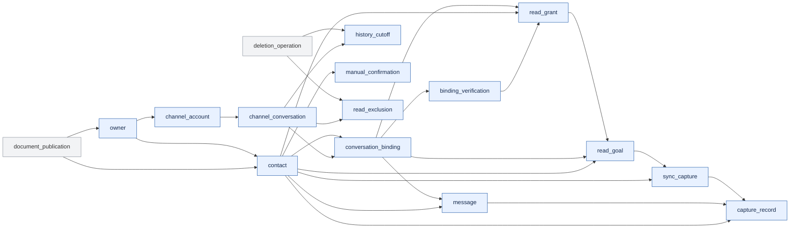
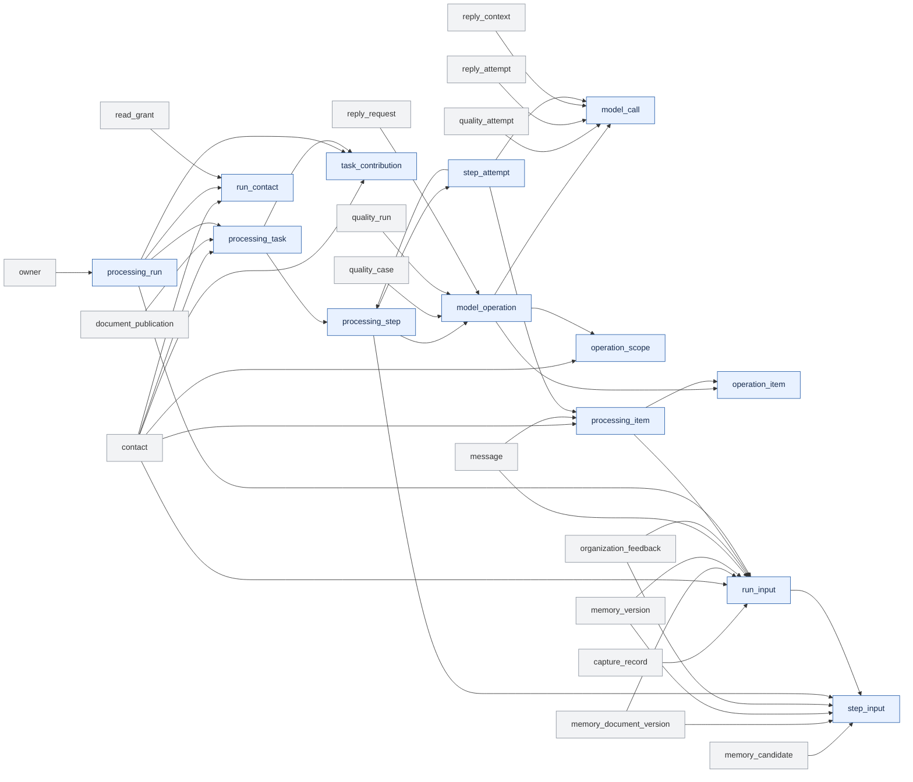
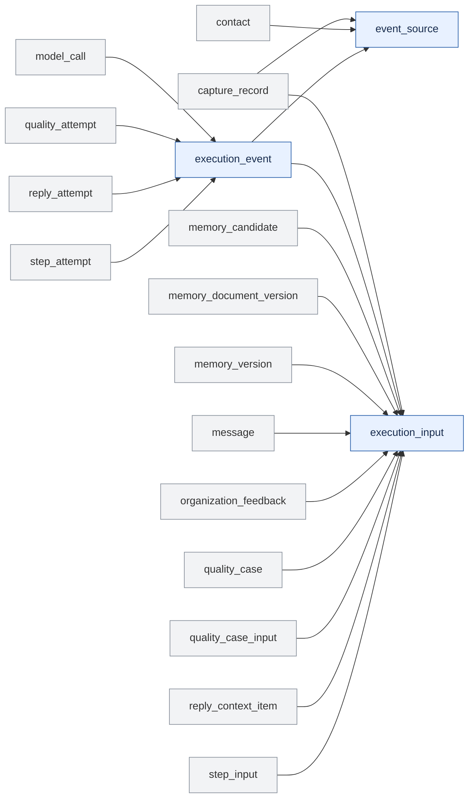
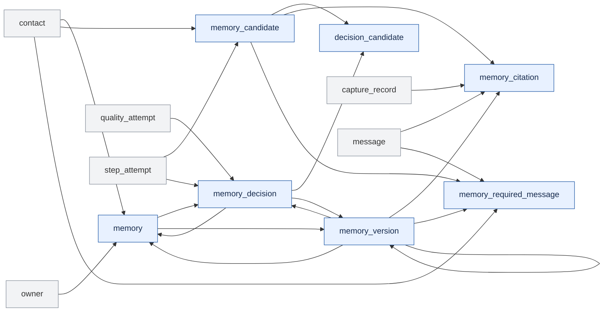
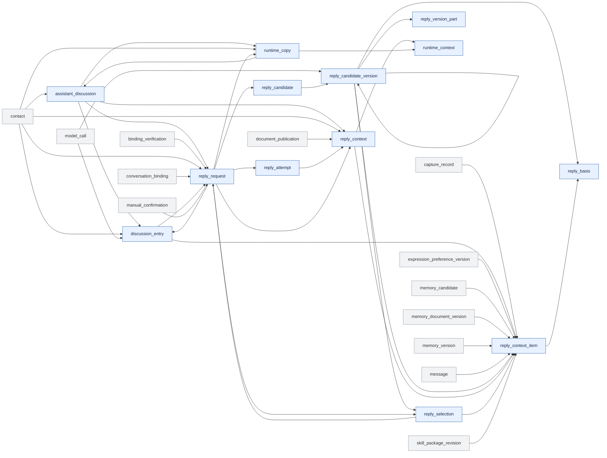
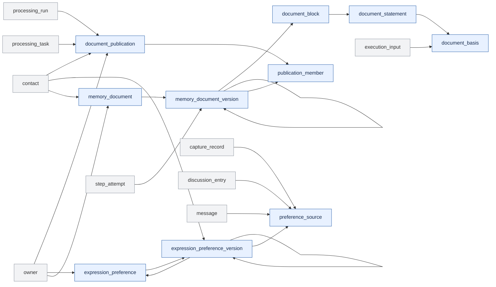
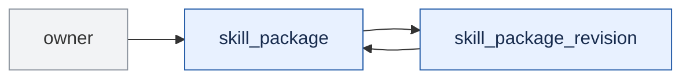
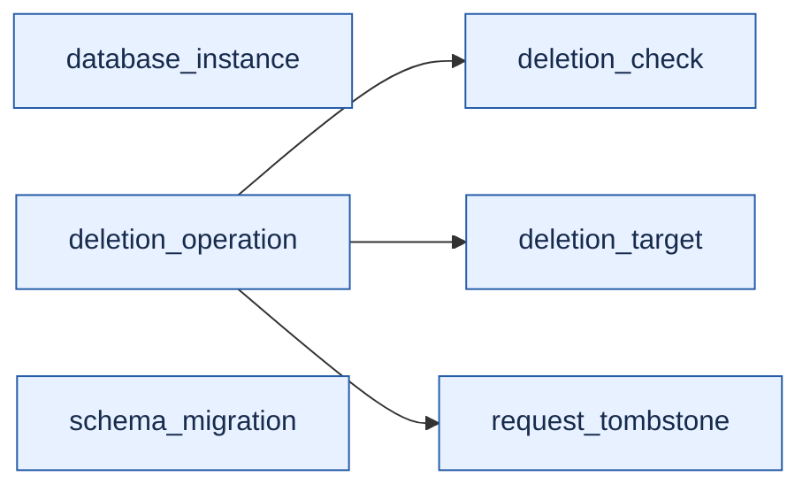
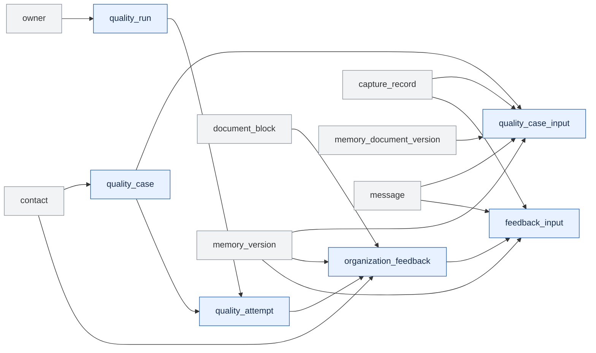
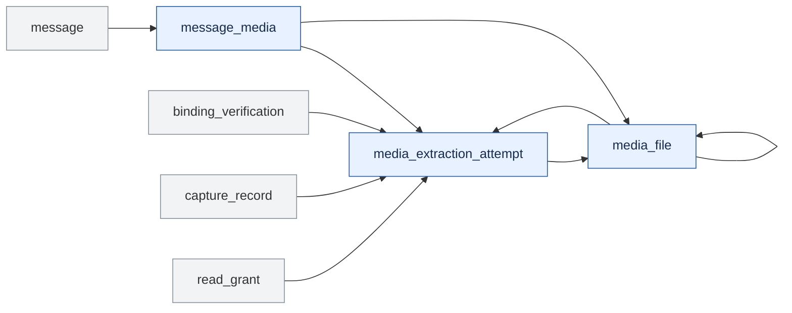

# 全表关系索引

由[结构化目录](consolidated-schema.json)生成，与[主方案](greenfield-design.md)同版。媒体Q11已确认并整合。

共77张表、215条基础外键。相同表对的多条FK在图中合为一条箭头，实际列组及范围约束见主方案。箭头由父表指向引用子表；基数由唯一性与分支CHECK决定。蓝色为本组，灰色为跨组引用。

## 身份与来源

## 处理与调用

## 实际追踪

## 记忆与裁决

## 助手与副本

## 偏好与文档

## Skill最小关联

## 删除与元数据

## 纠错与诊断

## 媒体提取

