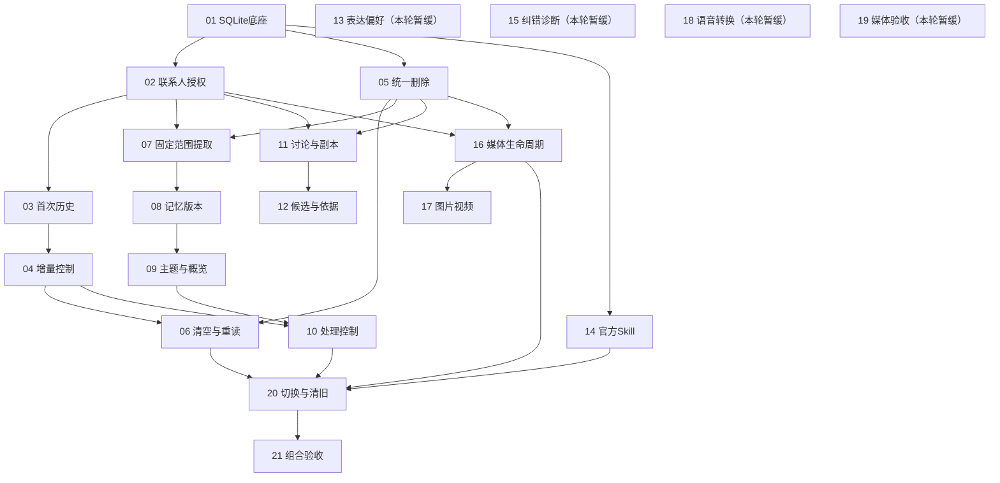

# 本机 SQLite 重建：21项实施任务索引

> 2026-10-30 新决定：03/04 当前已暂停；微信消息去重、撤回保留及旧扫描清理改按 [ADR-128](../../architecture/adr/128-deduplicated-wechat-message-storage.md)。下方冲突的旧要求和验收保留作历史记录，不代表新方案已实现或验收。

Triage: ready-for-agent
State: claimed

> 2026-10-29：用户已明确授权实施、独立执行会话和工作树、本地集成及状态维护。总 Goal 已启用，按依赖推进；App首次使用继续搁置。已发布规格与产品、数据和授权边界保持有效。

## 范围与规格

> 2026-10-30 最终收尾：剩余5项及全范围285个授权会话已完成本机历史遍历，当前活守卫285、来源围栏0、待完成0，已保存61,389条文字；03/04恢复resolved。大联系人查询93毫秒，实际交互与六分钟续读复验通过。未知状态继续隔离。实现bd20e110、9e551eb0、945b38c3，仅本地提交，见[最终证据](../../docs/verification/sqlite-private-history-support-03.md#2026-10-30-最终持续运行与全范围验收)。

> 2026-10-30 此前功能验收（历史记录）：用户随后要求补齐微信正文同步并明确完结。03/04 在 ADR-127 日常使用边界内完成真实历史、增量、退出停读、重启续读与去重验收，State 均保持 resolved；实现 `8b02bb2a`、新增来信验收 `fa66f5db`，仅本地提交。未知状态继续隔离，同标识原位回滚和下方四项暂缓范围不变；不将本次结论扩为06或21其他未认证能力通过。此前跳过03真实认证的安排保留为历史，当前证据见[正文同步最终验证](../../docs/verification/sqlite-private-history-support-03.md#2026-10-30-正式新增来信验收完成)。

> 2026-10-29用户最新范围：13表达偏好、15纠错诊断、18语音保存／转换、19媒体真实关联组合验收均本轮暂缓；保留原21项编号，本轮有效17项。18的既有实现与历史验收证据保留，不计本轮交付完成；仅做必要的入口停用。13、15、19不派发，不将19拆入其他任务继续验收。真实媒体唯一关联未验证时继续关闭对应入口；既有数据访问、隔离和删除保护保留，不据此删除用户资料。

本索引是原21项实施任务的统一入口，不另写一套规格。以下三份已定稿规格按上述本轮范围执行；暂缓条款不记为通过：

- [SQLite数据库重建](../sqlite-database-rebuild/spec.md)：结构、事务、实例生命周期、既有业务改接及旧业务清理切换。
- [同步与记忆](../sync-memory-behavior/spec.md)：逐人授权、历史/增量、清空/重读和手动记忆处理。
- [媒体提取](../wechat-media-extraction/spec.md)：单条图片/视频/语音、受管副本、本地转换及单独清除。

App首次使用不属于本轮执行范围：首用向导、微信组件准备/安装、新模型设置、干净机器、安装包及发布任务继续搁置，不作为这21项的前置。复用当前已有开发环境、可用组件和模型配置，仍须核验实际可用性、读取资格及必要文本出站授权。

数据库自身的初始化、升级、异常保护与切换，以及同步自身的联系人授权仍保留。微信迁移／恢复实验不加入本轮；失效隔离、旧排除及来源删除规则保持。

## 已批准的任务与直接依赖

保留原提案编号，一票一文件。有效任务的Blocked by只列本轮真正直接依赖；暂缓票保留原依赖供以后参考，不参与本轮调度。wontfix表示用户本轮不做，不表示永久废弃。18的resolved仅表示已发生的历史实现，不代表当前交付。

| 编号与任务 | Blocked by | Triage | State |
| --- | --- | --- | --- |
| [01 SQLite 基础与生命周期](issues/01-sqlite-runtime-lifecycle.md) | 无 | ready-for-agent | resolved |
| [02 联系人绑定与同步授权](issues/02-contact-binding-and-read-grants.md) | [01](issues/01-sqlite-runtime-lifecycle.md) | ready-for-agent | resolved |
| [03 首次历史同步与消息展示](issues/03-private-history-sync.md) | [02](issues/02-contact-binding-and-read-grants.md) | ready-for-agent | resolved |
| [04 增量同步与读取控制](issues/04-incremental-sync-controls.md) | [03](issues/03-private-history-sync.md) | ready-for-agent | resolved |
| [05 统一来源删除与清理流程](issues/05-source-deletion-and-cleanup.md) | [01](issues/01-sqlite-runtime-lifecycle.md) | ready-for-agent | resolved |
| [06 清空聊天与明确重读历史](issues/06-clear-and-resync-history.md) | [04](issues/04-incremental-sync-controls.md)、[05](issues/05-source-deletion-and-cleanup.md) | ready-for-agent | resolved |
| [07 固定范围的记忆提取与核验](issues/07-fixed-scope-memory-extraction.md) | [02](issues/02-contact-binding-and-read-grants.md)、[05](issues/05-source-deletion-and-cleanup.md) | ready-for-agent | resolved |
| [08 记忆候选、版本与修正](issues/08-memory-candidates-and-versions.md) | [07](issues/07-fixed-scope-memory-extraction.md) | ready-for-agent | resolved |
| [09 主题资料与长期概览](issues/09-memory-documents-publication.md) | [08](issues/08-memory-candidates-and-versions.md) | ready-for-agent | resolved |
| [10 记忆处理控制与恢复](issues/10-memory-processing-controls.md) | [04](issues/04-incremental-sync-controls.md)、[09](issues/09-memory-documents-publication.md) | ready-for-agent | resolved |
| [11 助手讨论与 DSH 副本](issues/11-assistant-discussions-and-runtime.md) | [02](issues/02-contact-binding-and-read-grants.md)、[05](issues/05-source-deletion-and-cleanup.md) | ready-for-agent | resolved |
| [12 候选回复与依据](issues/12-reply-candidates-and-basis.md) | [11](issues/11-assistant-discussions-and-runtime.md) | ready-for-agent | resolved |
| [13 表达偏好接回（本轮暂缓）](issues/13-expression-preferences.md) | [12](issues/12-reply-candidates-and-basis.md) | wontfix | open |
| [14 官方 Skill 加载接回](issues/14-official-skill-loading.md) | [01](issues/01-sqlite-runtime-lifecycle.md) | ready-for-agent | resolved |
| [15 既有纠错与诊断功能改接（本轮暂缓）](issues/15-feedback-and-quality-adaptation.md) | [09](issues/09-memory-documents-publication.md) | wontfix | open |
| [16 单条媒体保存与清除](issues/16-single-message-media-lifecycle.md) | [02](issues/02-contact-binding-and-read-grants.md)、[05](issues/05-source-deletion-and-cleanup.md) | ready-for-agent | resolved |
| [17 图片与视频提取](issues/17-image-video-extraction.md) | [16](issues/16-single-message-media-lifecycle.md) | ready-for-agent | resolved |
| [18 语音保存与转换（本轮暂缓）](issues/18-voice-save-and-conversion.md) | [16](issues/16-single-message-media-lifecycle.md) | wontfix | resolved |
| [19 媒体真实关联与组合验收（本轮暂缓）](issues/19-media-integration-acceptance.md) | [03](issues/03-private-history-sync.md)、[17](issues/17-image-video-extraction.md)、[18](issues/18-voice-save-and-conversion.md) | wontfix | open |
| [20 默认切换 SQLite 与旧业务清理](issues/20-sqlite-cutover-and-legacy-cleanup.md) | [06](issues/06-clear-and-resync-history.md)、[10](issues/10-memory-processing-controls.md)、[14](issues/14-official-skill-loading.md)、[16](issues/16-single-message-media-lifecycle.md) | ready-for-agent | resolved |
| [21 三份规格组合验收](issues/21-three-specs-integrated-acceptance.md) | [20](issues/20-sqlite-cutover-and-legacy-cleanup.md) | ready-for-agent | resolved |

## 依赖图

箭头只表示本轮有效依赖；四个暂缓节点不参与调度。

## 当前总进度

2026-10-30 先前检查点（本轮后续收尾前）：17项中13项 resolved（01、02、05、07、08、09、10、11、12、14、16、17、20）；03/04/06/21 均已实现并实际集成但 State=claimed：03真实普通历史/状态语义/来源生命周期/跨重启连续性未认证；04真实增量/重选/断线/微信不在前台CLI同步未认证（受控dev实机部分通过）；06真实observer/reader边界协议与最终只读制品未认证（生产保持boundary_pending）；10已通过App级环回供应商实机验收（开始/处理中/暂停小批收尾/继续复用/退出重开/单人失败/共用故障/unknown，14/14）并resolved（真实模型语义仍单独记录）；20真实清理经只读盘点重评：本机无旧业务对象（N/A+只读证据，未执行任何删除、未读.env内容），12/12通过并已resolved；21组合验收矩阵已产出（17项矩阵+四项暂缓+组合592/592+App闭环）但上述真实门槛未过、保持受阻抗。13/15/18/19用户暂缓（wontfix，入口关闭，不计通过）。本批全部变更已本地提交于集成分支 2bdec8c6，无push/PR/打包；工作区仅保留用户原有.gitignore修改与未跟踪资料，以及本批本地协调文件（.scratch手写handoff/report，未跟踪、不发布）。

历史（2026-10-29）：本轮有效17项：已集成且当前验收通过10项（01、02、05、07、08、11、12、14、16、17）；03因真实状态语义及来源生命周期未认证受阻；09独立会话执行中；04、06、10、20、21等待依赖。08、12已在独立工作树核验前置后实施。18历史实现完成但本轮不交付，最小停用已集成。撤回测试已按用户要求暂停，B保持现状；03实现及合成／实际App已完成的部分复用证据，不重新执行。

07跨窗口误删及08关系／合并引用覆盖、人工改文核验标识、撤回后去重等问题均已修复；最终后台70项、迁移11项、正式profile正例1项、桌面17项与实际合成App验证通过。总指挥补集成跨窗口及08→12各1项，源提交e8d01162实际纳入；09将在核验执行Goal后立即派发。

03补充只读查证：当前账号来源指纹和单连接 data_version 不足以证明跨次来源连续；03源码及合成评估确认单次固定快照与永久失证围栏仍不能满足旧排除跨实例映射和后续新消息接续；不能替代状态语义或重启增量等既定门槛。撤回测试继续跳过，不进行微信操作或迁移／恢复实验。

## 领取与并行约定

- 本轮已获准实施，当前前沿为01；01实际完成并集成后立即并行释放02、05、14。下游工作树必须包含已集成前置提交。
- 02和05完成后，07记忆提取、11助手讨论、16媒体生命周期可以并行，03历史同步也可沿02推进；公共文件或同一桌面实例仍须协调单一写入者。
- 17图片视频的既有实现和证据保留；18语音及19全部真实关联组合验收本轮暂缓，不再派发、读真实媒体或借其他票补做。未认证的真实资源入口继续拒绝。
- 20正式切换须先具备本轮目标结构、有效存储消费者改接、媒体文件登记/删除及活动引用复核；不能等21才补这些条件。13、15入口停用且不回退旧PG；18保持最小停用，真实媒体未认证不开放。原表目录数量用于查漏，不为凑数实施暂缓功能。
- 21本轮只依赖20及其有效依赖，收口17项有效任务组合行为；13、15、18、19标为用户暂缓，不记作验收通过，不转移到21补做。没有首用、安装包或发布票；其余真实渠道证据缺口仍据实报告。
- 03、14等早票按已定合同完成自身来源注册、资格保护和隔离测试；05及后续写者尚未就绪时明确使用合同替身，不宣称实际删除／运行链路已通过。真实链路、记忆／文档写者与回复消费者的兼容性必须在20切换前验证，21只扩大组合；清理或资格保护不完整的能力不能开放到真实业务数据。

## 各票共同验收与执行边界

1. 用户现已明确授权本轮实施；开始的任务改为claimed，真实验收满足后才resolved。Triage表示下一步处理角色，不表示真实渠道、产品功能或验收已完成。
2. 每张实现票贯通相应业务接口、持久化、现有界面反馈和测试；不新增手动聊天文件导入或外部消息发送能力。后续业务写者随票接入05删除闭包，不能留到最后才补隔离、来源或迟到保护。
3. 测试优先通过正常业务入口和正式profile，用独立SQLite、受管目录和合成/匿名化资料；替身只放在明确外部边界并记录差异。按单场景、相关模块、必要组合场景阶梯验证，复用条件未变的有效结果。
4. 合成数据可以验证本地实现；真实支持档未认证时运行时禁止相应真实读取。当前微信仅程序版本4.0.6/build29387已确认，真实结构、状态与最终读取制品仍需证据；正文渠道证据仍挂在03、06及有效组合验收；19真实媒体验收已暂缓，不再读取，不以未知默认支持，也不反复另开研究票。
5. 原生WCDB研究库12项、生命周期合成14项及既有SQLite/媒体/DSH证据仅证明其明确范围，不能替代当前微信、最终制品或新业务接线。全部拒绝输入不等于正常路径、新消息不漏或真实媒体关联通过。证据见[定稿记录](../../research/wechat-spec-finalization-validation.md)。
6. 正文、必要元数据与新媒体读取同受已核验账号、联系人、总开关和代次控制；关闭读取不停止合法已保存文字的手动记忆处理，取消联系人/来源失效则立即撤销相关提交。模型配置可用性和必要文本出站授权沿现有配置核验，不新增首用设置。
7. 实际依赖和真实验收条件满足后才能将任务resolved；本索引不自动把研究/设计完成、代码提交、静态结构通过或部分功能映射为产品完成。未完成/受阻证据如实保留，不更改已确认规则。
8. 日常开发和桌面验收仅用pnpm run dev，先dev:status核验并复用热更新实例；不自行打包、运行安装包或解除发布门禁。21票全部不授权push、远端分支或PR。
9. 开发实机测试仍遵守最小范围和明确授权；没有指定目标与内容不得发送/撤回消息，不对日常微信做迁移恢复实验。私人聊天、账号身份、凭据、截图、媒体及可恢复定位不进入提交。

## 旧任务与唯一执行入口

- [数据库旧决策地图](../sqlite-database-rebuild/map.md)及其01–10票保留历史，主要是研究和设计任务，不重编号、不覆盖、不以其resolved冒称这21项已实现；当前结构依据为[统一数据库设计](../sqlite-database-rebuild/greenfield-design.md)。
- [媒体旧四票提案](../wechat-media-extraction/ticket-proposal.md)由本轮已批准16–19承接，本次不再在媒体目录发布另一套相同功能票。
- App首次使用原规格与原票保留，当前继续搁置；本轮不改其父规格或任务状态，也不把其依赖加入本索引。
- 这21张票统一放在独立实施目录，保留用户确认编号，避免覆盖数据库目录里的同号历史研究票。原父规格不因发布任务被关闭或改为已实现。

## 发布验证

发布时只核对21张任务的编号、标题、依赖、元数据、验收条目、规格引用、本地链接和公开内容；不运行产品、模型、微信、业务库或实现测试。当前任务状态只记发布事实，最终检查结果及本地提交见本轮回报。

### 本轮静态检查结果

- 21张任务、1份索引，全部Triage为ready-for-agent、State为open，无领取或完成记录。
- 33条直接依赖与用户批准版本完全一致，依赖图无循环，图示与票内元数据一致；21能追溯到全部前置。
- 共254条可检查验收条件，本地链接无缺失，未加入首用或发布父任务，正文未固定易过期的实现路径。
- 本次22份文档的公开内容检查无命中；完整历史及工作区检查按本地提交后结果另行记录，不据此宣称其他草稿可公开。
- 只执行任务文档结构、依赖、链接和隐私检查；未运行产品、模型、微信、业务数据库、功能测试或任何实现任务。

## 实施调度记录

- 2026-10-29：总 Goal active；核对初始代码及现有会话后未发现本批重复执行。01已在独立执行会话和工作树启动，其余20票等待各自直接依赖。
- 本地集成使用`codex/sqlite-rebuild-integration`，保留主仓既有`.gitignore`修改与未跟踪资料。无推送、PR、打包或发布授权。
- 桌面资源当前由01独占；其余执行会话需等待总指挥安排，不并发启动、重启或操作微信。

- 01已完成并本地集成；Node与Electron各10项存储检查、25项桌面相关检查、两端类型及实际热更新正常/重开/故障/中断恢复通过。02、05、14已从包含01提交的集成分支分别派发；02优先使用桌面。复用01有效验证，本次无冲突不重跑相同用例。

- 14的独立实现与生产HTTP适配已纳入集成分支，22项相关回归及官方profile合成加载通过；正常管理路由和必要反馈仍待02共用入口接线后验证。14继续claimed，Goal保持active，不以实现提交替代验收完成。

- 05独立实现及共享删除合同已纳入集成分支，05/14仍为claimed。底座、删除和Skill合计44项相关场景及后台类型检查通过；profile最初从错误cwd执行后，在backend-ts单独复跑通过，其余43项未重跑。真实正常入口和反馈仍待共用接线验收，不据此关闭任务。

- 02已完成并集成，公共冲突仅registry：保留已发布删除v2，身份DDL原文追加v3并保留双方动作。集成后身份/官方宿主20项及后台类型通过。03已从含实际02提交的分支派发，不等待05/14收口；05/14实现已纳入但仍claimed。

- 14公共Skill接线已通过正常宿主/配置检查并纳入统一基线，实际App关联、启停、缺失/冲突与正常退出重开通过；剩余受管目录拒绝边界小补丁。05已拿到真实统一提交继续正常删除路由/compact验收，无需等14整票收尾。03获得下一窄认证桌面窗口，现有工具已从应用既有配置定位，仍须认证真实字节/协议/来源。

- 最新检查点：01、02、14已完成并集成；03历史核心按实际顺序发布v5，后台类型及历史／HTTP 19项通过，真实窄schema／来源认证继续执行。05宿主接线已与v5集成，正常宿主运行中账号删除及真实compact单例通过；元数据缓存／在途读取屏障和实际App验收仍在实施，03／05均保持claimed。桌面当前由05独占，释放后交03；05完成并实际集成后立即并行派发07、11、16。

- 05已完成真实正常宿主与实际App删除／compact验收并集成；联系人、账号、缓存与在途读取排空、Skill原件保留及失效快照撤下通过，Goal实际complete。当前01、02、05、14共四项resolved。07、11、16依赖已满足，即刻从包含真实02／05提交的基线分别派发，不等待03；03继续窄渠道认证和历史公共接线，独占桌面。

- 07、11、16已实际创建独立执行会话与工作树，从包含02和05最终集成提交的分支并行启动；每票立即创建自己的Goal、仅负责分配票。当前四票执行中（03／07／11／16），其余按直接依赖等待，公共宿主与桌面仍由03串行占用。

- 16已完成并按保留源祖先方式合并，media v6实际发布；后台36项、桌面19项、CSP解码及实际App四类删除、关闭异常均有证据，root仅补两端类型与跨模块3项。01／02／05／14／16共五项resolved，17与18即刻并行释放，真实类型关联仍由19按授权验收。后续统一完整合同与验证账，复用条件未变的结果，桌面按实际实例状态串行交接。

- 17、18已实际创建独立会话与工作树并行启动，基线包含16最终源与root合并祖先，开始仅负责各自类型模块；03现按用户明确固定文字授权占用微信状态验收窗口，所有媒体真实关联仍待19。

- 公共共享合同已按源祖先合并：讨论、记忆提取与执行追踪分别追加为迁移7／8／9，既有1–6保持不变；真实SQLite共享约束及删除7项、两端类型通过。07的唯一模型宿主注入检查点亦已集成，root补装配1项，复用条件未变的源验证。07／11继续claimed，正式宿主与实际App验收尚未完成。

- 17图片／视频完整检查点已集成，最小检查与双轴复核通过，正在独占短实际App窗口；18语音离线实现、依赖及许可证检查点已保存，Spec增量复核与实机待完成。03已按授权发送并保留第一条固定测试，随后唯一关联歧义停止；第二条未发送也未撤回，不据此认证真实状态。桌面已释放给17，03继续匿名原因诊断与首次历史公共hook收尾。

- 17已完成实际App和资源固定证明修复，Goal实际complete、最终源已保留祖先集成；PNG清除、视频控件播放、来源／联系人删除撤下快照均通过，root补图片／语音联合变异4项。当前共六项resolved，其余按直接依赖继续；19仍等待03和18，真实媒体范围已由用户明确为指定会话最新图片、视频、语音各一条（存在且能核验归属时读取）。

- 18已完成正常App的停读本地重转、实际播放、单独清除和来源删除，Goal实际complete并保留祖先集成；两份删除各40项复核且无阻塞、受管文件归零。当前七项resolved，19仍等待03。用户已明确将撤回校准留待以后手动操作：B发送态已唯一观察，撤回／未观测状态继续未验证，不等待或重复要求此项，不放宽对应读取门禁。

- 当前有效范围为17项，01、02、05、07、11、12、14、16、17已完成集成；08执行中，03真实历史仍受状态语义与来源连续性证据阻塞，04、06、09、10、20、21按依赖等待。撤回测试按用户要求跳过；独立只读复核未发现可以仅凭现有观察安全放开真实历史的依据，不额外要求迁移／恢复实验。

- 08的记忆管理页面、固定桌面桥和实际App失效反馈修复已集成；隔离合成资料验收覆盖修改采纳、人工保护、版本恢复、纠错、记录变化、并发冲突及来源删除后撤下。08继续实现正常关系裁决、准确来源引用与无损数据库升级，临时的同范围全部待定防护不算完成。12已通过正式记忆写者与候选版本失效组合检查，并完成来源失效的实际App复验；09正式文档写者的组合仍是20切换前门禁。

- 09 已按 08 实际集成提交启动独立执行会话，依赖祖先与 Goal 均已核验；只处理主题资料与长期概览，保留已发布迁移 1–12。

- 用户在独立会话另行授权的真实供应商合成复测：07源提交两次调用及两个目标成功，11源提交一次调用成功且重开未增请求；总指挥已核对状态数量和祖先关系。各自旧unknown保留，09没有因此获得真实外呼授权；不认证微信或真实聊天语义质量。

- 2026-10-30 票20集成（真实清理保持受阻，State claimed）：执行会话t20最终38ddd016（vs基线76文件+17935/−3146；迁移1..15未改、registry仅加cutover.snapshot只读动作、release/打包脚本零改动）；已--no-ff集成312c7bec。t03 checkpoint审查的全部阻断已修复：两端锁定TS 7.0.2 typecheck 0、结构审计完整比252 CHECK/92触发器body/FK action/defaults/views并含5类反例与生成脚本、77/778/215/115逐项disposition落tests+fixture、synthetic授权仅系统临时根可用（真实根强制confirmed_local+摘要二次确认）、清理前二次停写核验、旧helper补sqlite且run-current实跑无新增失败文件（本树1559/946通过/612失败 vs 基线1506/928/577）、13/15/18/19 ownership unavailable+旧路由503行为断言、ADR 7份修订+verification 519行。主仓复跑：backend/desktop typecheck 0、cutover五文件24/24（Electron Node；普通node 2项宿主就绪属原生绑定环境差异）、desktop启动相关15/15、inventory通过。真实旧业务库/含内容助手会话/缓存/派生文件无法精确归属，实际清理保持受阻未执行；本机无PG socket，managed-postgres/schema-prepare-cli源文件按裁决保留不可达、发布清单未改。默认开发入口实测：隔离根未预置控制文件即自动创建独立SQLite（8项检查passed/manifest completed）、5页UI正常console error 0、关停stopped/pids[]、重开同database_id+owner。

- 2026-10-30 票21派发（task-7 释放）：20已实际集成，17项有效范围组合验收启动。

- 2026-10-30 票20里程碑①（检查点提交6c8c184f切换控制面+隔离演练、52ab1a6f退役旧PG启动路径与手动导入）：迁移1..15实际创建82表；77逻辑目录=67本轮实现+9暂缓不建（13偏好3、15纠错6）+1由06来源级排除替代（read_exclusion→history_source_exclusion）；实际字段814，77目录778中已实现面预期674、实际726（52补充字段逐表差异待写入审计文档）；FK 215契约→已实现表186组→实际149组，37组差异分类（暂缓目标10、发布/前驱指针与循环14、范围候选键/材料分支13，部分由92范围触发器与60索引承担）；旧名称115=79实现+2查询派生+10暂缓目标+1手动导入退役+7确认退役+16范围外。消费者：产品运行入口运行时pg值导入0，全仓129个pg引用仅3个值导入且不可达，其余126 type-only；各域已改接SQLite；13/15/18/19 ownership unavailable且launch无sqlite配置直接失败、无PG回退。退役：launch旧profile/host-plugin/managed PG分支、桌面managed-runtime/managed-manifest/旧schema诊断、手动聊天文件导入全链路；旧测试移入historical登记（+4）。新增cutover.snapshot只读动作（registry仅加动作，迁移1..15未改）；演练8/8、结构审计4/4、退役静态回归5/5、两端typecheck 0。裁决：managed-postgres.ts/schema-prepare-cli.ts保留且不修改发布清单；92个需PG的current测试为既有基线单列；不新增迁移16。t03开始checkpoint双轴审查；桌面窗口分配t20复核正常入口默认SQLite。

- 2026-10-30 票10实机修正集成与验收边界：t10 实机发现「无固定目标被误显示范围失效」，修正432fb4e4（明确“当前没有待处理的文字目标”）已--no-ff集成66ab0fec；主仓复跑backend typecheck 0、控制测试通过。隔离dev（/tmp/t09-node/bin/node、隔离根schema15、CDP、NOTALONE_ENV_FILE隔离且无模型key）实机通过：记忆页挂载固定处理面板、开始后统一状态无百分比无伪完成、修正后无误导文案、Cmd+Q后stopped/pids[]、重开同一固定轮次同一状态且无自动模型调用/自动继续、隔离根与端口清理。未在App内构造的模型相关子项（暂停小批收尾/继续复用成功步骤/单人失败/共用故障/unknown/租约接替/取消清空后不恢复）由控制测试15/15+09文档用例+桌面headless23/23覆盖，如实记录为边界；不新增合成模型供应商dev开关（新增模型/凭据入口超范围）。票10 State保持claimed，不冒充真实模型通过。

- 2026-10-30 票20跨重启缺陷修复与集成（跨票）：t21在App复验发现「清空boundary_pending后同根重启→联系人同步状态读取失败」；t20用prepare-memory-management-desktop同构根复现：重启后/api/contacts、/api/sync/cli-bindings 409 identity_closed、/api/sync/status 503、/api/deletions仍可见blocked操作。根因：deletion.metadataAvailable把任何未完成删除（含contact_history/source/discussion/media_result）都判为身份元数据不可用→ContactMetadataLifetime重启用不绑定联系人服务。修复154ac9e2：仅未完成contact/account删除关闭名单服务；内容类未完成删除只清内容，联系人目录/绑定授权/删除进度保持可读，写入门禁仍由各领域边界与holder fence保证；迁移1..15与安全门禁未变；新增sqlite-deletion-metadata-restart 2项回归。同轮收口t03 4项非阻断：15个旧PG/纯TS宿主current测试+fixture退役登记historical、新增launchDsh静态守卫（current必须有受控sqlite配置来源）、verification §9.2错误表述、149/173 FK口径注明、结构基线不绑sqliteVersion。已--no-ff集成d1068fbf；主仓复跑：backend typecheck 0、cutover+新增回归28/28（Electron Node；普通node下该重启用例因原生绑定失败属环境差异）、deletion/binding/clear相关回归通过、public check 0。该缺陷属05删除门禁×06清空边界交互，非20切库引入，但影响04/06/20跨重启验收，21矩阵据此更新并在App同构根闭环复验通过。

- 2026-10-30 票20派发（task-6 已解除阻塞，t20-cutover 领取）：硬依赖06(task-3已complete)/10(task-5)/14(67b28e9a)/16(1683fbcf)全部实际进基线；从5fbe770c新建工作树sqlite-rebuild-20。要求：原77表/778字段/215基础FK/115旧名称逐项清点并标注本轮实现/退役/暂缓且入口关闭；活跃PG消费者改接或退役，13/15停用无旧PG回退；16媒体闭包复核；隔离合成演练目标识别/停机/清理/失败重试/配置切换；维护态停写；新独立database_id与SQLite账本；原子切配置；ADR-101/102、089/100、107/108替代条款修订。禁止真实切库/drop/清理/打包/发布；本机很可能无真实PG，清理对象归属不明时如实受阻只做合成演练。21在20集成后立即派发。

- 2026-10-30 票10代码集成（State保持claimed，实机验收待）：执行会话t10最终1f798662（无新增迁移，1..15保留；含09暂停修复b2a4f0f1与06清空2fdde8e2）；已--no-ff集成b5241920。执行会话门禁：两端typecheck 0、控制14/14、记忆+清空+删除+09文档+08管理108/108、09文档+控制25/25、桌面23/23、inventory通过、public 0。主仓复跑：backend typecheck 0、控制测试通过、inventory通过。剩实机App验收（暂停小批收尾/继续复用成功步骤/退出重开/unknown/租约接替/删除晚到）待窗口。集成后20的四个硬依赖（06、10、14、16）全部实际进基线，释放task-6。

- 2026-10-30 票06桌面pending路径实机验证通过：t06在隔离合成根（/tmp/t09-node/bin/node v24.21.0、CDP dev开关、合成SQLite schema15两位联系人；未接真实微信/未调模型/未打包）完成5项：实际管理后台显示结构版本15、选中合成乙出现清空面板、清空确认后显示boundary_pending+原因exact_channel_cutoff_required且无成功文案（生产HTTP复核phase=boundary_pending/completed=false/deletion_state=blocked/stored_messages=0/stored_sources=0/联系人选择保留）、刷新仍pending、重读确认提示“结果尚未确认”无成功文案、正常退出后stopped/pids[]并删合成根。第12条真实observer/reader协议仍pending如实记录。无代码改动、无新hash。

- 2026-10-30 票09文档阶段暂停边界修复集成：t10发现scene→profile阶段间未复验pause_requested_at（普通暂停后仍启动画像小批），t09以claimScene/claimProfile领取前复验pause_requested_at（暂停返回null保持pending）+普通暂停时场景收尾直接incomplete+run可单独领取画像小批供continue恢复修复（0f16b89d，分支HEAD 25e06116）；已--no-ff集成b2a4f0f1。主仓复跑：backend typecheck 0、文档10文件+提取101/101、desktop typecheck 0、桌面46/46；原12条验收无回退。

- 2026-10-30 票04实机验收（部分通过，State保持claimed）：t04在受控dev（主仓已集成04的HEAD d866a4fe+隔离userData+合成SQLite schema14；未操作微信/未发送/未接真实模型/未打包）核验：结构版本14、联系人授权显示、增量阶段与失败原因可见、总开关开→关→开资料与检查点保留（read_epoch 1→2→3）、取消单人只停该人且资料保留（active 2→1）、覆盖不足如实显示、正常退出后pids[]/端口关闭/DB持久事实（messages=4、grants 3/active1、游标与pagesAccepted保留）。未完成并如实记录：重选（需读微信会话元数据，受控环境禁止操作微信）、断线实机构造、微信不在前台有效授权CLI同步（真实读取门禁关闭）——三项不计通过。无代码缺陷、无新hash、桌面已释放给06。

- 2026-10-30 票06代码集成（State保持claimed，真实S(B)未认证）：执行会话t06最终a2e6862d（迁移15=historyClearMigration；按04接缝替换suppression函数体、两处accept接ingest clear_excluded、宿主路由与关闭、桌面联系人页面板）；已--no-ff集成2fdde8e2。t03双轴审查发现的阻断B1（取消/中断不使候选失效）、B3（B未绑定source_generation）及S5/S6/S3均已修复并补用例；B2（真实observer/reader协议与制品）如实保持pending，不冒充。主仓复跑：backend typecheck 0、清空/重读+清空HTTP 21/21；执行会话复跑清空17/17、HTTP4/4、历史/删除/增量107/107、宿主28/28、desktop typecheck 0、inventory通过、public 0。票06真实部分未过，不resolved。

- 2026-10-30 票09完成并 resolved（本轮第11项）：t09 在实际热更新 App（合成库+环回供应商，12次文档协议调用/errors=0，未操作微信/未接真实模型）完成 a–d 复验：权威阶段序列 extraction_verification→document_scene→document_profile→completed；记忆页显示同一发布集合两篇文档；本人全局概览不在联系人页展示；正常 quit 后 dev:status stopped/pids[]，合成临时根与供应商已清理。12 条验收逐条通过（d 项“时间待核验”实际 App 未强制构造，已由无头页面用例覆盖并如实记录）。边界：真实模型语义质量、真实微信数据、最终产品切换未认证，单独记账。桌面窗口已释放，下一顺位 04。

- 2026-10-30 票09回归修复集成：t09定位 memoryExtraction.start 的复用条件错误（新增 document_extraction_reuse 未区分本轮是否接线后续文档阶段，导致仅提取服务第二轮把已成功目标又纳入，next.total=2）；d5f3ee55 以 `followupStages = afterRunSettled!==undefined` 修复，runs 仅在 followupStages===true 且迁移13时启用复用。已--no-ff集成13a33b18；主仓复跑：backend typecheck 0、sqlite-memory-extraction 10/10（原失败转绿）、09文档10文件90/90、desktop typecheck 0。

- 2026-10-30 票04集成（含审查修复）：执行会话t04最终bad4c4ef（迁移14=historyIncrementalMigration，仅ALTER read_goal/message，不重建CHECK不建新表）；已--no-ff集成3ba737fc。集成前经t03独立Standards/Spec双轴审查，发现并修复3个阻断：提交树typecheck 10错误（错误收窄+SQLInputValue）、close不取消在途读取/迟到页可提交、未校验支持档incrementalTail能力；t03 delta复审确认三项闭环。主仓复跑：backend typecheck 0、增量4文件25/25、宿主12/12（Electron Node）、desktop typecheck 0、桌面5文件21/21。已知问题：09集成引入sqlite-memory-extraction 1项失败（0197bea4通过、5551aa5e失败），已交t09定位修复，不计入04。真实渠道增量能力仍属03门禁，打开前保持不可用。

- 2026-10-30 票09代码集成（桌面复验进行中，State保持claimed）：执行会话t09恢复b1f3未提交工作并提交e0f51331/8c7a66b5/fc5b2c54/e7df7dcd+merge dc8366c6；迁移1..13（13=memoryDocumentsMigration），1–12原文未改。已--no-ff集成5551aa5e；主仓复跑门禁：backend typecheck 0、Electron Node下文档10文件90/90、desktop typecheck 0、桌面4文件46/46。09桌面实际App用例a–d（合成库+环回供应商）进行中，完成后补最终12条判定。

- 2026-10-30 票03收口（task-1 complete）：执行会话t03把基线并入dsh/sqlite-rebuild-03并只读复核首次自动入口/能力报告/删除注册接线，未发现授权内需补写代码；提交34a6f98b仅+103行文档（合并后审计、12条逐条判定、精确真实缺口），已--no-ff集成7b934d73，集成后backend typecheck通过。03结论：第1/2条真实普通历史、状态语义、来源生命周期、跨重启连续性仍未认证，真实target/page全拒绝；需用户授权（真实逐人确认读取、固定文本发送+仅撤回一次）与正式窄操作制品，撤回测试此前已被用户跳过。State保持claimed、不resolved；03剩余工作转入需用户/架构决策的阻塞项，不空等。

- 2026-10-30 DSH 总指挥接管并派发剩余批次：核对 GitHub 无远端操作；集成分支 codex/sqlite-rebuild-integration @ 33e7dedc（14 由 67b28e9a、16 由 1683fbcf 核验为基线祖先；03 工作树 bbec 仅 1 个未合并文档提交 +17 行，源码已集成；09 工作树 b1f3 为 109e1d50 + 28 改 6 未跟踪，须保留）。桌面 dev:status stopped/pids[]，WeChat PID 892 运行。已并发派发 5 个执行会话：t03（task-1，恢复 bbec 并先并基线）、t04（task-2，新 worktree sqlite-rebuild-04）、t06（task-3，新 worktree sqlite-rebuild-06）、t09（task-4，恢复 b1f3）、t10（task-5，新 worktree sqlite-rebuild-10）；20=task-6 blocked_by [06,10]，21=task-7 blocked_by [20]。桌面串行队列：03→09→04/06/10。pnpm 经 /tmp/notalone-env.sh shim（默认 PATH 无 node/pnpm）。06/10 的共享路径集成门禁分别等 04、04+09 实际进基线。

- 2026-10-30（Goal round1）票20解决：t20只读复核确认本机无PG进程/数据目录、~/.notalone仅270个Skill原目录5.2M、默认userData仅Chromium缓存+wechat-tool开发制品+配置（无managed/state.json/旧业务SQLite/assistant-runtime/updates/runtime-copies）、NotAlone为空目录；据此第8条重评N/A（本机无清理对象）+只读证据，第12条保持通过，最终12/12（11通过+第8条N/A）。aff0366d已集成3bae162a；票20 State改为resolved。未执行任何真实删除/drop/切库/迁移，未读.env内容，目标不完整等安全门禁未变。

- 2026-10-30（Goal round2）票10解决：t10复用t09环回供应商思路（隔离合成库+真实热更新dev+CDP；仅供应商传输边界用/tmp本机环回供应商与既有test-only网络守卫，官方地址重定向127.0.0.1、拒绝其他出站；未新增产品开关/配置，替身未提交），App实机通过：开始→处理中→暂停(20/27提交后已暂停、无百分比/伪完成)→Cmd+Q重开保持暂停→继续27/27且首批未重发→单人失败(乙failed/甲继续)→共用故障固定原因+手动继续→unknown无继续/不重发。实机发现并修复：在途sending被误投影unknown、共用故障原因界面固定展示(sharedFaultCode)，均补回归。0fac4ada已集成a731d471；主仓复跑：两端typecheck 0、sqlite-memory-control 16/16、桌面固定处理23/23、inventory通过。票10 State=resolved（真实模型语义/真实微信边界单独记录，租约接替与取消清空由后端真实用例覆盖）。

- 2026-10-30（Goal round2）票21矩阵增补集成：t21仅文档更新row10/20为resolved并补证据指针/§5/§7/§8/§11增补记录；resolved计数13项（01/02/05/07/08/09/10/11/12/14/16/17/20），仍claimed/受阻（03/04/06真实渠道门槛、06依赖04、19暂缓、真实模型语义未认证）。c8be50d5已集成86db8e01；主仓public check committed ref issues 0。

- 2026-10-30（Goal round2）最终独立验证：t03对票10 fixed 0fac4ada 双轴审查通过、无阻断（两端锁定TS7.0.2 0/0；迁移1..15未改；t10自有源码仅8文件；sqlite-memory-control 16/16、桌面固定处理23/23、07/08/09相关48/48；在途sending不算unknown判定正确，真正unknown由fail/recover/租约接替/超时四路径保证），并确认最终集成树 HEAD bcf5671b 一致性 PASS（两端tsc 0/0、test-inventory通过、public check ref HEAD issues 0、代表性组合64/64、7个票分支均为HEAD祖先、工作区仅用户.gitignore+174个未跟踪.scratch资料、dev stopped/pids[]）。非阻断残留（记录不冒充已修）：①t10 shared故障同屏重复且措辞矛盾（statusText“修复后可继续”与新段落“修复后重新开始处理”，FixedMemoryProcessingPanel.tsx:26-32/135）且桌面无非空sharedFaultCode断言；②09文档阶段document_model_*共用故障未纳入sharedFailureCodes（只显示later_stages_failed，属09域边界需决定）；③建议补“sending后崩溃重启→unknown且无继续”跨域测试。已清理批次遗留挂起测试进程3个（worktree-10 backend-ts node --test、worktree-20 desktop node --test ×2，含端口52403监听），复检无残留。

- 2026-10-30 票10审查后补丁集成：t10按t03审查的4项非阻断闭环并提交1c02305b（发送中崩溃→重启unknown无继续回归+迟到可验证回执结算/旧租约不提交、共用故障展示去重统一“修复后可继续原任务”、document_model_unconfigured/configuration_invalid/credentials_unavailable/scope_invalid纳入sharedFailureCodes并补投影与桌面断言、遗留进程核实清理与App边界记录），已--no-ff集成4a6d8930（无迁移/registry变更）。主仓复跑：backend/desktop typecheck 0、sqlite-memory-control 18/18、桌面固定处理25/25、inventory通过、public check ref HEAD issues 0。票10最终树=1c02305b；此前3项非阻断残留已闭环。

- 2026-10-30 票10补丁独立确认：t03对1c02305b（delta 0fac4ada..1c02305b）确认可收、无阻断：sharedFailureCodes 11码后端与桌面键完全一致且真实09路径写入task.error_code成立（stages.ts noteFailure/model-port.ts抛出）；发送崩溃回归断言blocked/model_receipt_unknown/actions空/unknown=1，迟到可验证回执只结算不提交、继续后不重放未知；delta仅7预期文件无迁移/发布面越界；两端锁定TS 0/0、sqlite-memory-control 18/18、桌面25/25、文档/管理子集33/33、inventory通过、public check 1c02305b issues 0；App未构造项未写成通过；PID13034已不存在。非阻断建议：文档阶段共用故障投影后续可补经09真实失败路径的端到端断言（当前fixture注入与真实合同一致）。票10最终树=1c02305b，集成4a6d8930已收。

- 2026-10-30（用户恢复 Goal 后）人工验证路径决策与收尾：用户明确「真实渠道验证留待其人工完成，先做后面能做的」，本会话不再执行任何真实发送/撤回/真实微信读取。已恢复 Goal active；核查环境自 04:41 无变化（仓库无新提交、微信 PID 892 自 10-26 未重启、userData/制品/进程无变化）。执行最终一致性验证（RC gate）：backend/desktop 锁定 TS 7.0.2 typecheck 0/0、test-inventory 通过、后端代表性批次 96/96（Electron Node，含 memory-control/documents/clear/cutover/history/incremental/deletion-restart）、桌面代表性批次 fail 0、public check ref HEAD issues 0。已编写人工验证指南 .scratch/sqlite-rebuild-implementation/manual-real-channel-verification-20261030.local.md（03 固定 A/B 人工动作与停止条件、06 所需正式窄操作制品或构建授权、04 依赖、21 收口口径、证据回传与恢复方式）。03/04/06/21 保持 claimed/受阻，Goal 保持 active 等用户人工验证结果。

- 2026-10-30 票10最终补充（审查遗留项闭环）：t10补09真实文档失败路径的端到端共用故障回归（documentFixture.documentModel + 产品真实model=undefined形态，经09真实documents/service.ts port()抛document_model_unconfigured→真实memoryDocuments.fail/noteFailure写processing_task.error_code，不再fixture手工插值；断言后端sharedFaultCode/status=blocked/actions空/unknown0与桌面单一固定原因展示、无错误动作）；仅测试/文档4文件、无产品代码变更。d2a1aee7已--no-ff集成1d47dd97；主仓复跑两端typecheck 0、memory-control+documents+management fail0、桌面固定处理fail0、inventory通过、public ref HEAD issues0。t03审查唯一非阻断建议已闭环；票10保持resolved。

- 2026-10-30（Goal round4）组合验收后续复跑：t10产品补丁1c02305b/d2a1aee7在产品代码变化后进入基线（记忆控制投影/桌面展示），按条件变化在当前集成分支复跑21的A–K全部组合批次：**716/716通过**（A125/B148/C68/D94/E30/F57/G74/H25/I46/J21/K28；B/F/I/K因t10/t20补丁新增用例分别+3/+1/+1/+1；日志/tmp/round4-batch-{a..k}.log；Node v24.21.0与Electron 44.7.0自带Node、锁定TS7.0.2、条件未变复用原批次文件清单）。同轮复跑：两端tsc 0/0、inventory通过、public check ref HEAD issues 0。已请t21把该后续复跑写入21文档§12并更新§0/§3指向；21仍claimed/受阻（03/04/06真实门槛未变），票10/20状态不变。

- 2026-10-30（Goal round4）21文档Round4增补集成：t21新增§12「后续复跑（t10补丁后）」逐批A–K 716/716(0 fail; B148/F57/I46/K28)、§0/§3指向与Round4基线713c6d5f，矩阵结论/票State/其他票证据未改；4849e12f已--no-ff集成39bc2165（仅文档）。public check ref HEAD issues 0。当前集成HEAD=39bc2165（本批117提交、222文件+27900/−4530）；票状态不变：14 resolved（13有效+18历史）、4 claimed（03/04/06/21）、3 open（13/15/19暂缓）。Goal保持active，等待用户按manual-real-channel-verification指南完成人工真实验证后恢复采集。

- 2026-10-30（Goal round5）人工验证前置准备与桌面全量套件限制：①环境自 round4 无变化（仓库无新提交、微信PID892未重启、userData/进程无变化）。②尝试以 `cd desktop && pnpm test` 跑完整 safe-node 桌面套件作为最终门禁，但 test-safe.mjs 以 `node --test`（无 --test-force-exit）在开放句柄上挂起>10分钟，已终止并清理 /tmp/notalone-safe-tests-*；这是测试脚本/环境限制而非产品回归（代表性桌面批次与既有门禁仍绿），已记录为已知限制。③03 人工验证前置：已核对并确认 v11 开发窄操作只读制品仍完整——路径 `<bbec>/.scratch/sqlite-history-cli/dev-schema-v11/bin/wechat-cli`，sha256=d555fdce…（与 manifest cliSha256 一致）、WCDB sha256=4f05cafc…、manifest kind=notalone-history-cli-development、signing=ad-hoc-development、realWechatVerified=false；正式 CLI d566d4… 仍无 metadata 窄操作。④已更新人工验证指南新增§7：制品位置/哈希/身份、03 协调协议（先布防观察再执行人工动作，二选一：完整 A/B+仅撤回B，或仅观察下撤回B）、若事后告知则只能认证事后状态不能认证转移、Agent 收到消息后的只读核对→arm→next→关闭→更新证据待办。Goal保持active等待用户人工验证。

- 2026-10-30（Goal round6）人工验证驱动就绪性核对：环境无变化（仓库/微信PID892/userData）。仅只读验证v11制品可执行与完整性、未打开微信DB：`wechat-cli help`/`version`正常（version=2.0.1-rc.5、commit=795071f…、cliSha256=d555fdce…与manifest一致）、`codesign --verify --strict`退出0。定位既有观察驱动 `<bbec>/.scratch/sqlite-history-cli/observe-human-b.mjs`：经NarrowWechatClient校验双哈希→accountMetadata→resolveSelected('ran')精确目标→inspectSelected/supportSelected→observer_open，再由stdin控制 arm（lockedCount=0）→人工动作→next（直到lockedCount=1；>1判身份歧义失败）→close，输出匿名records（无正文/source/XML/原始身份，bodyRead:false）；运行环境 /tmp/t09-node/bin/node v24.21.0、cwd=bbec根；脚本finally会覆盖anonymous-human-b-v11.json，执行前须复制到/tmp并改输出名保留原证据。人工验证指南已补§7.5（就绪性、驱动用法、安全边界、我收到“准备开始”后的只读流程）。Goal保持active等待用户。

- 2026-10-30（Goal round7）人工验证驱动静态就绪性与预置：环境无变化。只读静态核对 drive-human-b.mjs 依赖：NarrowWechatClient 所需方法均存在（accountMetadata/resolveSelected/inspectSelected/observeTestMetadataSelected/supportSelected/targetSelected/close），CLI 以 `spawn(executable,['notalone-history'])`、HOME/PATH/TMPDIR/LANG/LC_ALL 环境、stdin/stdout JSON envelope 通信，与驱动协议一致。已预置 /tmp/observe-withdraw-dryrun.mjs（oberve-human-b.mjs 副本，输出名改 anonymous-human-b-v11-withdraw.json，node --check 通过），**未运行、未访问微信数据**。人工验证指南补§7.6。除用户人工动作与正式CLI/授权外已无可执行项；Goal 按规则（同一阻塞条件连续≥3 goal round：等待用户人工真实验证）标记 blocked。
