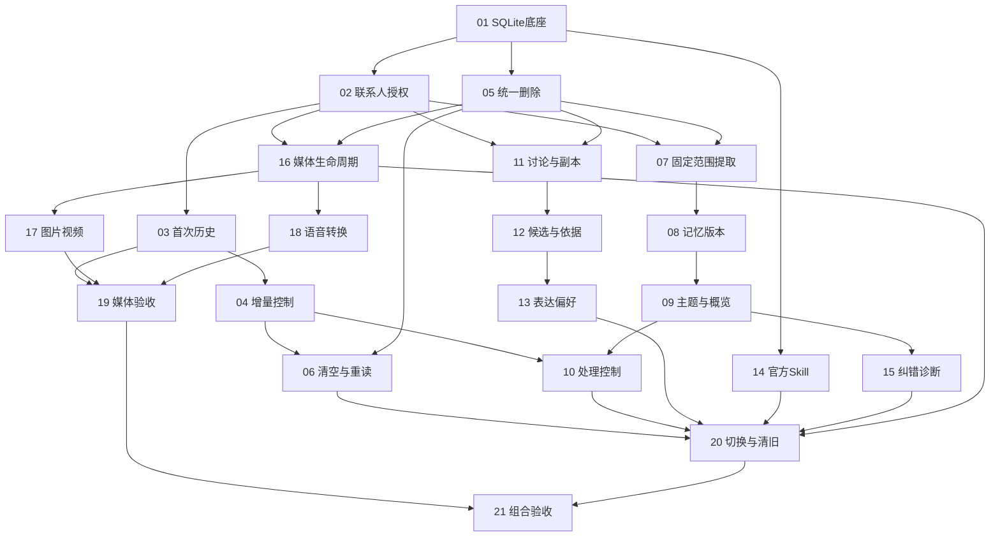

# 本机 SQLite 重建：21项实施任务索引

Triage: ready-for-agent
State: claimed

> 2026-10-29：用户已明确授权实施、独立执行会话和工作树、本地集成及状态维护。总 Goal 已启用，按依赖推进；App首次使用继续搁置。已发布规格与产品、数据和授权边界保持有效。

## 范围与规格

本索引是这21项实施任务的统一入口，不另写一套规格。仅承接以下三份已定稿规格：

- [SQLite数据库重建](../sqlite-database-rebuild/spec.md)：结构、事务、实例生命周期、既有业务改接及旧业务清理切换。
- [同步与记忆](../sync-memory-behavior/spec.md)：逐人授权、历史/增量、清空/重读和手动记忆处理。
- [媒体提取](../wechat-media-extraction/spec.md)：单条图片/视频/语音、受管副本、本地转换及单独清除。

App首次使用不属于本轮执行范围：首用向导、微信组件准备/安装、新模型设置、干净机器、安装包及发布任务继续搁置，不作为这21项的前置。复用当前已有开发环境、可用组件和模型配置，仍须核验实际可用性、读取资格及必要文本出站授权。

数据库自身的初始化、升级、异常保护与切换，以及同步自身的联系人授权仍保留。微信迁移／恢复实验不加入本轮；失效隔离、旧排除及来源删除规则保持。

## 已批准的任务与直接依赖

下列编号与用户确认的提案完全一致。一票一文件；Blocked by只列真正直接依赖，其他外部放行条件在票内验收。

| 编号与任务 | Blocked by | Triage | State |
| --- | --- | --- | --- |
| [01 SQLite 基础与生命周期](issues/01-sqlite-runtime-lifecycle.md) | 无 | ready-for-agent | resolved |
| [02 联系人绑定与同步授权](issues/02-contact-binding-and-read-grants.md) | [01](issues/01-sqlite-runtime-lifecycle.md) | ready-for-agent | resolved |
| [03 首次历史同步与消息展示](issues/03-private-history-sync.md) | [02](issues/02-contact-binding-and-read-grants.md) | ready-for-agent | claimed |
| [04 增量同步与读取控制](issues/04-incremental-sync-controls.md) | [03](issues/03-private-history-sync.md) | ready-for-agent | open |
| [05 统一来源删除与清理流程](issues/05-source-deletion-and-cleanup.md) | [01](issues/01-sqlite-runtime-lifecycle.md) | ready-for-agent | resolved |
| [06 清空聊天与明确重读历史](issues/06-clear-and-resync-history.md) | [04](issues/04-incremental-sync-controls.md)、[05](issues/05-source-deletion-and-cleanup.md) | ready-for-agent | open |
| [07 固定范围的记忆提取与核验](issues/07-fixed-scope-memory-extraction.md) | [02](issues/02-contact-binding-and-read-grants.md)、[05](issues/05-source-deletion-and-cleanup.md) | ready-for-agent | claimed |
| [08 记忆候选、版本与修正](issues/08-memory-candidates-and-versions.md) | [07](issues/07-fixed-scope-memory-extraction.md) | ready-for-agent | open |
| [09 主题资料与长期概览](issues/09-memory-documents-publication.md) | [08](issues/08-memory-candidates-and-versions.md) | ready-for-agent | open |
| [10 记忆处理控制与恢复](issues/10-memory-processing-controls.md) | [04](issues/04-incremental-sync-controls.md)、[09](issues/09-memory-documents-publication.md) | ready-for-agent | open |
| [11 助手讨论与 DSH 副本](issues/11-assistant-discussions-and-runtime.md) | [02](issues/02-contact-binding-and-read-grants.md)、[05](issues/05-source-deletion-and-cleanup.md) | ready-for-agent | claimed |
| [12 候选回复与依据](issues/12-reply-candidates-and-basis.md) | [11](issues/11-assistant-discussions-and-runtime.md) | ready-for-agent | open |
| [13 表达偏好接回](issues/13-expression-preferences.md) | [12](issues/12-reply-candidates-and-basis.md) | ready-for-agent | open |
| [14 官方 Skill 加载接回](issues/14-official-skill-loading.md) | [01](issues/01-sqlite-runtime-lifecycle.md) | ready-for-agent | resolved |
| [15 既有纠错与诊断功能改接](issues/15-feedback-and-quality-adaptation.md) | [09](issues/09-memory-documents-publication.md) | ready-for-agent | open |
| [16 单条媒体保存与清除](issues/16-single-message-media-lifecycle.md) | [02](issues/02-contact-binding-and-read-grants.md)、[05](issues/05-source-deletion-and-cleanup.md) | ready-for-agent | resolved |
| [17 图片与视频提取](issues/17-image-video-extraction.md) | [16](issues/16-single-message-media-lifecycle.md) | ready-for-agent | open |
| [18 语音保存与转换](issues/18-voice-save-and-conversion.md) | [16](issues/16-single-message-media-lifecycle.md) | ready-for-agent | open |
| [19 媒体真实关联与组合验收](issues/19-media-integration-acceptance.md) | [03](issues/03-private-history-sync.md)、[17](issues/17-image-video-extraction.md)、[18](issues/18-voice-save-and-conversion.md) | ready-for-agent | open |
| [20 默认切换 SQLite 与旧业务清理](issues/20-sqlite-cutover-and-legacy-cleanup.md) | [06](issues/06-clear-and-resync-history.md)、[10](issues/10-memory-processing-controls.md)、[13](issues/13-expression-preferences.md)、[14](issues/14-official-skill-loading.md)、[15](issues/15-feedback-and-quality-adaptation.md)、[16](issues/16-single-message-media-lifecycle.md) | ready-for-agent | open |
| [21 三份规格组合验收](issues/21-three-specs-integrated-acceptance.md) | [19](issues/19-media-integration-acceptance.md)、[20](issues/20-sqlite-cutover-and-legacy-cleanup.md) | ready-for-agent | open |

## 依赖图

箭头从前置任务指向后续任务。

## 领取与并行约定

- 本轮已获准实施，当前前沿为01；01实际完成并集成后立即并行释放02、05、14。下游工作树必须包含已集成前置提交。
- 02和05完成后，07记忆提取、11助手讨论、16媒体生命周期可以并行，03历史同步也可沿02推进；公共文件或同一桌面实例仍须协调单一写入者。
- 17图片视频与18语音可在16完成后并行；每张功能票自身已经包含入口、状态、测试和删除处理，19只做媒体组合与真实关联验收。
- 20正式切换须先具备完整目标结构、全部存储消费者改接、媒体文件登记/删除及活动引用复核；不能等21才补这些条件。17至19未通过时，对应用户媒体能力不得开放。
- 21依赖19和20，收口三份规格组合行为；没有首用、安装包或发布票。存在外部证据缺口时按实际结果报告，不因本地检查通过就关闭真实验收。
- 03、14等早票按已定合同完成自身来源注册、资格保护和隔离测试；05及后续写者尚未就绪时明确使用合同替身，不宣称实际删除／运行链路已通过。真实链路、记忆／文档写者与回复消费者的兼容性必须在20切换前验证，21只扩大组合；清理或资格保护不完整的能力不能开放到真实业务数据。

## 各票共同验收与执行边界

1. 用户现已明确授权本轮实施；开始的任务改为claimed，真实验收满足后才resolved。Triage表示下一步处理角色，不表示真实渠道、产品功能或验收已完成。
2. 每张实现票贯通相应业务接口、持久化、现有界面反馈和测试；不新增手动聊天文件导入或外部消息发送能力。后续业务写者随票接入05删除闭包，不能留到最后才补隔离、来源或迟到保护。
3. 测试优先通过正常业务入口和正式profile，用独立SQLite、受管目录和合成/匿名化资料；替身只放在明确外部边界并记录差异。按单场景、相关模块、必要组合场景阶梯验证，复用条件未变的有效结果。
4. 合成数据可以验证本地实现；真实支持档未认证时运行时禁止相应真实读取。当前微信仅程序版本4.0.6/build29387已确认，真实结构、状态与最终读取制品仍需证据；这些挂在03、06、19及组合验收，不以未知默认支持，也不反复另开研究票。
5. 原生WCDB研究库12项、生命周期合成14项及既有SQLite/媒体/DSH证据仅证明其明确范围，不能替代当前微信、最终制品或新业务接线。全部拒绝输入不等于正常路径、新消息不漏或真实媒体关联通过。证据见[定稿记录](../../research/wechat-spec-finalization-validation.md)。
6. 正文、必要元数据与新媒体读取同受已核验账号、联系人、总开关和代次控制；关闭读取不停止合法已保存文字的手动记忆处理，取消联系人/来源失效则立即撤销相关提交。模型配置可用性和必要文本出站授权沿现有配置核验，不新增首用设置。
7. 实际依赖和真实验收条件满足后才能将任务resolved；本索引不自动把研究/设计完成、代码提交、静态结构通过或部分功能映射为产品完成。未完成/受阻证据如实保留，不更改已确认规则。
8. 日常开发和桌面验收仅用pnpm run dev，先dev:status核验并复用热更新实例；不自行打包、运行安装包或解除发布门禁。21票全部不授权push、远端分支或PR。
9. 开发实机测试仍遵守最小范围和明确授权；没有指定目标与内容不得发送/撤回消息，不对日常微信做迁移恢复实验。私人聊天、账号身份、凭据、截图、媒体及可恢复定位不进入提交。

## 旧任务与唯一执行入口

- [数据库旧决策地图](../sqlite-database-rebuild/map.md)及其01–10票保留历史，主要是研究和设计任务，不重编号、不覆盖、不以其resolved冒称这21项已实现；当前结构依据为[统一数据库设计](../sqlite-database-rebuild/greenfield-design.md)。
- [媒体旧四票提案](../wechat-media-extraction/ticket-proposal.md)由本轮已批准16–19承接，本次不再在媒体目录发布另一套相同功能票。
- App首次使用原规格与原票保留，当前继续搁置；本轮不改其父规格或任务状态，也不把其依赖加入本索引。
- 这21张票统一放在独立实施目录，保留用户确认编号，避免覆盖数据库目录里的同号历史研究票。原父规格不因发布任务被关闭或改为已实现。

## 发布验证

发布时只核对21张任务的编号、标题、依赖、元数据、验收条目、规格引用、本地链接和公开内容；不运行产品、模型、微信、业务库或实现测试。当前任务状态只记发布事实，最终检查结果及本地提交见本轮回报。

### 本轮静态检查结果

- 21张任务、1份索引，全部Triage为ready-for-agent、State为open，无领取或完成记录。
- 33条直接依赖与用户批准版本完全一致，依赖图无循环，图示与票内元数据一致；21能追溯到全部前置。
- 共254条可检查验收条件，本地链接无缺失，未加入首用或发布父任务，正文未固定易过期的实现路径。
- 本次22份文档的公开内容检查无命中；完整历史及工作区检查按本地提交后结果另行记录，不据此宣称其他草稿可公开。
- 只执行任务文档结构、依赖、链接和隐私检查；未运行产品、模型、微信、业务数据库、功能测试或任何实现任务。

## 实施调度记录

- 2026-10-29：总 Goal active；核对初始代码及现有会话后未发现本批重复执行。01已在独立执行会话和工作树启动，其余20票等待各自直接依赖。
- 本地集成使用`codex/sqlite-rebuild-integration`，保留主仓既有`.gitignore`修改与未跟踪资料。无推送、PR、打包或发布授权。
- 桌面资源当前由01独占；其余执行会话需等待总指挥安排，不并发启动、重启或操作微信。

- 01已完成并本地集成；Node与Electron各10项存储检查、25项桌面相关检查、两端类型及实际热更新正常/重开/故障/中断恢复通过。02、05、14已从包含01提交的集成分支分别派发；02优先使用桌面。复用01有效验证，本次无冲突不重跑相同用例。

- 14的独立实现与生产HTTP适配已纳入集成分支，22项相关回归及官方profile合成加载通过；正常管理路由和必要反馈仍待02共用入口接线后验证。14继续claimed，Goal保持active，不以实现提交替代验收完成。

- 05独立实现及共享删除合同已纳入集成分支，05/14仍为claimed。底座、删除和Skill合计44项相关场景及后台类型检查通过；profile最初从错误cwd执行后，在backend-ts单独复跑通过，其余43项未重跑。真实正常入口和反馈仍待共用接线验收，不据此关闭任务。

- 02已完成并集成，公共冲突仅registry：保留已发布删除v2，身份DDL原文追加v3并保留双方动作。集成后身份/官方宿主20项及后台类型通过。03已从含实际02提交的分支派发，不等待05/14收口；05/14实现已纳入但仍claimed。

- 14公共Skill接线已通过正常宿主/配置检查并纳入统一基线，实际App关联、启停、缺失/冲突与正常退出重开通过；剩余受管目录拒绝边界小补丁。05已拿到真实统一提交继续正常删除路由/compact验收，无需等14整票收尾。03获得下一窄认证桌面窗口，现有工具已从应用既有配置定位，仍须认证真实字节/协议/来源。

- 最新检查点：01、02、14已完成并集成；03历史核心按实际顺序发布v5，后台类型及历史／HTTP 19项通过，真实窄schema／来源认证继续执行。05宿主接线已与v5集成，正常宿主运行中账号删除及真实compact单例通过；元数据缓存／在途读取屏障和实际App验收仍在实施，03／05均保持claimed。桌面当前由05独占，释放后交03；05完成并实际集成后立即并行派发07、11、16。

- 05已完成真实正常宿主与实际App删除／compact验收并集成；联系人、账号、缓存与在途读取排空、Skill原件保留及失效快照撤下通过，Goal实际complete。当前01、02、05、14共四项resolved。07、11、16依赖已满足，即刻从包含真实02／05提交的基线分别派发，不等待03；03继续窄渠道认证和历史公共接线，独占桌面。

- 07、11、16已实际创建独立执行会话与工作树，从包含02和05最终集成提交的分支并行启动；每票立即创建自己的Goal、仅负责分配票。当前四票执行中（03／07／11／16），其余按直接依赖等待，公共宿主与桌面仍由03串行占用。

- 16已完成并按保留源祖先方式合并，media v6实际发布；后台36项、桌面19项、CSP解码及实际App四类删除、关闭异常均有证据，root仅补两端类型与跨模块3项。01／02／05／14／16共五项resolved，17与18即刻并行释放，真实类型关联仍由19按授权验收。后续统一完整合同与验证账，复用条件未变的结果，桌面按实际实例状态串行交接。
