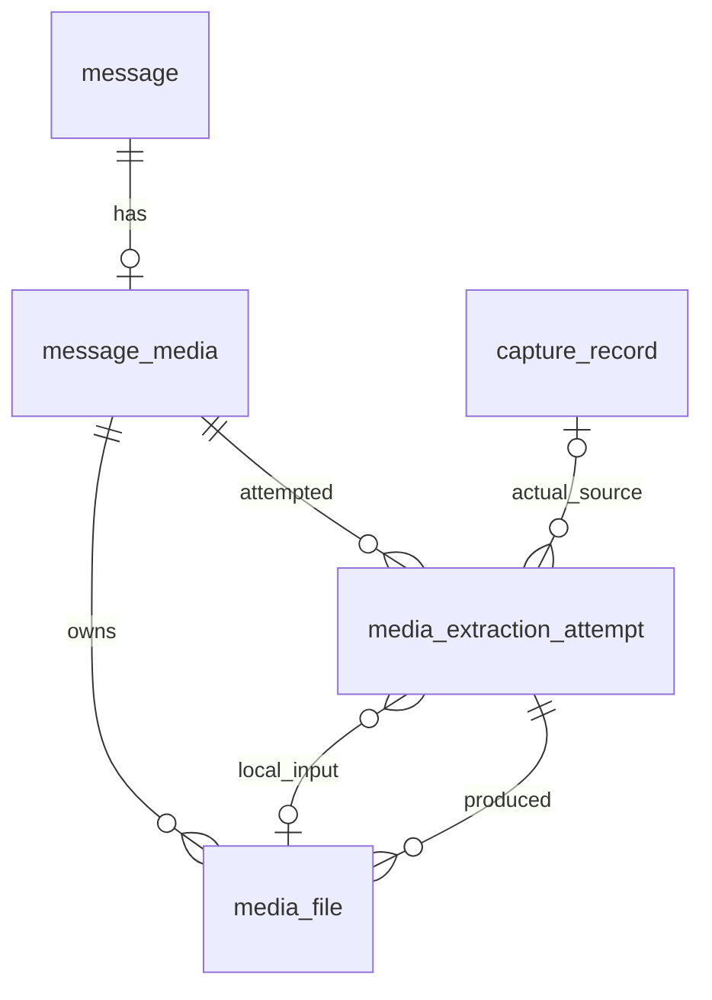

# 微信媒体资源提取与语音文件转换规格

Triage: ready-for-agent
State: open

> 状态：2026-10-29 规格定稿，实施未启动。Q1–Q10及Q11媒体关系已确认并整合统一数据库设计。`ready-for-agent`仅表示规格可供后续拆票；渠道唯一关联、质量证明、正式接线及产品验收仍须各自通过，不由规格标签放行。媒体功能继续属于已确认范围。
> 来源：此前讨论及媒体Q1–Q11确认；2026-10-29与同步、数据库两稿收敛
> 范围：已确认联系人下的图片、视频和语音媒体资源

## Problem Statement

用户需要在已确认联系人范围内，按需提取媒体资源；语音不要求调用模型转写，只要求保留原始语音并生成可播放文件。用户需要明确知道文件是否完整、是否可播放、是否只是缩略图，以及清除后会不会被旧操作恢复。

## Solution

只对已确认且勾选联系人下明确选定的一条消息执行手动提取，保存应用管理的独立副本并报告可用性与质量；语音保留原始SILK并在本机转换为WAV。媒体文件继承实际来源和联系人删除路径，不自动提取、不转写或加入记忆。

1. 从已确认且勾选的联系人下，提取用户明确选定的一条图片或视频消息。
2. 将需要解码的媒体转换为用户可以直接打开或播放的本地文件。
3. 从微信 `VoiceInfo.voice_data` 提取 SILK 原始数据，并生成可播放的 WAV 文件。

[四方案一致性约定](../sqlite-database-rebuild/map.md#plan-alignment)统一范围。本轮目标中的正文同步只保存非文字占位，不触发下载、解码、ASR、OCR或记忆提取。本功能是明确需要推进的工作，与SQLite和首用按接口协调，不因消息先占位而暂缓。真实文件、资源引用及受控缓存结构已纳入数据库逻辑设计；媒体三实体及删除账本扩展已按Q11整合，当前统一目录共77表（其中媒体3表），尚未执行DDL/产品接线。已有文字读取授权不自动授予媒体读取；新读取须核验本次手动指定范围、账号/联系人、读取控制与删除代次，不开放后台读取例外。对已合法保存文件的本地转换与从微信新取资源分开。

共同控制与删除边界以[三份方案的共同规则](../sync-memory-behavior/spec.md#cross-plan-contract)为准；本文细化媒体操作，表、键和事务以数据库统一设计为准。取消勾选不删除既有合法媒体，但停止新提取及本地转换并拒绝在途提交；单独清媒体、清空聊天、删除联系人分别按明确范围执行。

渠道身份采用[二轮收敛合同](../../research/wechat-channel-resolution-v2.md)的版本支持档和完整出现键；消息server_id补齐不换内部message.id，也不重新触发媒体提取。消息身份通过不等于媒体资源已唯一关联，仍须单独验证资源映射。清空接受的边界与代次不因媒体清理慢而后移；迟到文件继续按原删除规则处理。本轮未读取真实消息或媒体。

## User Stories

1. 作为用户，我希望针对一条已确认联系人的图片消息提取可查看文件，以便离开微信后仍能查看。
2. 作为用户，我希望针对一条视频消息保存经过校验的应用自有副本，以便微信原缓存失效后仍能播放。
3. 作为用户，我希望保留一条语音的原始SILK并在本机转换为WAV，以便区分原始资料与可播放结果。
4. 作为用户，我希望只在明确选定单条消息并点击操作后获取媒体，以便联系人选择或页面刷新不会触发后台提取。
5. 作为用户，我希望媒体按账号、联系人、消息和实际来源核验归属，以免同名文件或相近时间导致串人。
6. 作为用户，我希望媒体保存在NotAlone管理的本机目录，以便微信清理缓存不会使已保存结果失效。
7. 作为用户，我希望来源或联系人删除时清理应用副本而保留微信及外部原文件，以便删除范围准确可见。
8. 作为用户，我希望单独清除一条消息的媒体后保留聊天占位，以便不用清空聊天也能管理媒体。
9. 作为用户，我希望清除后只有我明确重提才重新获取，以便页面打开、重启和旧重试不会恢复已清内容。
10. 作为用户，我希望缩略图及未知质量明确标注，并由我主动补提原图，以便不会把有限结果当成原图。
11. 作为用户，我希望空间不足时停止本次提取并保留已有媒体，以便不会被系统自动淘汰已保存文件。
12. 作为用户，我希望新文件校验完成后再替换当前组合，失败时保留合法旧结果，以便提取失败不会降低已有可用性。
13. 作为用户，我希望每条消息独立管理文件副本，以便删除一条消息不会影响其他联系人或消息。
14. 作为用户，我希望关闭读取总开关或取消联系人勾选后不从微信取新文件，以便媒体提取遵守现有读取范围。
15. 作为用户，我希望退出或异常中断后等待明确重提，以便重开不会擅自恢复微信读取。
16. 作为用户，我希望SILK保存成功但WAV失败时保留原始件并明确不可播放，以便失败状态不会冒充完整成功。
17. 作为用户，我希望关闭微信读取时仍可对已勾选联系人合法保存的SILK手动本地重转，以便本地转换不要求重新读取微信。
18. 作为用户，我希望取消勾选、清除或来源失效后拒绝在途结果提交，以便旧操作不会复活已删除内容。
19. 作为用户，我希望媒体处理不调用模型、不外发文件且日志不记录私密内容，以便本地文件操作不扩大资料出站用途。

## Implementation Decisions

1. **联系人范围**：所有操作必须先限定 `owner_id + contact_id`；不得根据昵称、文件名或消息正文跨联系人猜测归属。
2. **触发方式**：本轮只支持用户明确选定一条图片、视频或语音消息后手动执行；选择联系人不触发提取，不做联系人批量或后台扫描。
3. **图片**：保留微信原始资源引用；对 `.dat` 图片生成可直接查看的本地派生文件，并返回派生路径。
4. **视频**：用户于2026-10-29确认Q1，取代“优先只返回微信原路径”的旧提案。提取成功须有应用保存并校验可用的自有副本；微信原路径只是来源定位，不能作为已可靠保存的证明。
5. **语音原始层**：从 `VoiceInfo.voice_data` BLOB 提取原始 SILK 数据，保存为独立 `.silk` 文件。
6. **语音播放层**：使用本地 SILK 解码器把原始数据转换为 WAV 等可播放文件；本规格默认 WAV。
7. **语音转写**：不在本功能内调用 ASR 或模型；“可播放文件”和“文字转写”是两个独立能力。
8. **本地保存**：Q1已确认，提取成功的图片、视频和语音须保存应用管理的副本，微信清理缓存不导致已保存结果失效。SILK、WAV、图片文件及视频副本的文件角色另在结构设计中明确；微信或用户已有的外部原件保持不动，不标成应用自有文件。统一数据库中的媒体三实体保存必要身份、引用及自有副本定位，不上传云端，也不写入message.text_body或capture_record.raw_payload。
9. **删除生命周期**：资源关联同owner/contact/message及实际来源绑定；删除来源或联系人时撤销相应外部引用、清理应用自有原始提取件/派生文件/复制缓存及索引，按统一deletion_operation计划复核并拒绝迟到写入。只撤销应用访问，不物理删除微信或用户原有文件；其他仍合法来源的关联须复核，不能借其他引用保留应清理的旧副本。
10. **单独清除媒体**：Q2已确认，可清除某条消息已提取结果及其自有文件/引用，同时保留聊天占位；清除后仅用户再次明确提取才建立新结果，后台读取、打开页面和旧重试不得自动恢复。来源/联系人清理仍按统一删除规则执行。
11. **质量与有限结果**：Q3已确认，原图不可取得而能可靠辨明缩略图时，允许保存并展示，明确标注“缩略图，原图未取得”；质量无法核验时标为未知，不按像素/扩展名猜原图。保存了可用文件与达成原图目标分开记录，后续取得原图仍需用户明确发起。
12. **空间不足**：Q4已确认，停止本次新增提取并提示清理，不自动淘汰其他成功保存的媒体。允许清理本次失败的临时文件，空间错误不能触发删除其他结果或后台重提。
13. **当前文件与尝试历史**：Q5已确认，只保留当前有效结果需要的文件组合，不保留每次重复提取的全部旧文件。每次尝试有记录；新结果必须先校验，再原子切换，失败保留仍合法的旧结果。语音SILK原始提取件与WAV播放件是不同角色，可以共存，不算重复历史；明确删除或来源失效的旧结果不适用保留例外。
14. **独立副本**：Q6已确认，本轮不同消息独立保存应用副本，不跨消息或联系人共享同一个文件身份/路径，不用内容哈希合并权限与删除边界。重复字节可能多占空间，后续仅在有实际容量依据和独立设计时评估物理去重。
15. **微信读取控制**：Q7已确认，新提取媒体必须用户明确发起，并同时满足App运行、读取总开关开启、该联系人已勾选及身份/来源核验；勾选与开启不会自动触发媒体下载。关闭开关/未勾选时不从微信取新文件，仍合法的已保存副本可查看播放。
16. **退出与中断**：Q8已确认，媒体提取退出/异常中断后只显示中断，等待用户明确再次提取，不在重开时自动读取微信恢复。已有合法结果仍可用，未完成临时件可按持久清理计划清理；原请求重送不启动第二次执行。
17. **语音有限结果**：Q9已确认，SILK原始文件已完整保存而WAV转换失败时，保留合法SILK，明确显示“语音已保存，暂不可播放”。用户可以明确重试本地转换，读取总开关关闭也可以，只使用仍合法的受管SILK，不读取微信；文件/来源失效、已清除或被撤销时禁止继续。
18. **本轮粒度**：Q10已确认，本轮只对用户明确选定的一条图片、视频或语音消息执行提取、补提、转换重试或单独清除；选择联系人不触发其全历史媒体提取。本轮不做多选/整联系人批量，不预建批量父请求和聚合进度。
19. **输出隐私**：终端、任务记录和错误日志不得输出语音正文、完整 XML、`aeskey`、原始 `voice_url` 或其他可恢复的私密内容。

## Testing Decisions

- 优先通过单条媒体操作的正式业务服务、认证接口与具名桌面桥检验提取、状态查询、手动本地转换和清除；使用真实文件登记、发布和统一删除协调。只在微信资源读取和确定性故障点使用明确的合成适配器，不用私有函数调用或文件存在断言代替整个用户结果。
- 来源定位与本地转换是两个测试边界：前者检验账号／联系人／消息唯一归属和读取资格，后者只消费已核验的受管输入。复用现有CLI只读契约、媒体生命周期及跨领域删除的测试先例；旧PG及合成结果不证明新SQLite接线或真实微信支持。
- 覆盖正常、有限结果、未知质量、取消、删除、空间不足、文件发布前后中断及迟到响应；同时验证合法旧结果保持可用、无隐式微信读取、无模型调用和跨联系人串用。通过以下可观察验收条件判断完成。

### Acceptance Criteria

1. 给定已确认联系人和一条图片消息，系统能返回原始资源状态和可查看派生文件路径；路径存在且能被图片探测工具识别。
2. 给定已确认联系人和一条视频消息，返回经校验的应用自有视频副本；微信原路径失效后仍能播放，文件可被媒体探测工具读取时长和编码信息。
3. 给定一条微信语音消息，按经核验的账号、会话、稳定消息身份及消息到资源关联合同唯一定位BLOB，不读取其他联系人语音。local_id与时间只可作适配器定位辅助，不能单独证明身份；关联不足、同秒冲突或账号变化时拒绝，不按内容猜测。
4. 完整语音结果含原始 `.silk` 和WAV；WAV须经格式/时长校验。若SILK完整保存而转换失败，允许发布明确不可播放的部分结果，并支持手动本地重转；不能把部分结果判为完整成功，也不能丢弃已保存合法原始件。
5. 整个媒体转换流程不调用外部模型、不发送外部网络请求、不修改微信数据库。
6. 失败时只返回资源缺失、解码失败、权限不足或范围不明确等非正文错误；不输出密钥、XML 或语音内容。
7. 删除来源后，撤销的外部引用、应用自有媒体/派生文件和缓存索引均不可再通过NotAlone读取；微信原文件及用户原文件保持不动。通过统一删除账本核验重试、部分失败、活动读取、迟到结果与范围隔离。
8. 两个联系人拥有相同文件名、相同媒体类型或相同时间时，媒体仍按 `owner_id + contact_id` 隔离。
9. 对三类媒体的已发布可查看/播放结果停用模拟微信原路径，应用副本仍可打开；只有SILK的部分结果验证原始文件仍完整，不要求可播放。只返回外部原路径不得计为已保存成功。
10. 单独清除一条媒体结果后聊天占位保留，自有副本不可读取，打开页面/重启/旧重试不重新提取；用户明确重提后使用新操作与删除代次，迟到旧结果不能复活。
11. 合成缩略图/原图/未知质量输入分别验证：缩略图可用但原图未取得、未知质量不冒称原图；主动补提才可能升级，不在后台抓取原图。
12. 模拟空间不足时新增提取失败/受阻且原因可见，已有媒体保持可用；只清理本次未完成临时件，不静默驱逐旧文件。
13. 新文件校验前旧合法结果仍可用；补提失败不丢旧文件；成功切换后不再保留不需要的旧字节，清理失败有真实待清理状态。
14. 两条消息提取相同字节时分别登记文件身份/路径；单独删除一条结果不影响另一条，内容摘要不作为权限键或跨消息唯一键。
15. 总开关关闭/联系人未勾选/绑定变化/来源失效时不发起新微信资源读取，已在途响应按接受代次拒绝失效提交；合法已保存副本仍可打开。
16. 在写入文件、验证、发布前后各点模拟中断；重开不触发微信读取，只有明确新操作才重提；发布成功后即使崩溃，旧文件清理目标仍存在并能同操作继续清理。
17. 保存SILK后模拟WAV失败，发布有限结果并明确不可播放；关闭读取后用户明确重转，只消费该SILK，无微信请求；清除媒体或来源失效时拒绝转换/迟到发布。
18. 本轮只接受单条明确消息目标，联系人切换/列表刷新不发起媒体批量获取；同一request_key重送返回原状态，不能换消息或重新执行；中断后显式新提取使用新request_key。

## Out of Scope

- ASR 语音转文字、模型选择、模型下载和云端转写。
- 后台自动扫描所有联系人或自动导出全部媒体。
- 图片理解、视频理解、OCR 或内容分类。
- 发送微信消息、控制微信窗口、切换会话或滚动历史。
- 跨联系人合并媒体、跨账号媒体归属或公开链接分享。
- 将 `aeskey`、完整消息 XML 或原始语音内容写入日志、任务记录或长期记忆。

## Further Notes

### 技术现状

本轮已查锁定CLI源码：图片/视频资源、语音BLOB路径及解码缓存逻辑存在，但当前关联回退不能证明唯一归属，只读模式也不允许沿用上游缓存写入链。图片可能为微信.dat，语音原始SILK需独立本地转换。用户安装制品未运行，不能把锁定源码能力直接当作当前产品可用。

### Processing Flow

以下第一条链只适用于从微信新取资源，须总开关开启、联系人已勾选且读取资格有效。本地重转使用已保存SILK，不重新定位或读取微信，仍复验联系人勾选、实际来源、文件及删除代次。

```text
用户选择 owner/contact/message
    -> 确认来源范围与权限
    -> 定位图片、视频或 VoiceInfo.voice_data
    -> 按核验后的来源定位取得资源并保存应用自有副本
    -> 需要时生成可查看/可播放派生文件
    -> 返回非正文结果：类型、时长、大小、路径、状态
    -> 来源删除时撤销引用、清理应用自有副本/派生文件及缓存，保留外部原文件
```

语音的目标处理链如下。本地解码路线已有合成证据；真实资源适配、产品接线及最终交付仍须验证：

```text
VoiceInfo.voice_data BLOB
    -> 原始 SILK 文件
    -> 经验证的本地 SILK 解码器
    -> WAV/PCM 可播放文件
```

本地重转链：用户明确选择一条消息 → 核验该消息已保存的合法SILK及当前处理资格 → 本地解码 → 校验并发布WAV；读取总开关可关闭。失败保留合法原始件及原有可用结果，不隐式补读微信。

### Implementation Notes

- 锁定commit的voiceBlob路径固定打开message/media_0.db，使用server_id/local_id/时间的OR回退后LIMIT1；这不能用于严格归属，也不能把media_0硬编码当所有版本合同。旧media_1笔记仅历史。具体证据与严格接口见[渠道报告](../../research/sqlite-ready-cli-contract.md)。
- 不调用上游完整agent语音提示链：其中会读取旧转写缓存。新适配器只返回严格匹配的目标资源字节/受控句柄，保持CLI只读门禁；应用写自己的已登记文件，不能把voice_url当路径。
- 上方处理链只说明本地解码职责，不能把Python重新变为App的必装依赖。实施采用已核验的silk-wasm 3.7.1与本地WAV封装路线，并在当前TypeScript/DSH宿主验证离线资源、接线和交付；资源定位与解码保持两个可测试边界。
- 依赖与接口方向已收敛，尚未安装或接入产品；既有四票拆分仍是提案。本轮不自动发布实施票或启动真实提取。

#### 已收敛的本地实现路线

依据[媒体运行时一手查证及合成探针](../../research/sqlite-ready-media-runtime.md)：语音选silk-wasm 3.7.1，在可终止Worker内解码，以TypeScript封装24kHz/单声道/s16le WAV；WASM随应用离线分发，实施时补完整第三方告知。当前开发Electron Node模式合成样例通过，不需要用户安装Python。库返回成功和duration均不足以证明完整；资源完整复制、SILK帧结构、PCM样本数/实际播放校验分别执行。整帧截短只有可靠来源长度/完整读取证据才能进一步判断，不能由解码结果补造证明。

macOS图片/视频校验使用ImageIO和AVFoundation窄helper，按macOS15部署目标接入；PNG/WAV/H.264合成探针通过，但不代表所有微信格式已支持。微信.dat必须先按已核验版本解密/转换，再交格式检查；已定位V3 XOR及V4 AES/明文/XOR，纯字节合成合同7/7通过。V2只使用已授权渠道的受控密钥，缺失报needs_image_key；WXGF上游无转换能力，明确unsupported，不改扩展名冒充支持。不放宽CLI只读门禁或自动刷新密钥。缺密钥、未知封装、未完成验证明确失败，不把文件扩展名或“能读头部”当作可查看/播放。具体支持边界见报告。

文件固定一个不可复用的managed_locator：先登记staged意图，排他创建并登记真实身份，写入、同步和校验后以短事务发布current；不另换最终路径。发布同时登记旧文件清理。中断后按持久记录清理，不自动重提；未知文件身份不能广泛递归删除。

媒体attempt只对pending/running状态建部分唯一索引，不在索引使用当前时间。用户明确新操作时同事务核对并终结过期旧执行，再创建新执行；过期本身不授权自动重提。跨行“本次产生合法文件”由完成事务/触发器核对，state/outcome的形状才由CHECK负责。[SQLite专项证据](../../research/sqlite-ready-constraints.md)

### 工作流进度

四票粒度与依赖见[本功能拆分提案](ticket-proposal.md)，仍是提案，未成为正式任务。本轮仅定稿规格，不发布实施票、不执行建库或迁移；Q11已确认并完成字段/关系向统一目录整合。后续拆票须保留资源唯一关联、读取资格及应用自有副本发布/删除的依赖和验收门槛，拆分认可后再按仓库任务约定发布。

### 本轮设计树（2026-10-29）

已定前提：媒体提取确定推进；用户明确选择已确认且勾选联系人下的单条消息；图片、视频及语音本地文件；无ASR/OCR/媒体入记忆；微信及用户外部原文件保持不动；应用自有副本继承来源与联系人删除规则。

#### 已确认

- **Q1=A 受管副本**：提取成功表示NotAlone保存应用管理的媒体副本，微信清理缓存后仍可查看/播放；替代旧视频仅优先外部路径方案，外部原文件不改动，副本继承来源和联系人删除规则。
- **Q2=A 单独清除**：单条消息的媒体结果可单独删除，聊天占位保留，之后仅用户明确再次提取才重新获取；不后台自动恢复。

- **Q3=A 有限图片结果**：允许可靠标注的缩略图保存/展示，原图未取得必须明示；质量未知不冒称原图，后续原图由用户主动补提。
- **Q4=A 空间不足**：停止本次新增提取并提示清理，保留已有媒体，只清理本次失败临时件，不自动淘汰。

- **Q5=A 当前文件组合**：不存重复文件历史，保留尝试记录；新结果校验完成才切换，失败保留仍合法旧结果，不绕过删除。
- **Q6=A 独立文件**：本轮不跨消息/联系人共享物理文件，各消息独立管理副本；不建共享文件引用计数或跨消息哈希唯一性。

- **Q7=A 读取控制**：新微信媒体读取也受总开关/联系人勾选限制，仍须明确提取；已保存合法副本可用，不因开关关闭就删除。
- **Q8=A 中断手动重提**：退出/崩溃后不自动重新读取微信，显示中断并等用户明确重提；旧合法结果可用，未完成临时件可清理。

- **Q9=A 语音有限结果**：SILK合法保存而WAV失败时保留SILK，明确不可播放；用户可在关闭微信读取时手动本地重转，来源和文件仍需合法。
- **Q10=A 单条消息**：本轮只对明确选定的一条消息提取/清除，不批量提取联系人全部历史，不预建批量任务。

#### 需求前沿与整体确认

Q1–Q10已全部明确。三实体关系与状态已整体确认；剩余的是CLI资源身份/质量合同、本机解码及文件清理能力的技术验证；技术事实由Agent查证，不把未知能力伪装成用户已决定。Q11已确认共同理解并完成结构整合；本轮不开始业务实现。

事实查证支线由Agent负责，用户无需判断底层唯一性：

- [CLI锁定记录](../../desktop/wechat-sources.lock.json)固定2.0.1-rc.5源码，不证明用户外置程序的实际版本；[身份研究](../../research/sqlite-wechat-message-identity.md)尚未证明local_id/时间可唯一定位媒体。
- 当前[同步调用](../../backend-ts/src/sync/sync-incremental-cli.ts)关闭include-media-paths；[规范化](../../backend-ts/src/sync/sync-incremental-normalize.ts)对非文字保存过滤收据后跳过。占位与实际提取均是待实现目标，不宣称正式链已接通。
- 旧[媒体生命周期迁移](../../backend-ts/database/migrations/072_scoped_media_lifecycle.sql)与[删除器](../../backend-ts/src/deletion/cross-domain-deletion.ts)可查漏自有缓存/删除身份规则，不要求照搬旧表，不证明新SQLite媒体链可用。

上述设计与源码证据未读取真实微信消息或媒体、执行真实媒体导出或模型调用；本轮新验证范围和结果以末尾证据记录为准。

技术核对补充：当前锁定CLI与旧variant字段未提供已验证的原图/缩略图质量合同，可查看、尺寸或扩展名不证明原图；Q3只确定期望策略，质量身份仍须adapter证据。现有媒体清理器按明确删除范围清应用自有目录，没有经验证的空间不足自动驱逐链；Q4不代表既有能力。

### 媒体关系模型（Q11已确认并整合）

不从旧PG表推导数量。当前事实需要区分“这条消息的媒体状态”“一次实际提取”“实际保存的文件”。Q11已确认用三个实体表达并整合到统一目录；字段、键和约束以[统一数据库草图](../sqlite-database-rebuild/greenfield-design.md)及[结构化目录](../sqlite-database-rebuild/consolidated-schema.json)同步维护，不宣称DDL已执行或验证。Q8/Q10已选择中断后手动新提取、单条消息操作，不建自动恢复平台或批量父请求；单个幂等请求只对应一次实际执行，重提是新请求、新执行。



#### 1. message_media：一条消息的媒体管理状态

- 一行：一条已核验非文字消息的提取管理单元，尚未提取/已提取/单独清除都不改变消息身份。
- PK `(owner_id,message_id)`；字段 `contact_id,media_generation,head_revision,state,created_at`。state区分active/cleared/invalidated/deleting，不用它替代每次尝试的错误状态。
- UNIQUE `(owner_id,contact_id,message_id)`注册完整范围候选键；FK `(owner_id,contact_id,message_id) → message(owner_id,contact_id,id)`；message.kind限定image/video/audio，不能给文字或待核验原始记录建提取单元。
- 这里独立于message，是可选媒体专属状态及单独清除边界；不用一组媒体文件/租约/重试字段污染所有文字消息，也不增加一个与message重复的随机media_id。
- 单独清除同事务推进media_generation与head_revision，捕获所有自有文件/在途目标；保留消息占位。清除不恢复旧请求，明确重提使用新请求键及当前代次。

#### 2. media_extraction_attempt：一次实际提取/转换尝试

- 一行：一次明确操作所启动的实际执行，不把同一HTTP请求重送当新尝试；若中断后由用户明确重试，则是新执行身份。Q8已确定中断后新明确操作创建新执行，不自动恢复旧执行。
- PK `(owner_id,id)`；字段 `contact_id,message_id,request_key,attempt_no,goal,record_id?,input_file_id?,accepted_media_generation,accepted_head_revision,accepted_data_generation,accepted_read_epoch?,accepted_selection_generation,grant_id?,binding_verification_id?,runtime_token?,state,result_outcome,lease_token?,lease_expires_at?,requested_at,started_at?,finished_at?,adapter_version,association_proof_format?,association_proof?,error_code?`。新读取分支要求read_epoch、selection_generation、有效grant、当前绑定核验记录与runtime_token非空；读取前后及发布前复验范围/删除/租约。Q9本地重转复验当前联系人勾选/selection_generation、已保存输入/来源、数据与媒体代次/租约；允许读取总开关关闭，不要求新微信读取的epoch/账号会话许可。不扩大所选联系人范围，也不把关闭读取误当删除既存资料。
- FK `(owner_id,contact_id,message_id) → message_media`的范围候选键；extract/original_upgrade分支须FK `(owner_id,contact_id,record_id,message_id) → capture_record(owner_id,contact_id,id,message_id)`；新读取另有FK `(owner_id,grant_id) → read_grant(owner_id,id)`、`(owner_id,binding_verification_id) → binding_verification(owner_id,id)`；触发器/提交复验要求grant.contact_id等于本contact、grant.binding_id等于message.binding_id、grant.verification_id等于本verification且绑定身份代次仍匹配，并核验runtime_token当前有效；不能用旧授权代次刷新当前资格；audio_conversion分支须FK `(owner_id,input_file_id) → media_file`，核对同消息、current/present且已校验的输入文件和仍合法来源。
- UNIQUE `(owner_id,request_key)`固定在本实例的media.extract命名空间；UNIQUE `(owner_id,message_id,attempt_no)`。一个消息最多一个仍有效的执行租约；相同请求重送返回原记录，已清除请求由共享request_tombstone拒绝，不重新执行。
- goal为extract/original_upgrade/audio_conversion的有限分支；前两者从微信读取，original_upgrade仅图片；audio_conversion仅使用本消息合法受管SILK。新读取保存实际资源关联证明，本地转换以实际输入文件追溯原来源，不借本地转换洗掉删除依赖。local_id/时间/文件名只作辅助，不能当关联证明。
- state为pending/running/completed/failed/interrupted/revoked；result_outcome明确记录full/limited/quality_unknown/no_result，错误码记录实际子阶段失败。completed可有有限结果：缩略图可用但非原图，SILK已保存但尚无WAV；failed/interrupted/revoked不得冒称有新结果发布，旧合法结果可独立继续可用。错误码/时间/执行结果可以记录，日志不含路径、密钥、媒体正文；相关来源/联系人删除继续清理敏感执行元数据。

#### 3. media_file：一个应用管理的文件副本

- 一行：应用实际保存的一个文件及其真实产生执行；文件名、字节相同不合并身份。
- PK `(owner_id,id)`；字段 `contact_id,message_id,produced_attempt_id,role,image_quality,quality_proof?,format?,mime_type?,byte_size?,content_digest?,managed_locator?,expected_file_identity?,parent_file_id?,content_state,publish_state,created_at`。
- FK `(owner_id,contact_id,message_id) → message_media`范围键；`produced_attempt_id → media_extraction_attempt`须同消息，注册并引用`(owner_id,contact_id,message_id,id)`候选键；`parent_file_id → media_file`须同消息、合法且无环；是实际派生关系，不是相似内容关联。
- role固定为image_display/audio_source/audio_playback/video_playback；image_display的image_quality为original/thumbnail/unknown，其他角色为not_applicable。不能靠像素尺寸或扩展名猜原图。SILK和WAV分别登记，二者不是一个path字段的多重解释。
- publish_state为staged/current/retired/cleanup_pending；content_state区分present/erased。每消息每个权威角色最多一个current文件，部分唯一约束`UNIQUE(owner_id,message_id,role) WHERE publish_state=current AND content_state=present`；允许的完整/有限文件组合在同一事务发布。派生所需父文件仍属于当前组合时不得按“旧文件”提前清除。
- staged/erased阶段的format与mime_type可为空；current/present发布时必须具备实测格式、MIME、大小、摘要和文件身份。非空managed_locator在owner范围内唯一，定位须规范化且只属一个文件记录。managed_locator与expected_file_identity仅指受控目录的应用自有文件；禁止外部路径冒充自有目录、符号链接或跨消息硬链接复用。digest只作完整性证据，不设跨消息唯一约束。
- current文件必须有受控locator、真实文件身份、校验后的大小/完整性摘要与角色；擦除后不得保留可恢复路径、私密关联证明或敏感摘要作为永久文件历史。
- 文件过期替换后由统一deletion_operation/target/check登记清理；未清完显式cleanup_pending，不能称已删。完成后擦除可恢复路径/资源证明及敏感摘要，只按实际需要保留无正文最小尝试结果；Q5不成为永久保存旧文件的例外。

#### 一次发布和一次清除

1. 明确操作：新微信提取复验消息/来源/账号、Q7读取资格和本消息media_generation；本地重转改为核验同消息合法SILK、联系人勾选及数据/媒体代次，不要求读取开关或新微信许可。登记尝试及受控临时目标后，在事务外分别读取/解码。
2. 文件提交：校验文件完整性、角色、质量声明和磁盘写入，短事务复验数据及媒体代次/租约/head_revision；新组合标current，旧不需要组合退役；同一事务同时建立统一deletion_operation及旧文件的类型化deletion_target（含预期身份/代次），原子推进head_revision。不能依赖发布后仅在内存登记清理；恢复该已记录的本地清理不等于自动重读微信。失败仅清本次未提交临时件，旧合法结果不变。
2a. 宿主实际更替/异常退出后，先封禁并将未完成媒体尝试标为interrupted，包括本地转换；重开/GET刷新不领取旧尝试。只允许恢复既有本地清理计划，用户明确新提取/转换才创建新执行。
3. 单独清除：先推进代次封禁在途写入，保留message；共享删除账本登记当前/临时/替换待清理文件及复核面，全部清完才完成。迟到执行不能把旧文件登记为current。
4. 来源/联系人删除：沿实际record/input_file/父子文件追溯清理，不只看当前主文件。先记录文件目标再移除live行，删除账本不因级联消失；不删除微信或用户原件。

此稿是已确认的媒体规格及逻辑模型。资源唯一身份、质量证据与新SQLite文件清理接线仍须按对应门槛验证；实施未启动，当前逻辑设计采用三张媒体表；Q1–Q10均已确认，Q11已整体确认媒体关系，并整合主清单；规格定稿不表示实际SQL约束或产品接线已通过。

#### 字段、分支与数据库约束补充

- 所有ID为TEXT，时间为UTC毫秒INTEGER，代次和修订为非负INTEGER；?表示可空。文件字节放受控目录，数据库保存受控定位与证据。协议证明可用带版本的值JSON，不存外键ID数组、AES密钥或完整私密URL/XML。
- message_media的state是管理资格，不冒充文件可播放状态。当前结果从current/present文件组合及质量/可播放标记读取；失败尝试不能覆盖已存在的有效结果。已有合法原图或合法可播放语音/视频时，有限或质量未知的新结果不得降低当前可用性；Q9只在尚无合法可播放组合时发布SILK-only有限组合，转换失败保留已有组合。
- attempt的state/result_outcome形状必须CHECK闭合；下述文件存在/归属由完成事务及触发器核验，不能写成CHECK子查询：pending/running/failed/interrupted/revoked均为no_result；completed只能为full/limited/quality_unknown且在完成事务中至少发布一个produced_attempt_id为本次执行的合法文件；仅查看/检查既存文件不新建提取执行，同request_key重试返回原记录。旧组合留存不能算成本次成功；本地重转复用的原始语音用input_file_id记录，新播放件归属本次执行。SILK已保存而WAV失败是completed/limited并记录转换子阶段错误，不是failed却发布新文件。
- attempt的goal决定分支：extract/original_upgrade只填写record_id和当前微信读取资格；audio_conversion只填写input_file_id和共有的勾选/资料/媒体快照，新的微信读取epoch/grant/verification/runtime字段为空，不伪造新CLI记录或读取许可。可选分支字段CHECK恰一；原图升级仅image，转换输入仅audio_source。input_file和produced_attempt均同owner/contact/message，显式注册所需范围候选键或用基础FK+范围触发器；本地输入actual source沿其producer追溯。
- 尝试进行中时租约token/到期时间必须完整；同消息pending/running状态部分唯一，索引不依赖当前时间。租约失效/中断后旧执行不可再提交，新明确操作用state/token/到期时间和代次CAS原子终结旧执行资格并生成新attempt；过期租约不是允许后台重取的理由。
- 文件部分唯一约束防止两个current主图或两个current播放件。质量未知不是原图；原图补提的有限/未知结果不得把已有合法原图降级。语音可只有audio_source而显示有限、不可播放；有完整audio_playback才可声明可播放。原始件与播放件一起构成当前需要组合，不能误清原始件。
- 每个文件先登记staged身份与清理地址，再写临时文件；退出/崩溃后仍能定位自有未完成目标。验证格式/完整性后原子发布；current/present行的定位、文件身份、MIME/格式/大小/校验摘要必须完整。既有擦除文件行不参与新转换，历史opaque ID可供最小审计，但不可保留可恢复路径/敏感证明/摘要为永久历史。
- 清理现有副本只有两类合法来源：用户明确清除/来源删除，或本次成功发布后对本媒体不再需要的旧组合进行替换清理。Q4不允许为腾空间删除其他已保存媒体。即便是替换，物理清理进度也由统一删除账本持久记录，不依赖易失内存；检查文件身份和代次以免删到新文件。
- 相关索引：head PK及范围UNIQUE；attempt(owner_id,request_key)幂等唯一、(owner_id,message_id,attempt_no)唯一及有效租约部分唯一；file当前角色部分唯一、(owner_id,message_id,publish_state)、producer/input/parent/source反查索引。无跨消息content_digest唯一键，也不建共享文件引用计数表。

#### 贯穿场景的设计推演（不是执行测试）

| 场景 | 预期状态和约束 |
| --- | --- |
| 第一张图只取得缩略图 | 新副本校验后current，质量thumbnail，尝试completed/limited；明确原图未取得 |
| 同一消息后续补到原图 | 新副本先staged，旧合法结果仍可用；校验后原子切current并登记旧文件清理；不会提前删旧图 |
| 原图补提失败 | 未发布新合法结果时为failed/no_result，旧合法结果继续可用；仅在原先没有原图且新有限结果符合发布条件时可completed/limited，不把旧结果留存算本次成功；临时件有精确清理目标 |
| SILK已存而WAV失败 | 受管SILK可作为current有限结果，明确不可播放；新明确转换在关闭微信读取时仅用本地SILK |
| 单独清除媒体后旧执行晚到 | head代次先递增；旧attempt发布被拒，文件进同操作清理；message占位保留，新读取要新明确请求 |
| 相同图片来自两条消息 | 两组文件身份/目录，摘要可相同；清一条不影响另一条，权限与源记录不合并 |
| 文件发布后立刻崩溃 | 当前组合与旧文件清理计划已同事务保存；重开只恢复本地清理，不自动新读微信 |
| 空间不足/退出/取消勾选 | 不开新微信读取；新尝试失败/中断/撤销，旧合法副本不因空间不足被驱逐；不自动批量提取 |

#### 实施前的技术门槛

技术选择已有上述报告，以下是接线依赖与验收，不能再将“解码方案未选”当作用户待决问题。

1. 在锁定与实际可用CLI源码中证明稳定消息到资源的映射及图片质量来源；证明不足拒绝归属/原图声明，不要求用户猜。
2. 按已确定的WASM/TS与原生格式检查路线实施输入校验、资源限额、取消、离线资产和第三方告知；扩展合成格式/边界矩阵，不能把单样例通过当全部媒体验收。
3. 生成并验证媒体三实体的实际SQLite约束、租约/代次CAS、文件发布/清理崩溃恢复及删除账本接线。
4. Q11已确认并完成统一目录整合，当前77表包含媒体3表；所有DDL/功能接线仍须验证，当前不发布未审阅实现票，不因技术未知取消已确认媒体功能。

#### 复用基础账本时的明确扩展

三张媒体候选表之外，仅对基础删除账本补齐定位能力，不另建媒体删除账本：

- deletion_operation新增可空`message_identity`（TEXT内部身份快照），scope_kind增加`media_result_clear`与`media_result_replace`分支；这两个分支要求owner_identity/contact_identity/message_identity完整，source_identity/discussion_identity为空，accepted_generation指本媒体代次。
- message_identity不外键关联即将删除的live message；操作/目标可在消息删除后继续完成，不存昵称、消息正文或媒体内容。
- deletion_target的row_kind白名单扩展为message_media/media_extraction_attempt/media_file及其真实PK；文件目标捕获独立file_id、预期文件身份/代次和受控定位，不删除可能同时容纳新旧文件的整个消息目录。只有已验证空目录才可收尾移除。
- 单独清除与替换清理分别使用各自固定request_namespace和request_key；重试沿原operation/plan_revision，不重新授权提取。clear推进媒体代次并封禁旧执行，replace只清本次退役文件，不擦掉仍current的新组合。
- 清理复核覆盖App自身预览/播放的活动读取资格及句柄、文件字节、数据库可恢复定位/证明/敏感摘要和临时目标；源文件及外部原件保护不变。所有必须复核面通过才完成，文件清理失败不得伪报成功。

该字段/枚举扩展已随Q11确认整合到基础目录，删除操作仍共用一套账本。

整体确认Q11=A：用户确认本轮媒体规则、三实体及基础删除账本扩展，并要求继续整合数据库草图。当前已整合77表；该确认不等于全部SQLite DDL、真实提取/解码或产品接线已验证。

### 本轮证据与未验证范围

- 证据统一见[独立证据复核](../../research/wechat-final-evidence-audit.md)及[规格定稿验证记录](../../research/wechat-spec-finalization-validation.md)。原生WCDB的12组合成机制和生命周期的14组合成合同只覆盖各报告声明范围，不认证当前微信表结构、消息到媒体唯一映射、质量来源或真实媒体提取。
- 本地WASM解码、原生格式检查及图片字节转换已有合成探针；资源限额、完整性、取消、离线资产、许可告知及新SQLite／文件故障恢复仍须在产品接线后验收。消息身份认证也不能代替媒体资源归属认证。
- 用户已明确本轮不考虑微信迁移／恢复实验；该项保持未验证，不阻塞本次规格定稿。以后若支持相关来源变化，仍须验证旧排除映射和身份连续性；证据不足时失效隔离，不能猜测恢复为新消息。
- 真实发送／撤回仅在用户指定测试对象与确切内容后才可进行开发验证；本规格不增加产品发送能力。本轮不实现、不发布实施票、不切换或清理业务数据库、不授权打包发布。
