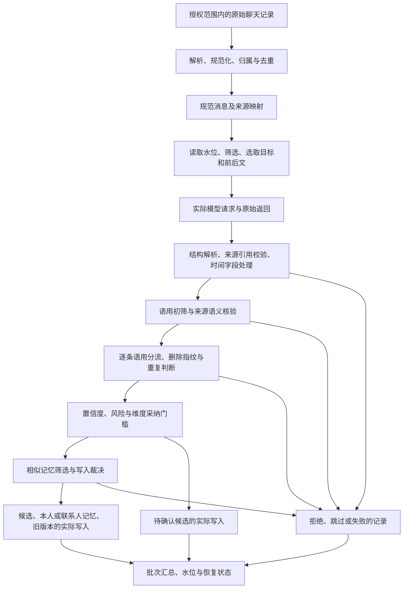

# 记忆提取完整追踪

> 状态：PostgreSQL 全过程记录、默认提取装配和受范围查询／删除已实现并经合成公开入口验证；**App 查看界面待 ADR-039 后续新前端接入**。
> 确认日期：2026-10-07。范围与留存决策见 [ADR-037](../adr/037-complete-memory-extraction-trace.md)。
> 实现状态更新：2026-10-08。迁移 `039`–`043` 与下方代码证据落实后端契约，不补造历史记录，不执行真实私人库迁移或历史重提取。实际捕获缺口继续明确标注。

## 要解决的问题

用户查一条记忆时，需要看到：最初是哪几条聊天、它们怎样成为规范消息、这次模型实际看了多少条及哪些内容、模型实际返回什么、程序怎样处理返回、为什么采纳或拦截、最终写入了哪些记录。

记忆的直接来源引用只指出候选引用了哪些消息。它没有覆盖模型看过的全部上下文、提示词、其他候选、来源语义核验、重复判断、采纳门槛和写入裁决。只有调用时间、模型名、用量和成功状态的出站台账也不能回答这些问题。

因此，每次提取都需要一条可逐步回查的链：**每一步的实际输入 → 执行的处理或规则 → 实际输出 → 下一步输入**。保存采纳结果、待确认结果、拒绝结果、跳过结果和失败过程，不能只保留最终成功的记忆。

## 完整链路

这是程序的处理阶段，不表示模型会为每条聊天再调用一次，也不表示存在一份未返回的中间摘要。没有执行的阶段必须记录跳过原因；发生失败时，后续阶段标为未执行。

## 每一步需要保存什么

### 0. 原始来源进入系统

- **输入**：用户已确认的联系人、来源类型和授权范围，以及实际处理的原始消息记录。
- **记录**：来源内部标识、输入适配器与版本、取得时间、原始消息定位、原始说话人标识、原始时间及其时区信息、原始正文和相关类型字段。导入文件记录消息所在的行或元素；CLI 记录实际消息事件定位及绑定范围。
- **新输入的捕获位置**：对已核对联系人范围、将进入此链路的文字记录，在字段裁剪与规范化前保留取得的记录原文，例如相关 JSONL 行或 CLI 文字事件 JSON；同时保存解析结果。无需复制整文件或整段 CLI 输出。范围校验失败的资料不借追踪持久化为另一联系人的正文。
- **输出**：可定位的原始记录快照与解析结果，能够连接到下一步的规范消息。
- **边界**：只保存本次链路涉及的已授权原始记录，不因追踪读取其他会话或复制无关文件内容。原始视觉帧继续遵守端侧内存处理边界；OCR/转写保存实际文字结果、已有合法来源定位及处理记录，不因本要求新增视觉帧持久化。

原始输入与已经解析的投影必须区分。旧版手动导入的 `raw_payload` 是已解析 JSON 的重序列化，旧版 CLI 的 `raw_payload` 是消息事件的字段投影；它们都不能被描述为原文件字节或完整 CLI 返回。新入口另外保存相关原始 JSONL 行／CLI 事件及当时解析与规范化记录；只有已解析输入的兼容入口明确标为 `parsed_only`。若旧来源缺少更早的输入，只能显示缺失，不能补造原始记录。

### 1. 解析、规范化与消息保存

- **输入**：步骤 0 的原始记录、联系人确认、说话人映射、解析与规范化配置。
- **记录**：从原始记录到 `message` 的映射；说话人如何映射为用户或联系人；时间如何解析、时区如何处理；正文及消息类型有哪些实际转换。记录转换前后值、规则与版本；没有转换也明确记录。
- **过滤与去重**：记录实际采用的去重键、命中消息及来源引用的增补结果。解析失败、未知说话人、非文字、空正文或缺失时间等分别记录发生阶段、记录定位和原因；不能用一个总计代替可定位结果。
- **输出**：实际保存的规范消息版本、消息内部标识、来源引用和保存结果。多条来源合并到同一消息时，保留本次使用的映射。

解析和规范化可能早于提取任务发生。提取追踪应连接当时保存的来源处理记录，不能把后来后台任务步骤的完成时间当成实际解析时间。重复提取可引用同一份受控快照，但必须锁定当时实际使用的版本。

### 2. 读取与构建提取窗口

- **输入**：实际 `owner_id + contact_id`、有效来源范围、提取前水位、批次与上下文配置，以及本次读取的规范消息版本。
- **记录**：读取范围、排序与筛选规则、被筛掉的消息定位及原因；窗口边界怎样由水位和配置计算。记录目标消息、前文、后文的实际数量、内部标识、顺序、正文、说话人和时间。
- **输出**：本批确切的有序消息窗口，逐条标明 `target` 或 `context`，以及实际目标区间与拟推进到的位置。

当前默认是 **20 条目标消息 + 前 20 条 + 后 20 条，最多 60 条聊天消息**。边界、剩余消息和筛选会使实际数量变少；中间 20 条是目标聊天消息，不是已提取记忆。下一批通常复用部分聊天作为上下文，但必须记录实际选择，不能用默认数量推算某次历史请求。

直接引用的消息另列为证据集合。窗口中没有被候选直接引用的消息也可能影响模型，因此它们的实际内容同样必须保存，并进入删除依赖。

### 3. 提取模型请求与原始返回

- **输入**：步骤 2 的窗口，以及本次实际提示词、结构化输出约束和模型配置。
- **调用前保存**：实际消息角色与顺序、完整提示词、渲染后的窗口文本、输出 schema，以及实际发送的模型名、供应商、非秘密参数、工具或结构化输出配置。保存实际内容及版本/内容摘要，内容摘要不能代替正文。
- **捕获层级**：区分应用请求与 SDK 最终序列化的供应商请求。实现时必须覆盖 SDK 添加的 schema、工具定义和包装，保存去除鉴权信息后的实际请求正文；尚未捕获最终请求的记录必须标出缺口，不能宣称已经记录了全部模型输入。
- **调用后保存**：适配器收到的原始响应，包括返回正文、工具调用参数、全部候选及其顺序、非预期字段、格式损坏内容、结束原因和可取得的响应元数据。保存实际返回的用量、耗时、供应商请求标识与对应出站台账标识；估算值必须单独标为估算。
- **失败记录**：超时、网络失败、非法结构、空响应等保存实际错误类别、发生位置和捕获状态。没有收到响应时标为未取得，不能用空候选代替失败。

不能先丢弃非法或被拒绝的候选再保存响应。每个原始候选在业务入库前就需要一个追踪内的稳定标识，保证没有 `memory_candidate` 行的结果也能被查询。

已保存请求表示请求已准备，不证明供应商已执行。发送后超时或进程中断可能使调用结果未知，记录必须保留这种不确定性。只能记录实际可观察的调用和重试，不能假称掌握 SDK 或供应商没有暴露的内部过程。

### 4. 解析候选与程序初步处理

- **输入**：步骤 3 的原始响应和当时的解析/schema 规则。
- **逐条记录**：原始候选位置及全部原字段；解析后的正文、主体、类别、主题、置信度、来源引用、时间、风险和语用字段。字段名以实际模型协议为准，不由日志重新分类。
- **来源校验**：引用是否都位于窗口、是否至少引用一条目标消息，以及其他实际执行的引用校验；每项保存输入、规则、结果和违规引用。
- **程序修改**：记录补充来源时间、计算有效期、添加时间风险等处理的前后值、触发条件与规则版本。必须能分清某个字段由模型返回，还是由程序计算。
- **输出**：通过解析的候选快照，或逐条拒绝/整批失败结果。保存具体校验错误和对应字段，不只保存 `rejected_count`。

无法从损坏返回中拆出候选集合时，在调用级保存原载荷与解析失败，候选数量标为未知，不能记成“模型返回 0 条”。

### 5. 语用初筛与来源语义核验

- **核验选择**：保存每条解析结果的语用解释与分流结果，说明它是否进入本次核验。纯玩笑等不生成记忆的结果也需要保留原候选、程序判断和去向。
- **实际核验请求**：完整保存核验器真正收到的窗口、候选集合、候选顺序、提示词、schema 和非秘密模型参数；不能拿提取请求充当核验请求。
- **实际核验返回**：保存逐候选的 `supported / uncertain / unsupported`、返回理由、证据片段及其定位，连同原始响应与调用元数据。
- **确定性核对**：记录证据片段是否属于指定原消息、片段范围是否有效、候选关联是否完整等实际检查；保存校验失败细节。
- **处理结果**：明确支持者继续原采纳流程；证据不足者添加实际风险后待后续门槛处理；无支持者拒绝。保存修改前后的候选及新增风险。核验不改写候选正文、主体、来源或有效期，不证明现实事实为真。
- **未执行或失败**：记录没有可核验候选、缺少核验器、核验器不可用或返回非法结构等原因，及其实际影响。没有注入核验器时产生的未核验风险也要可见。

模型返回的短理由，例如 `interpretation_reason`，原样保存为“模型返回理由”。它是输出中的一项证据，不是模型内部思考过程。

### 6. 逐条采纳前的跳过与门槛判断

对核验后继续处理的每条候选，记录当前采纳代码实际执行的顺序和结果：

1. **语用分流**：本条是否需要长期记忆、是否可待确认、是否可自动采纳；保存解释所用字段、规则与结果。
2. **已删除指纹**：是否命中禁止重新写入的已有删除记录；只记录实际使用的非正文删除标识、比较结果和规则版本，不恢复被删正文。
3. **重复判断**：是否命中有效记忆或已有待确认候选；保存命中记录标识、实际比较字段和比较方式。相同正文跳过不能被写成“模型认为无价值”。
4. **自动采纳门槛**：保存语用、置信度、风险白名单和维度放行的有效配置、逐项实测值及结论。置信度阈值当前为 `0.7`；维度放行记录实际维度键、放行表及运维开关状态。

遇到提前返回时，后面的检查标为未执行，不能补造检查结果。未通过门槛者写入待确认候选；非记忆、已删除指纹或重复命中等分别标明实际去向。保存具体命中规则，不能仅凭风险标签事后猜测原因。追踪不改变 [ADR-036](../adr/036-per-dimension-adoption-release.md) 的默认空放行表或其他安全门槛。

### 7. 相似记忆与写入裁决

- **输入**：通过自动采纳门槛的当前候选，以及当时实际查询的有效旧记忆集合。
- **筛选**：保存查询的合法范围、旧记忆版本、实际比较字段、相似度计算和阈值、排序及最终 shortlist。只保存程序实际处理的内容；不为追踪额外扩大检索。
- **裁决调用**：如果调用模型，独立保存其完整请求和原始返回。当前裁决输入是候选与 shortlist 中的旧记忆正文/标识，**不接收原始聊天窗口**；日志不能暗示它重新核验过原话。
- **规则路径**：没有相似项或未装配裁决运行时等情况下，记录实际走的确定性路径和跳过调用原因。
- **结果**：分别记录模型提出或程序产生的 `ADD / UPDATE / NOOP`、引用的旧记忆、动作合法性校验和最终执行动作。保存裁决错误、候选拒绝或动作跳过的实际原因。

旧记忆若参与判断，其当时的正文、版本及来源依赖也属于本条链路。仅保存一个可变的旧记忆标识，不能还原后来的比较输入。

### 8. 业务记录的实际写入

- **写入前**：记录准备保存的候选/记忆快照、来源引用、主体归属、采纳方式、版本关系和前序判断。用户本人主张与联系人主张的实际目标存储分别记录。
- **写入后**：记录真实返回的 `candidate_id`、联系人或本人 `memory_id`、状态、采纳方式、保存时间、来源时间与有效期，以及实际提交结果。自动采纳必须是 `auto`，不能标成用户确认。
- **更新旧记录**：记录被替代的旧版本、失效前后状态、新旧版本关联及实际写入顺序；正文被程序改变时保留可比较的前后值。
- **失败**：记录哪个操作已提交、哪个未提交或无法确认。不把“准备写入”当成“已保存”，也不把整批失败当成所有早期写入已回滚。

当前采纳是逐条处理，候选创建与确认有各自的事务边界，尚不能保证整批原子性。晚发生的故障可能留下前面已经写入的候选或记忆。新增追踪必须能准确列出这些部分结果；具体如何把业务写入与追踪持久化可靠关联，是后续实现必须解决的接缝。

### 9. 批次结束、水位、失败与恢复

- **逐条汇总**：每个原始候选都连接到最终去向：自动新增、自动更新、待确认、无支持拒绝、结构拒绝、非记忆、重复、已删除指纹、裁决 NOOP、失败或未执行。
- **批次结果**：实际目标与窗口消息数、原始候选数、各阶段处理数量、已提交记录标识，以及开始/结束时间。零候选也保存完整请求、原始返回和结果。
- **水位**：保存提取前位置、拟推进位置、实际推进后的值和提交结果。当前正常路径在采纳流程成功返回后推进水位；失败记录必须如实说明水位是否改变。
- **恢复**：记录错误类别、实际失败计数、是否跳过、恢复动作和下一次尝试关联。网络错误、模型输出错误、核验错误、裁决错误、业务写入错误和追踪写入错误分开。
- **重试**：保留每次尝试的请求、响应和部分写入，通过稳定关联连接；不能覆盖上次记录，也不能把两次模型返回拼成一次完整成功记录。

新增实现必须保证水位推进与对应追踪记录具有一致的提交结果，不能先推进再尝试保存日志。采用原子提交或等效可靠机制留待实现规格确定；中断造成状态不明时先核对，不能宣称水位未推进或批次已成功。

## 如何把这些记录串成一条链

以下是待实现的记录契约，字段名称可在实现规格中细化，但关联能力不能省略：

| 关联层级 | 必须能回答的问题 |
| --- | --- |
| 范围：`owner_id + contact_id` | 这次提取来自哪位已确认联系人？是否越界？本人记忆写到哪里？ |
| 来源处理记录 → 来源文档/观察记录、绑定、来源引用、`message_id` 与版本 | 规范消息来自哪个原始记录，发生过哪些转换？是否由多来源复用？ |
| `run_id → batch_id → attempt_id` | 哪次任务、哪个目标批次、哪次实际尝试？重试与原尝试是什么关系？ |
| 顺序事件、阶段名、前序事件与输入/输出快照 | 某一步实际使用的是上一步哪个版本的结果？是否缺步骤？ |
| `call_id` 与出站台账/供应商请求标识 | 提取、核验和裁决各是哪一次调用？哪份请求对应哪份返回？ |
| 追踪内候选标识 → `candidate_id` | 原始返回的第几条候选变成了哪条业务候选？没有落库的去了哪里？ |
| `candidate_id → memory_id` 与旧/新版本 | 最终记忆由哪个候选及哪次决策产生？是否替代了旧记忆？ |
| 内容来源依赖 → 所有含正文快照 | 删除某一来源时，需要清除哪些请求、返回、旧记忆快照与派生解释？ |

每个阶段至少有：开始/结束时间、执行状态、输入和输出的完整内容或不可变快照引用、代码/规则/提示词/schema 版本、确定性判断及实际副作用。提交号不足以标识未提交代码时，还需记录实际代码版本差异的内容摘要；这不是把源码和秘密配置整体复制进聊天记录。

不可变快照引用必须能取回当时的内容，且与来源一起删除。只有条目标识、内容摘要或可变业务行引用不满足完整追溯。列表和明细按授权范围查询，不能用一个不校验 owner/contact 的全局标识读取私密正文。

## 用户查看一条记忆时应该看到什么

从最终记忆可反查到原始候选、各阶段和确切输入窗口；从原始消息可正查到引用或使用它的提取批次及结果。无最终记忆的候选仍可从批次中查看。最少需要以下内容，具体界面不在本次确定：

1. 最终正文、状态、类别、主题、主体与采纳方式。
2. 直接证据消息，以及单独展示的全部目标消息/前后文，包含顺序和实际条数。
3. 原始来源 → 规范消息的转换、定位和当时版本。
4. 每次提取、核验、裁决的实际请求与原始返回。
5. 程序逐步添加/修改的字段、命中门槛、重复判断、相似记忆和动作依据。
6. 最终落库记录、旧版本、水位、失败/重试与缺失步骤。

“为什么得到这条记忆”由这些原始记录支撑。以后可从记录整理一份解释，但必须标为事后解读、链接所依据的阶段，不能把它冒充模型当时的返回理由。完整输入输出能定位不受原话支持的扩展在哪一步出现，不能承诺取得模型未返回的内部推理或保证重新调用得到相同结果。

### 合成示例：定位多出来的信息

以下只演示如何查记录，**不是实际运行日志，也不包含私人聊天**：

| 顺序 | 当时实际内容/结果（假设） | 能定位到什么 |
| --- | --- | --- |
| 原消息 | 联系人问“最近在学摄影吗？”；用户答“修车花了 3000，先缓缓。” | 原始记录、说话人、时间和来源定位。 |
| 窗口 | 本次只选了这两条，用户这条是目标，另一条是上下文。 | 实际是 2 条输入，不凭默认配置说是 60 条。 |
| 提取返回 | 模型返回“用户买镜头花了 3000”，引用用户消息。 | “买镜头”首次出现在提取返回，直接引用合法并不意味着内容受支持。 |
| 程序处理 | 解析通过，来源引用检查通过；保留原正文。 | 程序没有把“修车”改成“买镜头”。 |
| 核验返回 | 假设返回 `uncertain`，给出理由和证据片段。 | 可以逐字查看核验器看了什么、为何这样标注。 |
| 门槛与写入 | 不满足自动采纳门槛，保存待确认候选及实际阻断规则。 | 明确为何进入 pending，而不是仅按风险标签猜测。 |

若某次核验返回 `unsupported`，记录应体现拒绝且没有业务候选；若发生错误采纳，必须如实显示当时每道门的结果和最终写入。追踪本身不把错误内容变成正确事实。

## 保存、失败与删除

以下政策由用户确认，决策依据与取舍统一见 [ADR-037](../adr/037-complete-memory-extraction-trace.md)：

- **全部默认保存**：所有实际执行的记忆提取入口都适用，包括历史导入、后台增量、CLI 和人工触发；不是只在调试或发现错误时打开。
- **持续保留**：没有自动到期时间；一直保留到用户手动删除相关追踪记录或删除来源。主动删除追踪记录不等于删除权威记忆，但相关记忆必须显示追溯记录已被删除。
- **写入失败停止本批**：请求与输入记录可靠保存后才能进入相应模型调用；响应和阶段结果可靠保存后才能继续使用。发现追踪写入失败，停止后续调用、处理和新的业务写入，不推进本批水位。保留此前已经保存的记录与已提交业务结果，明确标出失败位置和不完整状态。

追踪写入错误不能算成模型“输出非法”，不能累积到 [ADR-029](../adr/029-extraction-failure-recovery.md) 的自动跳过策略。重试前须核对已有业务写入，避免重复保存；不能因水位未推进就假定此前无结果。

如果故障导致追踪存储本身不可写，当前执行必须返回明确的 `trace_write_failed`，通过不含正文的运行状态暴露失败；恢复后核对并标注未完成记录。不能承诺把故障写进同一个已经不可写的存储，也不能把尚未保存的响应说成已留存。日志故障或进程中断后的业务提交状态不明，需要如实标为待核对。

### 含正文追踪是独立的敏感资料

完整追踪与只保存元数据的 `outbound_ledger`、普通运行日志分开。含正文资料进入受控存储，不打印进控制台、普通日志、Git、公开评测或自动外部上传；连接密钥、鉴权头和数据库凭据不得写入。任何脱敏、截断或捕获缺失都要说明发生的位置，不可把经过删改的载荷称为完整原请求。

保存的是既有授权处理的资料，记录需求不扩大模型发送范围或联系人读取范围。未来云端存储接入仍遵守现行隐私与准入要求；本文没有证明加密、云端部署、完整查询或删除已经实现。长期保存会增加敏感副本与容量占用；容量或存储故障不能通过悄悄关闭记录来维持提取。

### 删除依赖覆盖全部输入

来源删除时，追踪清除范围必须覆盖原始与规范消息快照、**全部目标与上下文消息**、实际使用的旧记忆及其来源依赖、模型请求/响应、证据片段、规则解释、缓存和导出副本。仅按候选直接引用的 `source_message_ids` 清除会遗漏模型看过的聊天。

本次采用保守规则：某份追踪使用了被删来源的内容，就清除受影响整份追踪的含正文内容及可恢复副本；同一消息还有其他来源时，权威消息/记忆仍按原有多来源规则处理，不能为保留追踪而保留应删除的来源副本。保留的非正文删除凭证遵守现行隐私规范，不保留可恢复摘要、原文件名或聊天内容。

手动删除追踪、来源删除，以及联系人/账户范围的数据清除，都需要覆盖可恢复副本并验证不可再检索；删除任务失败保留执行中/失败状态，不能提前标为 `deleted`。本文记录删除契约，不授权现在删除任何真实资料。[ADR-031](../adr/031-source-deletion-retains-minimal-ledger.md) 的来源删除后保留最小出站台账规则继续有效，不能借台账保留追踪正文；联系人和账户删除时的台账规则仍由原规格另行确定。

用户删除单条候选或记忆时，其派生内容继续按现行删除规则清理，追踪中的正文快照和解释也纳入清理，不能从记录里静默恢复已删除的资料。

## 当前后端实现与缺口

下表区分已保存的实际处理与不能复原的历史／外部信息。验证使用合成资料，不证明真实模型、真实微信或新 App 界面已经验收。

| 当前环节 | 代码证据 | 已实现行为与边界 |
| --- | --- | --- |
| 历史导入 | [导入命令](../../src/notalone/ingest/import_command.py)、[来源处理存储](../../src/notalone/persistence/source_processing.py)、[规则文件适配器](../../src/notalone/source_processing/rule_capture.py) | 保存相关原始行、实际解析／校验／规范化输入输出及映射，来源与消息在同一事务提交；导入仍拒绝文件内重复或既有重叠，不改为合并。失败仅存具体安全类别、字段、规则与位置；执行边界取得实际时刻和当时文件摘要，快照构造只接收摘要和时刻。 |
| CLI 增量 | [CLI 适配器](../../src/notalone/wechat_cli/adapter.py)、[观察持久化](../../src/notalone/persistence/observation_store.py)、[来源处理存储](../../src/notalone/persistence/source_processing.py) | 保存实际事件、转换与去重决定、消息／来源引用映射；非文字／未知事件标明过滤原因。只处理已授权记录，不复制整段 CLI 输出；增量入口不新增提取调度。 |
| 原处理时间 | [导入命令](../../src/notalone/ingest/import_command.py)、[Worker](../../src/notalone/tasks/worker.py) | 原处理记录连接到提取使用的快照，保留实际处理时间与版本；后台 `parse / normalize` 步骤记账仍不是原解析时间。 |
| 消息读取与窗口 | [读取支持](../../src/notalone/memory_extraction/cli_support.py)、[批次命令](../../src/notalone/memory_extraction/command.py)、[追踪存储](../../src/notalone/persistence/extraction_trace.py) | 保存实际水位、消息版本、排除规则、20 + 20 + 20 窗口、顺序与 target 标记；保存前在范围锁内核对实际缓存的消息、来源与 ref 存活和原始投影，拒绝已删缓存，保留活来源与真实处理链缺口；没有重新读取扩大范围。 |
| 模型调用 | [捕获边界](../../src/notalone/memory_trace/transport.py)、[生产组装](../../src/notalone/memory_extraction/cli_support.py) | 分别保存 E/V/A 的提示词、schema、参数与原始返回；真实 SDK HTTP hooks 保存最终序列化正文、供应商返回及可观察重试，不保存鉴权头。未进入该 transport 的适配器标为 `not_observable`。 |
| 解析、时间与核验 | [提取流程](../../src/notalone/memory_extraction/flow.py)、[核验适配器](../../src/notalone/memory_extraction/verification_adapters.py) | 原始响应先保存，再记结构解析、来源契约、字段变化与逐候选核验，包含拒绝、失败与未执行结果。 |
| 采纳与裁决 | [采纳流程](../../src/notalone/memory_extraction/adoption.py)、[裁决适配器](../../src/notalone/memory_extraction/adjudication_adapters.py) | 保存稳定候选标识、语用分流、删除指纹、重复、门槛、shortlist 与 ADD/UPDATE/NOOP；手输本人资料的 owner 归属标识不充当来源，仍以自身 memory_id 绑定删除；其他真实来源继续复验。不改变默认空放行表、提示词或预算。 |
| 业务写入 | [追踪存储](../../src/notalone/persistence/extraction_trace.py)、[记忆存储](../../src/notalone/persistence/memory_store.py)、[操作关联迁移](../../database/migrations/043_extraction_trace_record_operations.sql) | 保存写入意图、返回／权威记录回执与部分提交；联系人及本人旧记忆失效计划也关联实际 ID，按 invalidated 状态核对提交，原行仍 active 时不能因行存在就报失效成功。结束记录和水位同事务提交；回执丢失显示未知／待核对，不假称回滚。 |
| 调用台账 | [上下文与补账](../../src/notalone/memory_trace/context.py)、[最小关联迁移](../../database/migrations/042_extraction_trace_call_receipts.sql) | 正常、停止和来源删除后的实际调用关联同一 `call_id`／台账 ID，区分 received／returned／unavailable 与 consumed／not_adopted；提交回执未知不另造补账。不保存正文，正文删除后只保留最小关联。 |
| 查询与删除 | [查询服务](../../src/notalone/application/trace_service.py)、[HTTP](../../src/notalone/server/app.py)、[CLI](../../src/notalone/memory_trace/command.py) | 默认查询装配不需要模型；授权批次列表稳定分页、详情和候选／记忆反查；消息正查引用或使用它的提取批次，包括仅上下文、零候选与失败。来源处理仍使用独立资源。区分已删、未记录及手输不适用，人工确认模型候选仍可反查。所有 HTTP 追踪响应 no-store，越界／不存在统一 404。App 界面尚未实现。 |

043 前已有窗口可以按实际已保存的消息标识正查；清除这类窗口前只保留无正文标识关联，继续显示已删状态。早已清除且未保存关联的历史无法补造，仍保留 `not_recorded`。生产与合成追踪的错误码／状态使用[同一纯映射](../../src/notalone/memory_trace/status.py)。

规范化还有以下当前差异，需要按实际输入与版本记录，不能统一写成“清洗了一下”：

- 历史导入：`is_from_me` 映射说话人；要求 `time_iso` 带时区且与 `create_time` 对应，失败则拒绝文件；保存媒体占位文字，但占位不等于媒体内容。
- CLI：`is_from_me` 映射说话人，文字原样使用；优先由 `create_time` 转 UTC，否则使用 `time_iso`，当前对不带时区的值赋 UTC；完全缺失时间保留未知，不补成读取时间。
- 提取读取：已经保存的系统/未知说话人、空正文或无时间消息仍可能被排除，因此“消息已保存”不能证明“模型曾读到它”。

已有事后审计、附近消息补查、数据库现状和进度文件只能按各自内容提供部分证据，标为“事后重建/历史缺失”。没有保存原请求的批次，不能利用现在的消息重算后宣称找回当时的输入或模型理由。

## 实现时的验收要求

只使用合成资料验证，至少覆盖：

1. 一条记忆能反查到当时完整输入和所有实际阶段；多条候选共享一次提取调用仍分别可追踪，被拒/重复/非记忆结果没有业务行也可查。
2. 默认 20 + 20 + 20 与不足窗口分别核对真实数量、顺序、目标标记、引用集合及水位；未知说话人、空正文、缺失时间和去重的具体处理可定位。
3. 原始模型返回与解析后结果分别保存；非法 JSON、错误引用、核验不支持/证据不足、时间风险、缺核验器、门槛拦截和未执行阶段均可区分。
4. 相似筛选、规则直达 ADD、模型 ADD/UPDATE/NOOP、旧记忆失效、新旧关联及本人/联系人目标都能回查到当时的内容与有效配置。
5. 在调用前、收到响应后、业务写入前后及水位更新处注入追踪故障，验证停止后续动作、不推进水位、保留已有记录、暴露部分写入及恢复关联；不会触发模型非法输出的自动跳过。
6. 跨 owner/contact 查询被拒；删除一条仅作为上下文的来源仍清除受影响追踪；旧记忆来源、重试快照、缓存及导出副本也被清除，最小台账无正文。
7. 零候选、超时、重试、进程中断、来源已删、手动删除追踪和历史缺失分别展示真实状态；不会伪造完成、内在推理、加密或历史复现能力。

后端实施与验收记录见 `.scratch/memory-extraction-trace/issues/01-extraction-trace.md`、`02-source-processing-trace.md`、`03-app-and-all-entrypoints.md`。公开 HTTP 验收覆盖默认 priority 装配、原行到记忆反查、零候选、停止／晚响应、来源删除、故障恢复与翻页；真实已安装 SDK 的本地 HTTP transport 另验证 E/V/A、tools、thinking 与可观察重试。两个验证层分别提供证据，不据此宣称真实外部服务集成完成。App 验收随新前端接入，当前任务保持未完成 UI 状态。
