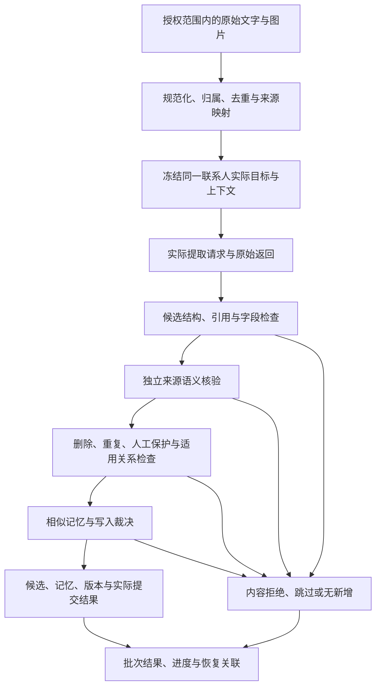

# 记忆提取完整追踪

本文规定每次实际记忆提取的追踪、查询、留存与删除合同。默认记录实际执行的协议和图文输入；旧语用／置信度／维度门、固定 20 + 20 + 20 窗口及 Python 实现记录见[历史协议与实施记录](../history/memory-trace-implementation-notes.md)，不作为当前默认流水线。

## 1. 目标与默认边界

用户查一条记忆时，应能回看原始资料、规范化转换、本次模型实际看到的全部材料与原始返回、程序逐步判断、裁决及实际写入。直接证据引用只说明候选引用了什么；它不能代替完整模型上下文，出站台账的时间、模型名和用量也不能代替追踪正文。

每一步保存**实际输入 → 执行规则或处理 → 实际输出 → 下一步输入**。自动采纳、待决定、拒绝、跳过、无新增及技术失败都要记录，不能只保存最终成功的记忆。

- 所有实际提取入口默认保存追踪，包括已授权历史、后台增量及人工触发；无需先开启调试。
- 追踪只处理本次已授权范围，不扩大联系人读取、模型用途或资料出站范围。
- 没有自动到期时间，保留至用户手动删除追踪或按来源、记忆、联系人／账户删除范围清理。主动删除追踪不等于删除权威记忆，记忆须显示追踪已删除。
- 记录实际可观察内容。缺失、截断、脱敏、兼容投影、供应商未知回执和未执行阶段均明确标识，不能补造原请求、模型内部思考或旧阶段成功。
- 来源支持不等于现实事实为真，完整记录不保证重新调用会产生相同结果，也不证明模型质量达标。

依据：[ADR-037](../adr/037-complete-memory-extraction-trace.md)、[ADR-085](../adr/085-source-verified-automatic-adoption.md)、[ADR-197](../adr/197-chat-image-and-memory-image-input-consolidated.md)。

## 2. 当前处理链

图表示记录对象之间的关系，不要求每条聊天分别调用模型。按实际协议保存顺序、并发尝试及跳过原因；技术故障处停止后续动作，未执行阶段不能填成通过。

默认自动路径在结构与独立来源核验通过后，按适用检查进入新增、更新、合并或跳过裁决，不因语用、置信度或风险标签单独增加人工门。关系未知及未解决矛盾的既有待定例外仍须记录具体原因，不能把所有拒绝写成 `pending`。

候选级结构不合格或来源语义不通过，是正常内容拒绝；全部被拒也记录 `no_new_memory` 及实际拒绝条数，并在可靠提交后继续后续批次。模型未配置、认证／服务错误、整体协议或证据合同异常、未知调用回执、来源删除和授权撤销属于技术或资格故障，保持受阻或暂停，不能伪装成无新增。具体处理状态由[记忆处理流程](memory-processing.md)定义。

## 3. 各阶段必须记录的内容

### 3.1 原始来源与规范化

| 环节 | 记录要求 |
| --- | --- |
| 范围与来历 | 已确认联系人、来源类型、授权范围、输入适配器及版本、实际取得时间。 |
| 原始记录 | 本次涉及记录的原始定位、说话人、原始时间与时区、正文、消息／媒体类型；文件来源记录行或元素，CLI 来源记录实际事件及绑定范围。 |
| 捕获层级 | 区分相关原始字节、原始事件与已解析字段投影；仅有解析结果的入口标为 `parsed_only`，不能将重序列化 JSON 冒充原文件。 |
| 转换 | 说话人映射、时间解析、正文／类型转换的前后值、规则与版本；没有转换也明确说明。 |
| 过滤与去重 | 实际去重键、命中消息、来源引用增补结果；失败或筛除的阶段、记录定位与具体原因，不用总计代替逐条结果。 |
| 输出 | 真实保存的消息标识、版本、来源引用与处理结果；多来源复用同一消息时保留本次映射。 |

只保存此链路涉及的已授权原始记录，不复制整文件或无关 CLI 输出。范围核验失败不能借追踪保存另一联系人的正文。解析可能早于提取；后台记账时间不能冒充原处理时间。重复提取可引用同一受控快照，但须锁定实际使用版本。

前台原始视觉帧继续只在端侧内存处理，不因追踪新增保存或上传。OCR／转写记录实际结果及已有合法来源；聊天图片与前台画面是不同资料来源。

### 3.2 固定窗口与图文输入

记录实际 Owner、联系人、有效来源范围、处理前水位／检查点、批次配置、排序筛选规则，以及本次选取的目标和上下文。逐项保留消息标识、版本、顺序、正文或内容快照引用、说话人、时间、`target`／`context` 角色和实际数量；被筛掉的项目记录定位及原因。

同一联系人、同一固定窗口中的聊天文字与实际图片共同参与模型输入。图片保留所属消息、内容插件及版本、实际文件身份、内容哈希和来源代次，并进入核验、追踪与删除依赖。没有图片、读取失败或已清除时记录实际状态；占位文案不能证明模型看过图片，文字处理数量也不能代替图片进度。

目标／上下文及媒体预算由正式处理配置决定，追踪记录实际值，不按某个历史默认窗口推算。候选直接引用的证据另列集合；未被引用但参与模型输入的上下文也须可追溯并承担删除依赖。保存／展示图片不等于已发送模型，更不单独触发记忆调用。

### 3.3 提取请求与原始响应

调用前保存实际消息角色与顺序、渲染后的图文窗口、完整提示词、输出 schema、实际模型名与供应商、非秘密参数、工具或结构化输出配置。内容或可恢复的不可变快照引用必须能还原当时实际输入，内容摘要不能代替正文或图片。

区分应用请求与 SDK 最终序列化的供应商请求，记录可观察到的 schema、工具定义及包装，去除鉴权信息。没有捕获最终请求时标明缺口，不能宣称掌握全部发送内容。图片引用须绑定当时文件版本；可变文件路径不是完整快照。

调用后先保存适配器收到的原始响应，再解析和筛除候选，包括返回正文、工具参数、全部候选及顺序、非预期字段、格式损坏内容、结束原因和可取得的响应元数据。记录实际用量、耗时、供应商请求标识和出站台账关联；估算值单独标明。

没有收到响应时记录错误、发生位置和捕获状态，不能用空候选代替失败。已保存请求只说明准备完成，不证明供应商执行；发送后超时或中断可能产生未知回执。只记录实际可观察的调用和重试，不推断 SDK 或供应商内部过程。

每个原始候选在业务入库前取得稳定追踪标识，未形成 `memory_candidate` 的结果也可查。无法拆出候选集合时保留原载荷及解析失败，候选数量为未知，不记为返回零条。

### 3.4 候选解析、引用与时间

逐项保存原始位置和字段、解析后的正文、主体、类别、主题、来源、时间、置信度、风险及协议实际使用的其他字段。校验引用是否在本窗口、是否涉及目标消息及当前来源合同要求；保存每项规则、输入、违规定位及结果。

程序补充或调整字段时，保存前后值、触发条件和规则版本，区分模型返回与程序计算。单条结构问题记录内容拒绝；整体返回不可解析、来源绑定不成立等协议故障独立记录。

发生时间 `event` 是可选标注。按当前核验协议，不具备结构或逐字段支持时丢弃该标注，并在核验结果及执行事件记录 `time_unverified`；其余正文按自身证据判断。正文、主体、分类、语义、`valid_at`／`invalid_at` 和 `conditions` 仍须来源支持，不随发生时间降级。顶层核验结论整体不确定时也不能私自升级为通过；丢弃的结构化时间不能用于时间检索。

`time_unverified` 不写入记忆事实字段。没有来源依据的时间、有效期或条件保持未知；不以读取、采纳或系统当前时间补造事件发生。依据：[ADR-081](../adr/081-source-grounded-memory-time-and-conditions.md)、[ADR-150](../adr/150-optional-event-time.md)。

### 3.5 独立来源核验

- 保存本次进入核验的确切候选及选择原因；未进入者也保留原候选和实际去向。
- 独立保存核验器真正收到的窗口、图像、候选顺序、提示词、schema 与非秘密参数，不能拿提取请求冒充核验请求。
- 保存实际原始响应、逐候选结论、字段判定、理由、证据片段或类型化图片证据及定位，连同调用元数据。
- 保存引用范围、原消息对应、证据片段、图片版本和候选关联的确定性检查，失败有具体位置。
- 核验不改写正文、主体、来源或事实有效期。支持的候选继续适用检查；证据不足或不支持按内容拒绝处理，技术故障按故障处理，不普遍转成人工待办。

模型返回的短理由原样标为“模型返回理由”，不是内部思考过程。无核验器、无候选、不可用或返回协议异常时记录实际影响，不能伪造核验结果或仅添加风险后继续默认自动采纳。

### 3.6 采纳检查与写入裁决

按实际执行顺序保存检查输入、有效配置、结果和去向：

- 删除指纹及禁止重写记录，只保留实际非正文标识和比较结果，不恢复已删正文。
- 有效记忆／既有候选的重复命中、被比较字段与方式，不能将确定性重复跳过写成模型认为无价值。
- 人工修正、否决、停用、来源与版本保护；适用关系、条件、时间及金额方向等来源一致性检查。仅记录本协议实际执行的规则，不补造历史阈值或空维度门。
- 对相似记忆查询保存范围、当时正文及版本、来源依赖、比较字段、阈值、排序和 shortlist；不为追踪额外扩大检索。
- 模型裁决独立保存实际请求和原始返回。涉及新旧来源或关系核验时记录实际参与资料、核验和事务版本复验；确定性直达或跳过调用也说明原因。
- 保存提出的新增、更新、合并、跳过等动作、引用对象、合法性校验及最终执行动作，区分建议与提交结果。

提前返回后的检查标为未执行。窄关系待定分支保留具体依据；语用、置信度、风险标签本身不成为默认人工门。显式历史协议或冻结重放在其独立记录中注明协议，不修改历史成绩，也不冒充当前默认行为。

### 3.7 业务写入、进度与恢复

写入前记录候选／记忆快照、来源、主体、自动或人工来历、版本关系与前序判断。写入后记录真实返回的候选、本人／联系人记忆标识、状态、采纳方式、保存时间、来源时间、有效期及提交结果。自动采纳标为 `auto`，不能标成用户确认。

更新记录保留旧版本失效前后状态、新旧关联与实际顺序。部分提交、未提交和未知回执分别记录，不能将准备写入当成已保存，也不能因批次失败就宣称早期写入全部回滚。

每条原始候选连接到最终去向；批次汇总实际输入与候选数量、内容拒绝数、已提交记录、各阶段状态及起止时间。零候选或全部内容拒绝也保留请求和原始返回，可靠记录 `no_new_memory` 后推进适用进度；正常内容拒绝不构成处理失败。

记录处理前位置、拟推进位置、实际提交的位置和结果。进度与对应追踪须具有一致的可靠提交结果，不能先推进再尝试写日志。恢复时保留错误类别、部分写入、原尝试与下一尝试关联，未知回执先核对。每次重试保留独立请求和响应，不能覆盖原记录或拼成一次虚假成功。

## 4. 关联与查询合同

| 关联 | 必须能回答的问题 |
| --- | --- |
| Owner、来源联系人、实际记忆归属 | 本次来自谁，是否越界，本人记忆写到哪里？ |
| 原始来源、绑定、来源引用、消息与版本 | 原消息经历了什么转换，是否多来源复用？ |
| 轮次、任务、批次、步骤与尝试 | 哪次固定输入，哪次调用，重试与原尝试什么关系？ |
| 有序事件、阶段、前序结果与快照 | 每步用了哪个版本的输入，哪些未执行？ |
| 调用、出站台账与供应商标识 | 提取、核验、裁决各用哪次请求与响应？ |
| 追踪候选、业务候选、记忆与版本 | 每条原始候选的最终去向，是否替换旧记忆？ |
| 内容依赖及全部受管副本 | 删除来源时需清除哪些请求、响应、图片、解释和恢复副本？ |

阶段记录至少包含起止时间、执行状态、完整输入输出或不可变快照引用、代码／规则／提示词／schema 版本及实际副作用。提交号不能标识未提交改动时，记录实际差异摘要；不复制全部源码或秘密配置。可变业务行标识或摘要不足以替代当时内容。

列表、明细及正反查询都受 Owner／联系人授权约束。从记忆反查来源和阶段，从消息正查所有使用它的批次，包括仅作上下文、零候选与拒绝结果。无业务行的候选仍可由批次查询；缺失、已删和手录不适用分别展示，不能利用现在的数据重算并宣称还原历史输入。

日常“查看依据”只展示能明确关联的直接证据；不能把整批窗口冒充直接引用。完整调试视图提供实际目标／上下文、来源转换、各次请求响应、程序变更与裁决、最终写入及恢复链。事后解释须标为解读并链接依据，不冒充模型当时返回。

HTTP 追踪响应使用 `Cache-Control: no-store`，查询与展示不得跨范围缓存正文。切换范围、断线、读取失败或来源失效时清除旧展示，迟到响应不回填；含正文调试内容仅提供给受信任的管理入口。具体界面入口与可用状态按当前桌面实现核验，不沿用旧 Python 页面路径宣称已接入。

## 5. 保存失败与删除

### 5.1 写入失败即停止

请求与输入可靠保存后才能进入模型调用，响应与阶段结果可靠保存后才能继续使用。追踪写入失败停止后续调用、处理和新的业务写入，不推进本批进度；保留此前已保存记录和已提交业务结果，标明失败位置及不完整状态。

该故障不能记为模型输出非法，也不能按旧非法批次计数自动跳过。存储本身不可写时返回明确的 `trace_write_failed`，通过不含正文状态暴露；恢复后核对已有写入。不能承诺将故障写进同一个不可写存储，或把尚未保存的响应称为已留存。

### 5.2 正文与普通台账分离

完整追踪是受控本机敏感资料，与普通日志及仅元数据的 `outbound_ledger` 分开。正文、图片、请求与响应不打印到控制台、Git、公开评测或自动外部上传；不保存连接密钥、鉴权头和数据库凭据。长期留存会增加副本和容量需求，容量故障不能通过静默关闭追踪维持提取。

本合同不证明已实现加密，也不扩大既有模型发送范围。捕获、查询和删除能力按实际验证记录确认。

### 5.3 删除覆盖实际全部输入

来源删除清除受影响的原始与规范消息快照、全部目标及上下文、实际参与的旧记忆及来源、图片文件或受管引用、请求／响应、证据、规则解释、缓存、导出和恢复副本。仅按候选直接引用消息清理会遗漏模型看过的内容。

某份追踪使用被删来源时，保守清除整份受影响追踪的含正文内容及可恢复副本。消息仍有其他合法来源时，权威消息／记忆按多来源规则处理；不能为保留追踪而保留应删除来源的副本。

手动删除追踪、来源删除、单条候选或记忆删除，以及联系人／账户清空，均按其派生依赖清理并验证不可再检索。失败保留执行中／失败状态，不提前标为已删。最小删除凭证不含正文、可恢复摘要或原文件名，记录不能静默恢复已删除资料。

单份来源删除保留允许的最小无正文调用记录；整联系人／账户删除清除对应调用记录和可恢复副本。共用范围规则见[隐私与删除](privacy-deletion.md)，追踪不能借台账例外保留正文。

## 6. 实现与验证入口

当前 TypeScript／SQLite 承接入口见[执行与追踪](../../backend-ts/src/memory/sqlite/execution.ts)、[追踪 HTTP](../../backend-ts/src/memory/sqlite/http.ts)及[图文内容适配](../../backend-ts/src/memory/content/README.md)。旧迁移、固定 Git 源码与页面验收仅供[历史追溯](../history/memory-trace-implementation-notes.md)。本轮文档整理不构成新的模型、桌面或真实微信验收。

最小验证范围：

1. 正反查询能还原实际图文窗口、阶段与每个候选去向，拒绝或无业务行结果仍可查；目标／上下文与来源依赖完整。
2. 实际请求和原始响应分别保留；非法整体协议、单候选拒绝、可选时间降级、技术错误与未执行状态可区分。
3. 相似筛选、确定性分支、模型裁决、版本失效及本人／联系人目标均能对应到当时输入和提交。
4. 调用前后、业务提交和进度更新处的追踪故障停止后续动作，保留部分提交和未知回执，恢复不重复写入。
5. 全部候选被拒可靠记录无新增并继续，技术故障保持受阻或暂停；重试不覆盖原记录。
6. 跨 Owner／联系人查询拒绝；仅上下文来源、实际图片、旧记忆、重试、缓存和恢复副本参与完整删除；最小台账不含正文。
7. 零候选、来源已删、手动删追踪及历史缺失展示真实状态，不伪造模型内部推理、加密或历史复现能力。
