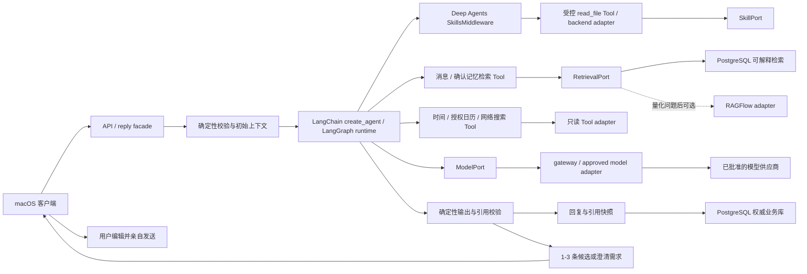
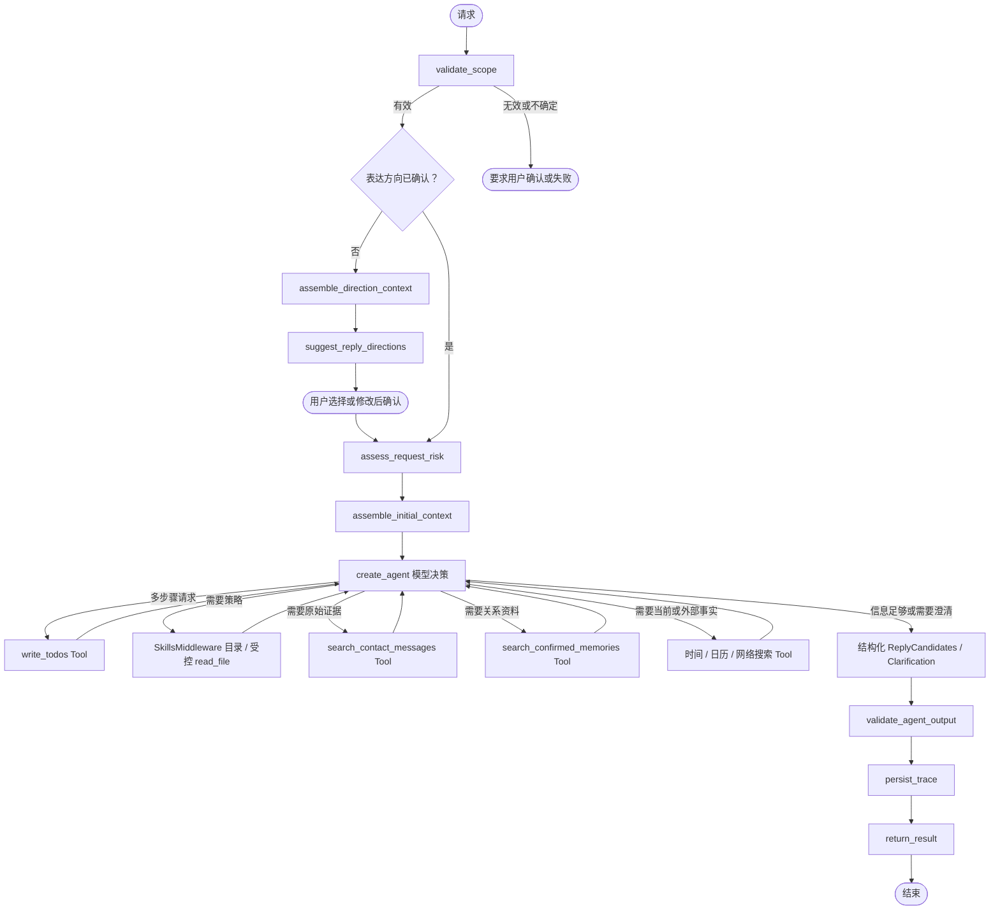

# Agent 编排与检索运行时（草案）

> 状态：草案。本文定义候选回复、未来 Tool 和长任务的运行时边界；不表示任一框架方案已经完成生产集成。现行已采纳决策仍见 ADR-006、ADR-009 和 ADR-010；下方第 0 节记录 2026-08-22 提出的 DeepSeek Harness 暂定方向，尚未替代这些 ADR。

## 0. 2026-08-22 运行时方向讨论记录（未采纳）

本节记录当天上午提出的阶段性选型方向，以及同日稍后逐项复议后的收敛结论（见 0.4）。本节不改变现行 ADR，也不代表已经完成框架 POC、真实模型调用或端到端验证。

### 0.1 分层决定

NotAlone 暂定把 DeepSeek Harness 作为通用 Agent Runtime，把 NotAlone 保留为业务插件和 Python 领域服务：

```text
DeepSeek Harness
  Agent Loop / Tool / Skill / Context Compact / Subagent
  Session / Permission / Hooks / MCP / Runtime

TypeScript or JavaScript bridge plugin
  verified scope injection
  NotAlone Tool registration
  candidate output bridge

Python NotAlone service
  contact binding and owner_id + contact_id isolation
  RetrievalPort and relationship memory
  source provenance, deletion and candidate validation

PostgreSQL
  authoritative business state
```

DeepSeek Harness 负责通用运行机制；NotAlone 不重新实现 Agent Loop、Tool 执行管线、Skill Loading、Context Compact 或 Subagent。原生 Harness 插件需要 TypeScript/JavaScript；现有 Python 业务可以通过薄桥接插件、受控 JSON-RPC/HTTP 服务或 Python MCP Server 接入。Python SDK 负责从外部进程驱动 Harness，不等同于同进程 Cordis 插件。

### 0.2 NotAlone 不外包给 Harness 的边界

- `owner_id + contact_id`、联系人确认和会话绑定必须由 NotAlone 确定性代码验证，不能由模型或 Harness Session 推断。
- `message`、`memory_candidate`、`confirmed_memory`、`reply_candidate`、来源证据和删除状态继续由 PostgreSQL 管理；Harness Session、压缩摘要和 checkpoint 只是可重建运行状态。
- NotAlone 通过受控只读 Tool 暴露 `search_contact_messages` 和 `search_confirmed_memories`；Tool handler 再次验证范围、来源状态、数量和删除状态。
- 候选回复必须通过 NotAlone 的结构、引用和风险校验；外部聊天发送不注册为 Tool，最终消息仍由用户手动编辑和发送。

### 0.3 采用前置验证

新方案只有在合成数据 POC 通过后，才进入 ADR 复审：

1. 两个联系人和两个 owner 的检索不会串库；模型不能通过 Tool 参数扩大范围。
2. Harness Context Compact、Session resume 和 Skill Loading 不会恢复已删除来源或旧联系人范围。
3. Python 领域服务与 TypeScript/JavaScript bridge 的失败、超时、重试和幂等行为可观察且不会产生未落库候选。
4. 运行时默认不挂载 Shell、文件系统、网络搜索、Subagent 或外部发送能力；确需启用时逐项配置和审计。

在上述验证完成并新增 ADR 前，ADR-009 的 LangChain `create_agent` 仍是当前已采纳的候选回复运行时决策；本节只是允许以 DeepSeek Harness 作为替代 Runtime 做隔离 POC。

### 0.4 同日复议结论：维持现行 ADR，Harness 不进入主线

同日就"是否改为在 DeepSeek Harness 等开源 Harness 上做插件"逐项对照后收敛如下，本结论与 `research/agent-runtime-options-notalone.md` 的排序一致：

1. **能力对照**：Harness 能力清单中 NotAlone 需要的部分（Agent Loop、Tool 执行、Skill 加载、多模型适配）已有 LangChain `create_agent` + Deep Agents 等价实现在跑（ADR-009/010）；NotAlone 真正独有且无开源替身的部分——联系人隔离、来源证据、删除级联、人工发送——不在任何 Harness 的能力清单上。"能力都有"不等于"能力按 NotAlone 的约束运行"：把开放式 Harness 裁剪进有界笼子的工作量与风险不小于自建薄运行时层。
2. **插件形态的真实成本**：原生插件需 TypeScript/Cordis，Python 领域服务仍需自建并加桥接层；DeepSeek Harness 官方仍为 developer preview。两条路线的领域服务都要自写，差别只在运行时层，当前路线无桥接层且已完成。
3. **Context 压缩不需要**：候选回复任务的上下文为常数大小（近期会话窗口 + 检索命中 + 相关记忆），不随聊天时长线性增长；会话内连续性由检索窗口参数承接，跨时间连续性由关系记忆（含时效性近期状态）承接。压缩摘要丢来源、不可解释（与 ADR-005 冲突）且可能残留已删除内容。
4. **Subagent 与沙箱无对应任务**：记忆提取与关系分析是确定性批处理 pipeline，由 ADR-007 Worker 承接；候选生成无可执行代码，无沙箱需求，且方向恰与"默认不挂载执行能力"（0.3 第 4 条）相反。
5. **触发条件不变**：仅当出现长周期、沙箱、可恢复多轮工具执行等已证明需求时，才按 0.3 做隔离 POC 并复审 ADR-009。

## 1. 核心架构

NotAlone 的核心不是通用 Agent 平台，而是受联系人范围和来源证据约束的候选回复系统。领域规则不依赖 Agent 框架：框架可以替换，联系人隔离、来源删除和人工发送不能改变。



图中不存在外部消息发送节点。RAGFlow 不接触回复编排；`create_agent` 不拥有联系人权限或业务事实；LangGraph runtime state/checkpoint 不成为关系记忆。

## 2. 运行时分层

| 层 | 职责 | 可依赖 | 禁止承担 |
| --- | --- | --- | --- |
| 领域层 | 联系人、来源、消息、记忆、回复候选和删除规则 | Python 类型与 repository port | LangChain/LangGraph 类型、供应商 SDK |
| 应用层 | 用例入口、事务、幂等键、权限与预算 | 领域层、port | 模型自由决定联系人或权限 |
| 工作流层 | 确定性外壳、`create_agent` 配置、有界 Tool loop | LangChain、LangGraph runtime、应用层 port | 业务事实存储、自动发送 |
| 适配层 | 模型、Tool handler、Retriever、对象存储和渠道输入 | LangChain 或供应商 SDK | 绕过应用层直接写领域数据 |
| 基础设施层 | PostgreSQL、任务 worker、checkpoint、日志 | 明确 schema 与迁移 | 把 checkpoint 当成权威业务库 |

## 3. 首条回复运行时



### 节点契约

| 阶段 | 输入 | 输出 | 性质 |
| --- | --- | --- | --- |
| `validate_scope` | `owner_id`、`contact_id`、请求身份、幂等键 | 已验证的请求范围 | 确定性代码 |
| `assemble_direction_context` | 当前待回复消息、少量近期对话、自动选出的极少量相关关系记忆和连续性状态 | 不含 Skill、Agent Tool 补查或外部 Tool 结果的最小方向建议上下文 | 确定性代码 |
| `suggest_reply_directions` | 最小方向建议上下文、结构化输出 schema | 未预选的表达方向建议 | 单次有界模型调用；不运行 Tool loop，不生成回复候选 |
| `assess_request_risk` | 当前消息、确定性规则版本 | 风险类型、生成前核实提醒 | 确定性代码 |
| `assemble_initial_context` | 已确认表达方向、当前消息、近期对话、自动记忆基线、可用 Skill 目录、运行配置 | 初始六轨上下文和 runtime context | 确定性代码 |
| `create_agent bounded Tool loop` | 初始上下文、核心与授权外部只读 Tool、Todo/摘要 middleware、结构化输出 schema | Tool calls、Todo 进度、1-3 条候选或澄清需求 | 模型决策；执行层强制范围与预算 |
| `write_todos` | 本次多步骤请求 | 可修正的步骤、状态与进度 | 模型 Tool；普通回复不强制调用，不写业务任务表 |
| Skill 目录与 `read_file` | middleware 只见当前范围目录；Tool 使用 `file_path/offset/limit` 且只接受目录中的 `SKILL.md` 虚拟路径 | 一个不可变 Skill 版本 | `SkillsMiddleware` + 定制提示词 + 受控只读 Tool，经 `SkillPort` 校验 |
| `search_contact_messages` | 查询意图、允许的 limit/时间范围 | 当前联系人内带来源的规范消息 | 模型 Tool，经 `RetrievalPort` 校验 |
| `search_confirmed_memories` | 查询意图、允许的 limit/时间范围 | 当前联系人内带来源的已采纳资料 | 模型 Tool，经 `RetrievalPort` 校验 |
| 时间 / 日历 / 网络搜索 | 时间范围或公开查询意图 | 当前时间、授权日历结果或公开搜索结果 | 只读 adapter；执行层强制授权与出站范围 |
| `validate_agent_output` | 候选或澄清需求、引用和请求风险 | 结构校验、引用校验、禁止动作检查 | 确定性代码 |
| `persist_trace` | Tool calls、引用、模型元数据和已校验输出 | `reply_request`；有候选时再写 `reply_candidate` | 事务和幂等写入 |
| `return_result` | 已持久化的候选或澄清需求 | UI 响应 | 不包含发送动作 |

## 4. 工作流状态与业务状态

两类状态必须分开：

```text
业务状态（PostgreSQL）
  contact / message / confirmed_memory / reply_request / reply_candidate

可重建派生状态
  contact_memory_index / 检索索引

运行状态（create_agent / LangGraph runtime）
  run_id / messages / todos / summary / selected_skill_version_id / skill_library_revision / Tool call metadata / retry metadata
```

- v1 同步回复不以 checkpoint 为前提；若后续启用持久化，只保存恢复执行所需的最小引用和临时结果，优先保存业务对象 ID，不复制完整聊天正文。
- 每次恢复必须重新执行范围、授权和删除状态校验；不能因旧 runtime state 绕过新权限。
- `skills_metadata` 缓存绑定 `owner_id + contact_id + skill_library_revision`。联系人变化时使用新的线程/checkpoint namespace；Skill 安装、更新、禁用或删除时清除旧 metadata、旧 Skill Tool 结果和相关摘要，或创建新的运行状态。
- `persist_trace` 使用 `reply_request_id + agent_run_id` 或等效幂等键，避免重试产生重复候选。
- 删除来源或联系人时，`jobs` 同时失效相关运行记录；checkpoint 保留期不得长于对应业务资料。
- `TodoListMiddleware` 始终可用，但只在多步骤请求中创建 Todo；Todo 可向 UI 输出精简进度，不作为 `background_task` 或长期关系资料。
- `SummarizationMiddleware` 按运行预算压缩较早 `messages` 并保留最近原文；摘要可丢弃、可重建，不写入 `confirmed_memory`，也不能替代带来源的 PostgreSQL 消息。

## 5. Tool 与 Permission

未来语音、OCR、日历和文件都是输入或 Tool 适配器，不建立独立回复管线。

| 策略 | 示例 | 执行规则 |
| --- | --- | --- |
| `allow` | 当前时间、已选联系人范围内的只读检索、现有授权范围内的日历读取和公开网络搜索 | 参数校验、授权范围校验和出站记录后执行 |
| `ask` | 首次启用或扩大日历/搜索范围、向外部服务发送关系上下文 | 暂停图，展示字段、用途和范围，批准后恢复 |
| `deny` | 切换微信会话、读取其他联系人、发送消息 | 不注册 Tool，或在执行层硬拒绝 |

模型提出 Tool call 不等于获准执行。Permission policy、联系人范围、数据状态、查询预算和出站数据裁剪均由应用层确定性代码处理。

v1 向模型注册受控 `read_file(file_path, offset=0, limit=1000)`、`search_contact_messages`、`search_confirmed_memories` 和 `get_current_time` 四个核心只读 Tool；经过用户授权和 adapter 配置后，再注册只读 `search_calendar` 与 `web_search`。Skill 目录由 `SkillsMiddleware` 和 NotAlone 定制提示词注入，`read_file` 只能经 `SkillPort` 读取本次目录列出的策略版本，不提供任意文件读取；Skill 本身不是 Tool。两个联系人检索 Tool 经 `RetrievalPort` 执行，`owner_id + contact_id` 只从已验证的 runtime context 注入，不作为模型参数。日历 Tool 不创建、修改或删除日程；网络搜索不默认携带聊天正文、联系人身份或关系资料。具体调用次数、返回数量、token、超时和重试数是可调运行配置；联系人隔离、删除状态和禁止发送是不可调产品硬边界。

## 6. 多模态输入与回复形态

文字是领域层的统一表示，多模态能力位于主图两端：

```text
文字 -------------------------------> normalized current_message
语音 -> ASR adapter ----------------> normalized current_message
截图/前台画面 -> OCR adapter --------> normalized current_message

normalized current_message -> 同一条 reply workflow -> text reply_candidate

text reply_candidate -> UI 文本展示
text reply_candidate -> 可选 TTS renderer -> 语音预览或文件
```

- ASR/OCR 只负责产生带来源和置信度的规范化文字，不拥有联系人、记忆或回复逻辑。
- 低置信度转写必须让用户修正后再进入图，不能由模型静默猜测。
- TTS 等输出 renderer 只处理用户已看到的候选，不改变候选正文和引用。
- 使用外部 ASR/TTS 前必须记录发送字段、用途、保留和删除行为。
- renderer 产物只供用户预览或自行使用，不连接聊天渠道自动发送。

## 7. Retriever 边界

```python
class RetrievalPort(Protocol):
    def search_messages(
        self, scope: ContactScope, request: MessageSearchRequest
    ) -> MessageSearchResult:
        ...

    def search_confirmed_memories(
        self, scope: ContactScope, request: MemorySearchRequest
    ) -> MemorySearchResult:
        ...

    def delete_by_source(
        self, scope: ContactScope, source_id: str
    ) -> DeleteResult:
        ...

    def rebuild_contact(self, scope: ContactScope) -> RebuildResult:
        ...
```

Tool 的模型参数只表达查询意图、允许的 limit 和时间范围；`ContactScope` 由 runtime context 注入。两个检索结果都必须包含业务引用、实际检索器版本、分数、入选原因和状态，不得混淆原始消息与提炼后的关系资料。

v1 的实现是 PostgreSQL 全文/结构化检索。RAGFlow 若被评估，只能实现同一 port：它返回候选引用，NotAlone 再根据 PostgreSQL 权威状态做二次校验；它不能写 `confirmed_memory`、选择联系人或生成最终候选回复。

## 8. 后台任务与子 Agent

`jobs` 与候选回复 runtime 是两个运行面：

- 短文字回复默认执行一次有界 `create_agent` 运行；
- 历史导入、OCR/转写和索引重建使用 `background_task`；
- 未来关系分析任务必须由用户从独立入口主动创建并明确联系人、时间和资料范围，不因打开聊天窗口或生成候选而自动开始；
- 关系分析任务证明需要动态规划、大量中间材料、跨进程恢复或多个专业子 Agent 时，才单独评估普通 Worker、直接 LangGraph 与 Deep Agents；
- 子 Agent 若被采用，只返回带来源的结构化证据，结果先进入 `memory_candidate`；
- 子 Agent、后台任务和候选回复 runtime 都不能直接向外部聊天渠道发送消息。

后台任务不使用候选回复 runtime state/checkpoint，也不把 Todo/plan 当作业务状态。`background_task` 与 `background_task_step` 持久化在 PostgreSQL，由独立 Worker 进程按确定性模板、租约和幂等规则执行；只有 `extract_memory`、冲突检查等语义步骤通过 `ModelPort` 使用模型。最终 `verifying -> succeeded` 由代码校验器控制，具体见 ADR-007。

## 9. 失败与可观测性

每次 agent run 至少记录：外壳阶段、开始/结束时间、重试次数、模型/检索器版本、Tool 决策、引用 ID、错误类型和出站数据类别。日志不默认保存完整聊天正文。

错误按位置处理：

1. 范围错误：立即失败，禁止降级到其他联系人；
2. 检索为空：允许模型在运行预算内调整查询；仍为空时显式标记，不能让模型补猜；
3. 模型失败：有限重试或切换已批准模型，保持相同上下文快照；
4. Tool 失败：返回可见错误，不能伪造结果；
5. 持久化失败：不返回未落库的候选，依靠幂等键恢复。

## 10. Learn Claude Code 当前 S01-S17 适用性

本节映射官方仓库在 2026-08-16 标为 canonical 的根目录 S01-S17 课程（<https://github.com/shareAI-lab/learn-claude-code>）。课程网站曾展示过 S01-S20 的另一套编排；两套编号不能混用，后续引用必须同时写章节号和标题。新版不再把 System Prompt 和 Error Recovery 作为独立章节，但这两项仍是本运行时的必要横切能力，分别由上下文组装和第 9 节失败处理承担。

“直接采用”表示该机制属于 NotAlone 已确定的目标架构，不表示代码已经实现；“条件采用”表示存在明确产品场景，但必须先满足本行触发条件和产品硬边界；“远期探索”表示当前没有足够需求证据，只保留方向，不进入近期实施路线。课程机制可能提供参考，不等于整章能力都适合本产品。

| 课程 | 结论 | NotAlone 中的对应方式 |
| --- | --- | --- |
| S01 Agent Loop | 直接采用 | 候选回复在确定性外壳内使用 `create_agent` 的有界模型-Tool 循环；联系人、权限、预算、校验和持久化不交给模型。 |
| S02 Tool Use | 直接采用 | v1 注册 Skill、联系人检索和当前时间核心 Tool；日历与网络搜索经授权后由只读 adapter 接入。Tool handler 调用框架无关的 port 或 adapter。 |
| S03 Permission | 直接采用 | 使用 `allow / ask / deny`，并由应用层校验联系人范围、参数和出站字段；外部聊天发送永远是 `deny`。 |
| S04 Hooks | 条件采用 | 只借鉴模型调用、Tool 调用、审计和指标的横切扩展点；出现多个适配器共享同一横切逻辑时再引入，不得绕过确定性外壳、事务或权限策略。 |
| S05 TodoWrite | 直接采用 | `TodoListMiddleware` 始终可用；普通回复不创建 Todo，多步骤请求由模型调用 `write_todos` 并向浮动窗口输出精简进度。Todo 不是业务事实或后台任务状态。 |
| S06 Subagent | 条件采用 | 仅在长历史冲突检查或证据复核确有收益时使用，且只能返回带来源的结构化证据。 |
| S07 Skill Loading | 直接采用 | `create_agent` 组合 Deep Agents `SkillsMiddleware`；模型从精简目录按需使用受控 `read_file` 读取一个不可变版本，Skill 是回复策略而不是 Tool 或关系事实。 |
| S08 Context Compact | 直接采用 | 使用 `SummarizationMiddleware` 按 token 或消息预算压缩较早运行消息并保留最近原文；摘要是可重建 runtime state，不是 PostgreSQL 关系记忆。 |
| S09 Memory | 直接采用 | PostgreSQL 保存 `message`、`memory_candidate` 和 `confirmed_memory`；长期记忆带来源、采纳状态、有效期和删除路径。 |
| S10 Task System | 条件采用 | 长导入、删除和重建需要跨请求恢复、依赖和可观测进度时，借鉴其持久化任务图；实际业务状态由 ADR-007 的 `background_task` 管理，不建立模型自治任务板。 |
| S11 Background Tasks | 直接采用 | 长导入、OCR/转写和重建由 Worker 执行；短候选回复保持同步，后台任务不能发送外部消息。 |
| S12 Cron Scheduler | 远期探索 | 可评估用户明确创建的回复提醒、资料过期检查或删除验证调度；必须可查看、暂停和删除，不能自动读取未授权聊天、替用户选择联系人或发送消息。 |
| S13 Agent Teams | 远期探索 | 只有检索、生成、风险复核等子任务能独立并行，且量化证明优于单图或按需 Subagent 时才评估专业分工；自治任务认领和产品运行时 Worktree 仍不采用。 |
| S14 MCP Plugin | 条件采用 | 只有标准化、可替换的外部能力确有价值时才使用；联系人内数据库检索优先走本地 port，不为展示 MCP 而包装。 |
| S15 Integrated Harness | 条件采用 | 用作端到端核对清单，验证模型、Tool、上下文、权限、任务和追踪能在同一运行时协作；只整合已由需求证明的机制，不照搬完整通用 Harness。 |
| S16 Workflow Runtime | 直接采用 | `create_agent` 使用 LangGraph runtime；v1 不直接手写 `StateGraph`。出现明确的暂停恢复或复杂固定流程时，可把 `create_agent` 作为节点放进自定义图；业务事实只保存在 PostgreSQL。 |
| S17 Goal Loop | 条件采用 | 借鉴“停止前独立检查目标是否满足”，用于候选结构、引用和风险校验；只有确定性检查不足时才增加独立 evaluator，重试必须有上限。 |

汇总：直接采用 9 章（S01-S03、S05、S07-S09、S11、S16），条件采用 6 章（S04、S06、S10、S14、S15、S17），远期探索 2 章（S12、S13）。不再用“当前不采用”排除整章，而是通过触发条件决定是否引入；其中自动发送、跨联系人读取、自治关系任务和产品运行时 Worktree 等硬边界仍然禁止。

## 11. 实施顺序

1. 先定义领域类型、`ModelPort`、`RetrievalPort`、`SkillPort`、Tool 输入输出和合成测试；
2. 实现 PostgreSQL 可解释检索、Skill 库版本管理、scope-aware discovery backend adapter、定制 Skill 提示词、受控 `read_file` 和确定性外壳；
3. 用 LangChain `create_agent` 接一个模型，组合 Deep Agents `SkillsMiddleware`、核心只读 Tool、`TodoListMiddleware` 与 `SummarizationMiddleware`，验证 Skill 渐进加载、缓存失效、Tool schema、按需 Todo、上下文压缩、结构化候选输出和运行预算；
4. 只有出现复杂分支、跨进程暂停恢复或 durable execution 的已证明需求时，才直接编写 LangGraph `StateGraph`；
5. 只有量化问题满足 ADR-005 与 ADR-006 条件后，才做 RAGFlow POC。
