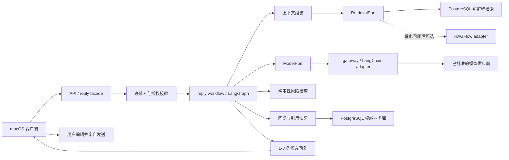
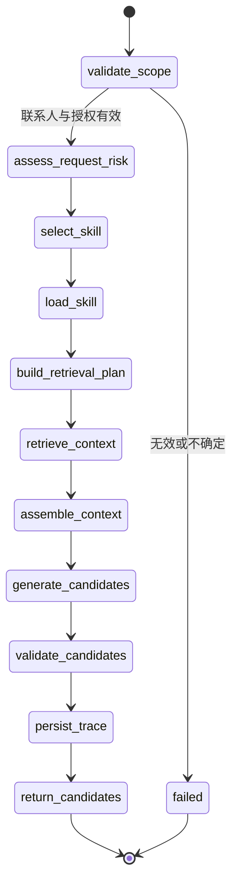

# Agent 编排与检索运行时（草案）

> 状态：草案。本文定义候选回复、未来 Tool 和长任务的运行时边界；不表示 LangGraph、LangChain 或 RAGFlow 已安装或可用。最终框架决策见 ADR-006。

## 1. 核心架构

NotAlone 的核心不是通用 Agent 平台，而是受联系人范围和来源证据约束的候选回复系统。领域规则不依赖 Agent 框架：框架可以替换，联系人隔离、来源删除和人工发送不能改变。



图中不存在外部消息发送节点。RAGFlow 不接触回复编排；LangChain 不拥有领域状态；LangGraph checkpoint 不成为关系记忆。

## 2. 运行时分层

| 层 | 职责 | 可依赖 | 禁止承担 |
| --- | --- | --- | --- |
| 领域层 | 联系人、来源、消息、记忆、回复候选和删除规则 | Python 类型与 repository port | LangChain/LangGraph 类型、供应商 SDK |
| 应用层 | 用例入口、事务、幂等键、权限与预算 | 领域层、port | 模型自由决定联系人或权限 |
| 工作流层 | 回复节点、条件边和可恢复执行 | LangGraph、应用层 port | 业务事实存储、自动发送 |
| 适配层 | 模型、Tool、Retriever、对象存储和渠道输入 | LangChain 或供应商 SDK | 绕过应用层直接写领域数据 |
| 基础设施层 | PostgreSQL、任务 worker、checkpoint、日志 | 明确 schema 与迁移 | 把 checkpoint 当成权威业务库 |

## 3. 首条回复图



### 节点契约

| 节点 | 输入 | 输出 | 性质 |
| --- | --- | --- | --- |
| `validate_scope` | `owner_id`、`contact_id`、请求身份、幂等键 | 已验证的请求范围 | 确定性代码 |
| `assess_request_risk` | 当前消息、确定性规则版本 | 风险类型、生成前核实提醒 | 确定性代码 |
| `select_skill` | 当前消息、近期对话、可用 Skill 目录、可选的用户指定 ID | 最多一个 Skill ID、版本、原因与置信度 | 用户指定时确定性校验；否则经 `ModelPort` 结构化选择 |
| `load_skill` | 已验证范围、Skill ID 与不可变版本 | 完整 inline Skill 正文 | 只经 `SkillPort`；不接受文件路径 |
| `build_retrieval_plan` | 当前消息、已加载 Skill、允许的资料类型和时间范围 | 结构化查询计划 | 可调用模型；结果需校验 |
| `retrieve_context` | 已验证范围、查询计划、预算 | 带来源的命中列表 | 只经 `RetrievalPort` |
| `assemble_context` | 六轨材料和 token 预算 | 有序、已截断上下文 | 确定性代码 |
| `generate_candidates` | 上下文、生成策略 | 1-3 条结构化候选 | 经 `ModelPort` |
| `validate_candidates` | 候选、引用和请求风险 | 结构校验、引用校验、禁止动作检查 | 确定性代码 |
| `persist_trace` | 计划、引用、模型元数据和候选 | `reply_request` 与 `reply_candidate` | 事务和幂等写入 |
| `return_candidates` | 已持久化候选 | UI 响应 | 不包含发送动作 |

## 4. 工作流状态与业务状态

两类状态必须分开：

```text
业务状态（PostgreSQL）
  contact / message / confirmed_memory / reply_request / reply_candidate

运行状态（LangGraph checkpoint store）
  graph_run_id / current_node / selected_skill_version_id / retry metadata / interrupt metadata
```

- checkpoint 只保存恢复执行所需的最小引用和临时结果，优先保存业务对象 ID，不复制完整聊天正文。
- 每次恢复先重新执行范围、授权和删除状态校验；不能因旧 checkpoint 绕过新权限。
- `persist_trace` 使用 `reply_request_id + graph_run_id` 或等效幂等键，避免重试产生重复候选。
- 删除来源或联系人时，`jobs` 同时失效相关运行记录；checkpoint 保留期不得长于对应业务资料。

## 5. Tool 与 Permission

未来语音、OCR、日历和文件都是输入或 Tool 适配器，不建立独立回复管线。

| 策略 | 示例 | 执行规则 |
| --- | --- | --- |
| `allow` | 当前时间、已选联系人范围内的只读检索 | 参数校验和出站记录后执行 |
| `ask` | 读取用户授权日历、向外部服务发送关系上下文 | 暂停图，展示字段、用途和范围，批准后恢复 |
| `deny` | 切换微信会话、读取其他联系人、发送消息 | 不注册 Tool，或在执行层硬拒绝 |

模型提出 Tool call 不等于获准执行。Permission policy、联系人范围和出站数据裁剪均由应用层确定性代码处理。

v1 的 `load_skill` 是 LangGraph 节点调用的 `SkillPort`，不是暴露给模型的 Tool。教程中的通用 Agent Loop 需要 `load_skill` Tool 才能让模型自行触发加载；本图已有显式选择和加载节点，因此不额外引入开放式 Tool loop。未来 Workflow Skill 若需要 Tool，仍必须经过本节的 Permission policy。

## 6. 多模态输入与回复形态

文字是领域层的统一表示，多模态能力位于主图两端：

```text
文字 -------------------------------> normalized current_message
语音 -> ASR adapter ----------------> normalized current_message
截图/前台画面 -> OCR adapter --------> normalized current_message

normalized current_message -> 同一条 reply workflow -> text reply_candidate

text reply_candidate -> UI 文本展示
text reply_candidate -> 可选 TTS renderer -> 语音预览或文件
```

- ASR/OCR 只负责产生带来源和置信度的规范化文字，不拥有联系人、记忆或回复逻辑。
- 低置信度转写必须让用户修正后再进入图，不能由模型静默猜测。
- TTS 等输出 renderer 只处理用户已看到的候选，不改变候选正文和引用。
- 使用外部 ASR/TTS 前必须记录发送字段、用途、保留和删除行为。
- renderer 产物只供用户预览或自行使用，不连接聊天渠道自动发送。

## 7. Retriever 边界

```python
class RetrievalPort(Protocol):
    def retrieve(self, request: RetrievalRequest) -> RetrievalResult:
        ...

    def delete_by_source(self, scope: ContactScope, source_id: str) -> DeleteResult:
        ...

    def rebuild_contact(self, scope: ContactScope) -> RebuildResult:
        ...
```

`RetrievalRequest` 必须包含 `owner_id`、`contact_id`、查询计划、资料状态过滤和预算。`RetrievalResult` 必须包含业务引用、实际检索器版本、分数、入选原因和降级状态。

v1 的实现是 PostgreSQL 全文/结构化检索。RAGFlow 若被评估，只能实现同一 port：它返回候选引用，NotAlone 再根据 PostgreSQL 权威状态做二次校验；它不能写 `confirmed_memory`、选择联系人或生成最终候选回复。

## 8. 后台任务与子 Agent

`jobs` 与回复图是两个运行面：

- 短文字回复默认执行单图、单模型路径；
- 历史导入、OCR/转写和索引重建使用 `background_task`；
- 长历史冲突检查或证据复核确有需要时，主图可调用专职子 Agent；
- 子 Agent 只返回带来源的结构化证据，结果先进入 `memory_candidate`；
- 子 Agent、后台任务和回复图都不能直接向外部聊天渠道发送消息。

后台任务不使用 LangGraph checkpoint，也不把 Todo/plan 当作业务状态。`background_task` 与 `background_task_step` 持久化在 PostgreSQL，由独立 Worker 进程按确定性模板、租约和幂等规则执行；只有 `extract_memory`、冲突检查等语义步骤通过 `ModelPort` 使用模型。最终 `verifying -> succeeded` 由代码校验器控制，具体见 ADR-007。

## 9. 失败与可观测性

每次 graph run 至少记录：节点、开始/结束时间、重试次数、模型/检索器版本、Tool 决策、引用 ID、错误类型和出站数据类别。日志不默认保存完整聊天正文。

错误按位置处理：

1. 范围错误：立即失败，禁止降级到其他联系人；
2. 检索为空：按 ADR-005 放宽一次并显式标记，不能让模型补猜；
3. 模型失败：有限重试或切换已批准模型，保持相同上下文快照；
4. Tool 失败：返回可见错误，不能伪造结果；
5. 持久化失败：不返回未落库的候选，依靠幂等键恢复。

## 10. Learn Claude Code 当前 S01-S17 适用性

本节映射官方仓库在 2026-08-16 标为 canonical 的根目录 S01-S17 课程（<https://github.com/shareAI-lab/learn-claude-code>）。课程网站曾展示过 S01-S20 的另一套编排；两套编号不能混用，后续引用必须同时写章节号和标题。新版不再把 System Prompt 和 Error Recovery 作为独立章节，但这两项仍是本运行时的必要横切能力，分别由上下文组装和第 9 节失败处理承担。

“直接采用”表示该机制属于 NotAlone 目标架构，不表示代码已经实现；“部分或条件采用”表示只借鉴适合本领域的边界，或等待真实需求出现；“当前不采用”表示它服务于通用编程 Agent 或自治团队，不应为了让产品看起来更像 Agent 而引入。

| 课程 | 结论 | NotAlone 中的对应方式 |
| --- | --- | --- |
| S01 Agent Loop | 部分采用 | 保留模型判断和受控的模型-结果反馈思想；回复主链仍是 ADR-006 的有界图，不复制开放式 `while` Tool loop。 |
| S02 Tool Use | 条件采用 | 未来只把确有模型决策价值的窄能力注册为 Tool；v1 的 `RetrievalPort`、`SkillPort` 是工作流 port，不伪装成模型 Tool。 |
| S03 Permission | 直接采用 | 使用 `allow / ask / deny`，并由应用层校验联系人范围、参数和出站字段；外部聊天发送永远是 `deny`。 |
| S04 Hooks | 部分采用 | 只借鉴模型调用、Tool 调用、审计和指标的横切扩展点；不得用 Hook 绕过图节点、事务或权限策略。 |
| S05 TodoWrite | 当前不采用 | 回复生成是短时有界流程；UI 待办或模型计划不能成为业务状态。 |
| S06 Subagent | 条件采用 | 仅在长历史冲突检查或证据复核确有收益时使用，且只能返回带来源的结构化证据。 |
| S07 Skill Loading | 直接采用 | `select_skill -> load_skill` 两级加载；每次最多一个不可变版本，Skill 是回复策略而不是关系事实。 |
| S08 Context Compact | 直接采用 | 同一联系人保持持续聊天；模型输入按 token 预算滑动，保留最近原始消息并压缩较早内容，不按固定分钟数强制切断。 |
| S09 Memory | 直接采用 | PostgreSQL 保存 `message`、`memory_candidate` 和 `confirmed_memory`；长期记忆带来源、采纳状态、有效期和删除路径。 |
| S10 Task System | 部分采用 | 长导入、删除和重建借鉴可持久化状态、依赖和可观测进度，但由 ADR-007 的 `background_task` 管理，不建立模型自治任务板。 |
| S11 Background Tasks | 直接采用 | 长导入、OCR/转写和重建由 Worker 执行；短候选回复保持同步，后台任务不能发送外部消息。 |
| S12 Cron Scheduler | 当前不采用 | 当前产品闭环没有定时自治工作；若未来出现用户明确创建的提醒，再单独评审授权和通知边界。 |
| S13 Agent Teams | 当前不采用 | 新版将团队、协议、任务认领和 Worktree 合为一章；这些并行编程 Agent 机制都不属于当前产品运行时。 |
| S14 MCP Plugin | 条件采用 | 只有标准化、可替换的外部能力确有价值时才使用；联系人内数据库检索优先走本地 port，不为展示 MCP 而包装。 |
| S15 Integrated Harness | 部分采用 | 用作端到端核对清单，验证模型、Tool、上下文、权限、任务和追踪能在同一运行时协作；不照搬其中的团队、定时或完整通用 Harness。 |
| S16 Workflow Runtime | 直接采用 | 固定回复编排由 LangGraph 图表达，使用生命周期事件、最小 checkpoint、幂等写入和恢复校验；业务事实仍只保存在 PostgreSQL。 |
| S17 Goal Loop | 部分采用 | 借鉴“停止前独立检查目标是否满足”，用于候选结构、引用和风险校验；重试必须有上限，不允许模型无限继续或自主发起关系任务。 |

汇总：直接采用 6 章（S03、S07-S09、S11、S16），部分或条件采用 8 章（S01、S02、S04、S06、S10、S14、S15、S17），当前不采用 3 章（S05、S12、S13）。这表示 14 章的知识对设计有参考价值，但只有 6 章应直接进入当前目标架构。

## 11. 实施顺序

1. 先定义领域类型、`ModelPort`、`RetrievalPort`、`SkillPort` 和合成测试；
2. 实现 PostgreSQL 可解释检索和无框架的确定性节点；
3. 用 LangChain adapter 接一个模型，验证结构化候选输出；
4. 用 LangGraph 串起首条回复图、幂等写入和失败恢复；
5. 只有量化问题满足 ADR-005 与 ADR-006 条件后，才做 RAGFlow POC。
