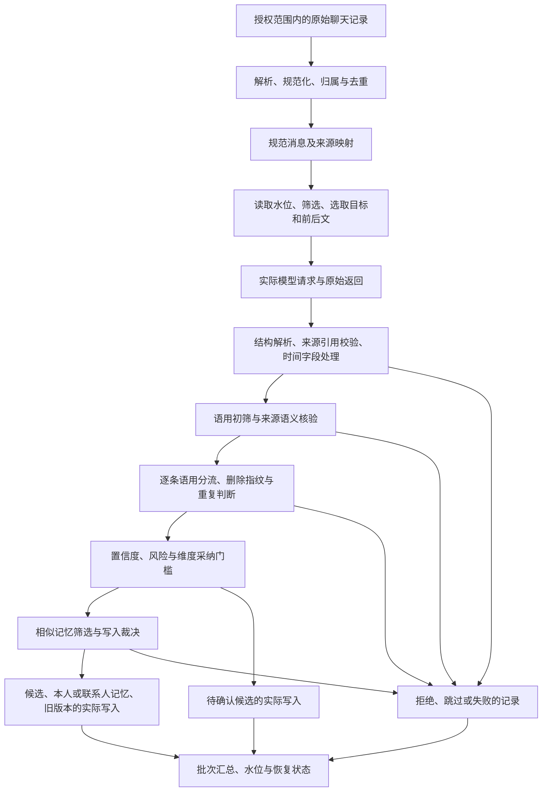

# 记忆追踪历史协议与实施记录

> 状态：历史参考。以下摘录来自 2026-11-03 收敛前的规格（基线提交 `8057a688`），保留当时协议、实现断言及证据来历；摘录中的“当前”“待实现”和通过情况均指原记录阶段。现行合同见[当前规格](../current/memory-extraction-trace.md)。

正文摘录不代表当前 SQLite 正式入口已开放旧接口，也不授权恢复已失效的协议、资料或旧实现。

### 清理前第 3–12 行

> 图文输入目标按 ADR-153 执行；本文件既有文字追踪实现与验收不代表图片已经参与提取或核验。

> 历史源码链接：本文已退役 Python 文件指向历史测试清单采用的固定 Git 快照 `23a76733`，仅供查看旧实现，不表示该快照就是文中各日期的原始验收版本，也不是当前运行入口。

> 2026-10-21 决定收敛：下文固定语用／置信度／维度门步骤属于显式历史提取协议；默认 direct／automatic 路径按 ADR-085 取消额外人工门。追踪应记录实际协议、有效检查、执行分支和未执行阶段，不能伪造已执行旧门；默认空维度表已由 ADR-070 退役，旧评测合同保持。

> 状态：SQLite 全过程记录、默认提取装配和受范围查询／删除已实现；React 管理页已接入查看与删除，并通过合成普通页面验证。原生 Electron、最终签名包与真实微信验收仍独立保留。
> 确认日期：2026-10-07。范围与留存决策见 ADR-037。
> 实现状态更新：2026-10-10。迁移 `039`–`043` 与下方代码证据落实后端契约，不补造历史记录，不执行真实私人库迁移或历史重提取。实际捕获缺口继续明确标注。
> 边界更新：2026-10-16。ADR-047 的版本二语义依据与 ADR-060 的作者引句包装分支属于候选依据列（迁移 `057`、`059`），由本文之外的候选读取路径保存和复核；本文的追踪契约与服务不保存、不返回这些依据，因此本文件不因该分支改变。

### 清理前第 22–46 行

## 完整链路

这是程序的处理阶段，不表示模型会为每条聊天再调用一次，也不表示存在一份未返回的中间摘要。没有执行的阶段必须记录跳过原因；发生失败时，后续阶段标为未执行。

### 清理前第 75–75 行

当前默认是 **20 条目标消息 + 前 20 条 + 后 20 条，最多 60 条聊天消息**。边界、剩余消息和筛选会使实际数量变少；中间 20 条是目标聊天消息，不是已提取记忆。下一批通常复用部分聊天作为上下文，但必须记录实际选择，不能用默认数量推算某次历史请求。

### 清理前第 101–121 行

### 5. 语用初筛与来源语义核验

- **核验选择**：保存每条解析结果的语用解释与分流结果，说明它是否进入本次核验。纯玩笑等不生成记忆的结果也需要保留原候选、程序判断和去向。
- **实际核验请求**：完整保存核验器真正收到的窗口、候选集合、候选顺序、提示词、schema 和非秘密模型参数；不能拿提取请求充当核验请求。
- **实际核验返回**：保存逐候选的 `supported / uncertain / unsupported`、返回理由、证据片段及其定位，连同原始响应与调用元数据。
- **确定性核对**：记录证据片段是否属于指定原消息、片段范围是否有效、候选关联是否完整等实际检查；保存校验失败细节。
- **处理结果**：明确支持者继续原采纳流程；证据不足者添加实际风险后待后续门槛处理；无支持者拒绝。保存修改前后的候选及新增风险。核验不改写候选正文、主体、来源或有效期，不证明现实事实为真。
- **未执行或失败**：记录没有可核验候选、缺少核验器、核验器不可用或返回非法结构等原因，及其实际影响。没有注入核验器时产生的未核验风险也要可见。

模型返回的短理由，例如 `interpretation_reason`，原样保存为“模型返回理由”。它是输出中的一项证据，不是模型内部思考过程。

### 6. 逐条采纳前的跳过与门槛判断

对核验后继续处理的每条候选，记录当前采纳代码实际执行的顺序和结果：

1. **语用分流**：本条是否需要长期记忆、是否可待确认、是否可自动采纳；保存解释所用字段、规则与结果。
2. **已删除指纹**：是否命中禁止重新写入的已有删除记录；只记录实际使用的非正文删除标识、比较结果和规则版本，不恢复被删正文。
3. **重复判断**：是否命中有效记忆或已有待确认候选；保存命中记录标识、实际比较字段和比较方式。相同正文跳过不能被写成“模型认为无价值”。
4. **自动采纳门槛**：保存语用、置信度、风险白名单和维度放行的有效配置、逐项实测值及结论。默认自动路径在门槛内另做确定性的金额收支方向检查：正文与来源对同一金额给出唯一且相反的方向时不采纳，记录金额、正文方向与来源方向；该检查只降不升，不改写正文。显式历史协议的置信度阈值为 `0.7`，并记录其实际维度键、放行表及运维开关状态；当前路径按实际协议记录有效检查，不套用未执行的历史门。

遇到提前返回时，后面的检查标为未执行，不能补造检查结果。显式历史协议按其规则将门槛失败者写入待确认；direct／automatic 路径记录真实失败、拒绝、跳过或窄时间关系待确认分支，不能统一写成 pending。非记忆、已删除指纹或重复命中等分别标明实际去向。保存具体命中规则，不能仅凭风险标签事后猜测原因。追踪本身不改变被执行协议的采纳规则；ADR-036 的空表仅属显式历史维度协议，不能作为当前默认配置写入追踪。

### 清理前第 140–140 行

当前采纳是逐条处理，候选创建与确认有各自的事务边界，尚不能保证整批原子性。晚发生的故障可能留下前面已经写入的候选或记忆。新增追踪必须能准确列出这些部分结果；具体如何把业务写入与追踪持久化可靠关联，是后续实现必须解决的接缝。

### 清理前第 194–201 行

| 原消息 | 联系人问“最近在学摄影吗？”；用户答“修车花了 3000，先缓缓。” | 原始记录、说话人、时间和来源定位。 |
| 窗口 | 本次只选了这两条，用户这条是目标，另一条是上下文。 | 实际是 2 条输入，不凭默认配置说是 60 条。 |
| 提取返回 | 模型返回“用户买镜头花了 3000”，引用用户消息。 | “买镜头”首次出现在提取返回，直接引用合法并不意味着内容受支持。 |
| 程序处理 | 解析通过，来源引用检查通过；保留原正文。 | 程序没有把“修车”改成“买镜头”。 |
| 核验返回 | 假设返回 `uncertain`，给出理由和证据片段。 | 可以逐字查看核验器看了什么、为何这样标注。 |
| 门槛与写入 | 不满足自动采纳门槛，保存待确认候选及实际阻断规则。 | 明确为何进入 pending，而不是仅按风险标签猜测。 |

若某次核验返回 `unsupported`，记录应体现拒绝且没有业务候选；若发生错误采纳，必须如实显示当时每道门的结果和最终写入。追踪本身不把错误内容变成正确事实。

### 清理前第 231–259 行

## 历史 Python 后端实现与缺口

> 以下表格保留 Python 版本的实现沿革，旧源码路径可能已不在当前检出中，不能作为当前能力证明。当前 TypeScript／SQLite 的承接实现见 [执行与追踪](../../backend-ts/src/memory/sqlite/execution.ts)，映射与验证限制见 [SQLite 切换记录](../../docs/verification/20-sqlite-cutover-and-legacy-cleanup.md)。上文的隐私、来源与删除要求不因历史实现退役而取消。

下表区分已保存的实际处理与不能复原的历史／外部信息。验证使用合成资料，不证明真实模型、真实微信或新 App 界面已经验收。

| 历史环节 | 当时代码证据 | 当时已实现行为与边界 |
| --- | --- | --- |
| 历史导入 | [导入命令](https://github.com/Aqua-ava/NotAlone/blob/23a767330e4af8a024629a00c8740344be564259/backend/src/notalone/ingest/import_command.py)、[来源处理存储](https://github.com/Aqua-ava/NotAlone/blob/23a767330e4af8a024629a00c8740344be564259/backend/src/notalone/persistence/source_processing.py)、[规则文件适配器](https://github.com/Aqua-ava/NotAlone/blob/23a767330e4af8a024629a00c8740344be564259/backend/src/notalone/source_processing/rule_capture.py) | 保存相关原始行、实际解析／校验／规范化输入输出及映射，来源与消息在同一事务提交；导入仍拒绝文件内重复或既有重叠，不改为合并。失败仅存具体安全类别、字段、规则与位置；执行边界取得实际时刻和当时文件摘要，快照构造只接收摘要和时刻。 |
| CLI 增量 | [CLI 适配器](https://github.com/Aqua-ava/NotAlone/blob/23a767330e4af8a024629a00c8740344be564259/backend/src/notalone/wechat_cli/adapter.py)、[观察持久化](https://github.com/Aqua-ava/NotAlone/blob/23a767330e4af8a024629a00c8740344be564259/backend/src/notalone/persistence/observation_store.py)、[来源处理存储](https://github.com/Aqua-ava/NotAlone/blob/23a767330e4af8a024629a00c8740344be564259/backend/src/notalone/persistence/source_processing.py) | 保存实际事件、转换与去重决定、消息／来源引用映射；非文字／未知事件标明过滤原因。只处理已授权记录，不复制整段 CLI 输出；增量入口不新增提取调度。 |
| 原处理时间 | [导入命令](https://github.com/Aqua-ava/NotAlone/blob/23a767330e4af8a024629a00c8740344be564259/backend/src/notalone/ingest/import_command.py)、[Worker](https://github.com/Aqua-ava/NotAlone/blob/23a767330e4af8a024629a00c8740344be564259/backend/src/notalone/tasks/worker.py) | 原处理记录连接到提取使用的快照，保留实际处理时间与版本；后台 `parse / normalize` 步骤记账仍不是原解析时间。 |
| 消息读取与窗口 | [读取支持](https://github.com/Aqua-ava/NotAlone/blob/23a767330e4af8a024629a00c8740344be564259/backend/src/notalone/memory_extraction/cli_support.py)、[批次命令](https://github.com/Aqua-ava/NotAlone/blob/23a767330e4af8a024629a00c8740344be564259/backend/src/notalone/memory_extraction/command.py)、[追踪存储](https://github.com/Aqua-ava/NotAlone/blob/23a767330e4af8a024629a00c8740344be564259/backend/src/notalone/persistence/extraction_trace.py) | 保存实际水位、消息版本、排除规则、20 + 20 + 20 窗口、顺序与 target 标记；保存前在范围锁内核对实际缓存的消息、来源与 ref 存活和原始投影，拒绝已删缓存，保留活来源与真实处理链缺口；没有重新读取扩大范围。 |
| 模型调用 | [捕获边界](https://github.com/Aqua-ava/NotAlone/blob/23a767330e4af8a024629a00c8740344be564259/backend/src/notalone/memory_trace/transport.py)、[生产组装](https://github.com/Aqua-ava/NotAlone/blob/23a767330e4af8a024629a00c8740344be564259/backend/src/notalone/memory_extraction/cli_support.py) | 分别保存 E/V/A 的提示词、schema、参数与原始返回；真实 SDK HTTP hooks 保存最终序列化正文、供应商返回及可观察重试，不保存鉴权头。未进入该 transport 的适配器标为 `not_observable`。 |
| 解析、时间与核验 | [提取流程](https://github.com/Aqua-ava/NotAlone/blob/23a767330e4af8a024629a00c8740344be564259/backend/src/notalone/memory_extraction/flow.py)、[核验适配器](https://github.com/Aqua-ava/NotAlone/blob/23a767330e4af8a024629a00c8740344be564259/backend/src/notalone/memory_extraction/verification_adapters.py) | 原始响应先保存，再记结构解析、来源契约、字段变化与逐候选核验，包含拒绝、失败与未执行结果。 |
| 采纳与裁决 | [采纳流程](https://github.com/Aqua-ava/NotAlone/blob/23a767330e4af8a024629a00c8740344be564259/backend/src/notalone/memory_extraction/adoption.py)、[裁决适配器](https://github.com/Aqua-ava/NotAlone/blob/23a767330e4af8a024629a00c8740344be564259/backend/src/notalone/memory_extraction/adjudication_adapters.py) | 保存稳定候选标识、语用分流、删除指纹、重复、门槛、shortlist 与 ADD/UPDATE/NOOP；手输本人资料的 owner 归属标识不充当来源，仍以自身 memory_id 绑定删除；其他真实来源继续复验。只记录实际执行；默认策略按 ADR-070／085，显式历史放行表与评测合同保持，追踪本身不改变提示词或预算。 |
| 业务写入 | [追踪存储](https://github.com/Aqua-ava/NotAlone/blob/23a767330e4af8a024629a00c8740344be564259/backend/src/notalone/persistence/extraction_trace.py)、[记忆存储](https://github.com/Aqua-ava/NotAlone/blob/23a767330e4af8a024629a00c8740344be564259/backend/src/notalone/persistence/memory_store.py)、历史迁移 `backend-ts/database/migrations/043_extraction_trace_record_operations.sql` | 保存写入意图、返回／权威记录回执与部分提交；联系人及本人旧记忆失效计划也关联实际 ID，按 invalidated 状态核对提交，原行仍 active 时不能因行存在就报失效成功。结束记录和水位同事务提交；回执丢失显示未知／待核对，不假称回滚。 |
| 调用台账 | [上下文与补账](https://github.com/Aqua-ava/NotAlone/blob/23a767330e4af8a024629a00c8740344be564259/backend/src/notalone/memory_trace/context.py)、历史迁移 `backend-ts/database/migrations/042_extraction_trace_call_receipts.sql` | 正常、停止和来源删除后的实际调用关联同一 `call_id`／台账 ID，区分 received／returned／unavailable 与 consumed／not_adopted；提交回执未知不另造补账。不保存正文，正文删除后只保留最小关联。 |
| 查询与删除 | [查询服务](https://github.com/Aqua-ava/NotAlone/blob/23a767330e4af8a024629a00c8740344be564259/backend/src/notalone/application/trace_service.py)、[HTTP](https://github.com/Aqua-ava/NotAlone/blob/23a767330e4af8a024629a00c8740344be564259/backend/src/notalone/server/app.py)、[CLI](https://github.com/Aqua-ava/NotAlone/blob/23a767330e4af8a024629a00c8740344be564259/backend/src/notalone/memory_trace/command.py)、[React 查看页](../../desktop/src/renderer/TracePanel.tsx)、[具名控制器](../../desktop/src/main/traces/controller.ts) | 默认查询装配不需要模型；授权批次列表稳定分页、详情和候选／记忆反查；消息正查引用或使用它的提取批次，包括仅上下文、零候选与失败。来源处理仍使用独立资源。区分已删、未记录及手输不适用，人工确认模型候选仍可反查。所有 HTTP 追踪响应 no-store，越界／不存在统一 404。React 管理页可主动查看阶段原始快照和关联、翻页、按记录查询、确认后删除追踪；切换范围、断线、读取失败和来源删除检查点清除旧正文，迟到响应不回填。正文事件只发布到可信管理窗口，小窗不得查询。普通页面证据不替代原生 IPC 或最终 App 验收。 |

043 前已有窗口可以按实际已保存的消息标识正查；清除这类窗口前只保留无正文标识关联，继续显示已删状态。早已清除且未保存关联的历史无法补造，仍保留 `not_recorded`。生产与合成追踪的错误码／状态使用[同一纯映射](https://github.com/Aqua-ava/NotAlone/blob/23a767330e4af8a024629a00c8740344be564259/backend/src/notalone/memory_trace/status.py)。

该历史版本的规范化还有以下差异，需要按实际输入与版本记录，不能统一写成“清洗了一下”：

- 历史导入：`is_from_me` 映射说话人；要求 `time_iso` 带时区且与 `create_time` 对应，失败则拒绝文件；保存媒体占位文字，但占位不等于媒体内容。
- CLI：`is_from_me` 映射说话人，文字原样使用；优先由 `create_time` 转 UTC，否则使用 `time_iso`，当前对不带时区的值赋 UTC；完全缺失时间保留未知，不补成读取时间。
- 提取读取：已经保存的系统/未知说话人、空正文或无时间消息仍可能被排除，因此“消息已保存”不能证明“模型曾读到它”。

已有事后审计、附近消息补查、数据库现状和进度文件只能按各自内容提供部分证据，标为“事后重建/历史缺失”。没有保存原请求的批次，不能利用现在的消息重算后宣称找回当时的输入或模型理由。

### 清理前第 272–274 行

后端实施与验收记录见 `.scratch/memory-extraction-trace/issues/01-extraction-trace.md`、`02-source-processing-trace.md`、`03-app-and-all-entrypoints.md`。公开 HTTP 验收覆盖默认 priority 装配、原行到记忆反查、零候选、停止／晚响应、来源删除、故障恢复与翻页；真实已安装 SDK 的本地 HTTP transport 另验证 E/V/A、tools、thinking 与可观察重试。两个验证层分别提供证据，不据此宣称真实外部服务集成完成。App 验收随新前端接入，当前任务保持未完成 UI 状态。
